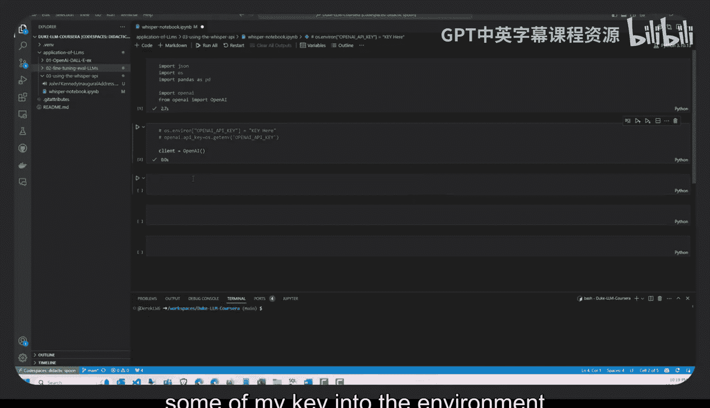
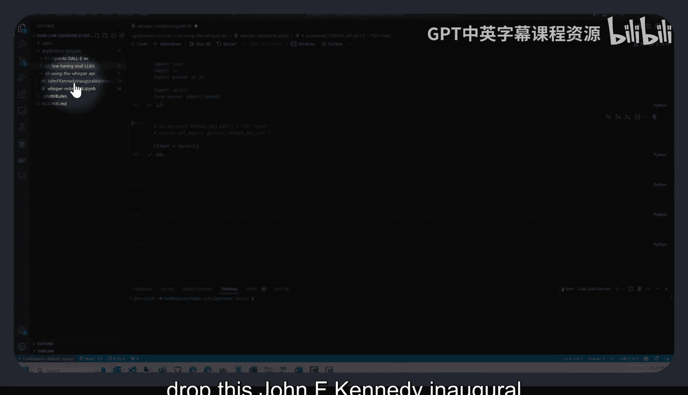
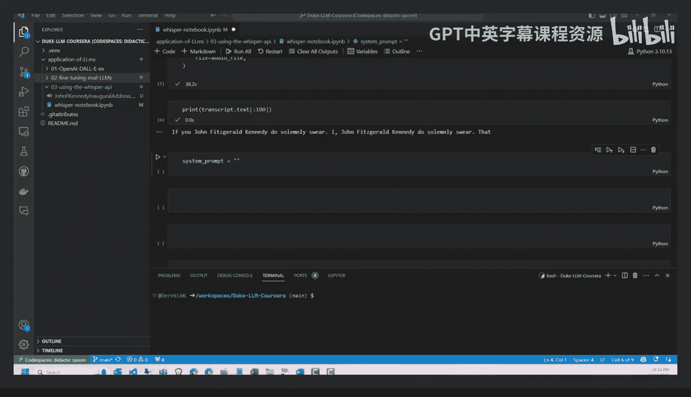
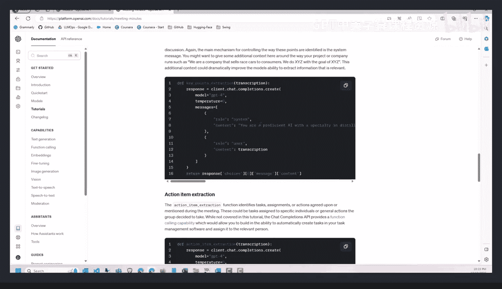
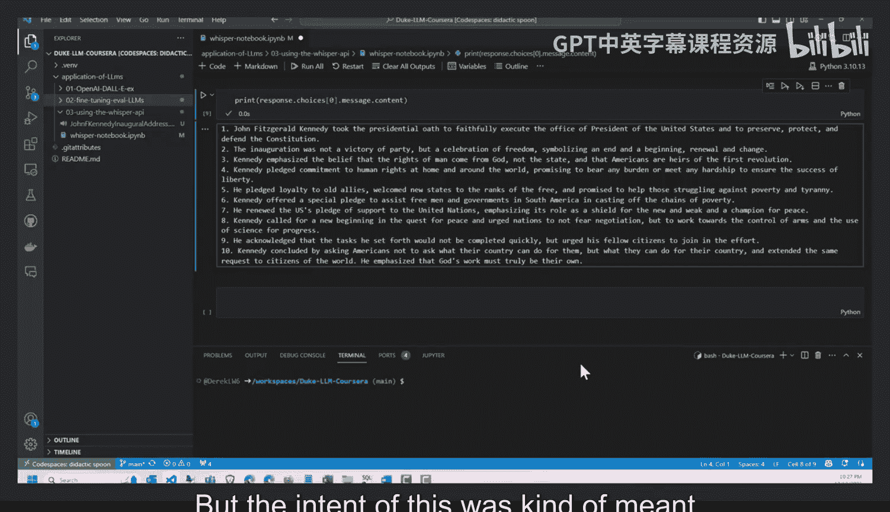

# 大型语言模型实践：P71：视频摘要生成器详解 🎬

在本节课中，我们将学习如何利用OpenAI的Whisper和GPT模型，构建一个能够将音频文件（如演讲录音）转换为文本摘要的生成器。我们将从导入必要的库开始，逐步完成音频转录、提示词设计以及调用API生成摘要的完整流程。

---

上一节我们介绍了课程的整体目标，本节中我们来看看具体的代码实现步骤。

首先，我们需要导入项目运行所必需的Python库。

以下是需要导入的核心库：
```python
import os
import pandas as pd
import openai
from openai import OpenAI
```





导入完成后，我们运行这些代码来初始化环境。

---

接下来，我们需要设置OpenAI的API密钥以建立连接。

我们将API密钥导入环境变量，并初始化一个OpenAI客户端会话。
```python
# 假设API密钥已存储在环境变量'OPENAI_API_KEY'中
client = OpenAI()
```

同时，我已将一个名为“John F. Kennedy inaugural address”的音频文件拖放到了当前工作环境中。

---

现在，让我们读取这个音频文件。

我们使用Python的标准文件操作来加载音频文件。
```python
# 为本次演示，我们将文件命名为‘audio_file’
with open(‘John_F_Kennedy_inaugural_address.mp3‘, ‘rb‘) as audio_file:
    audio_data = audio_file.read()
```

代码运行后，音频数据已成功加载。我们可以在后续的单元格中继续使用它。

---

上一节我们准备好了音频数据，本节中我们来看看如何将其转换为文字。

我们将把音频数据传递给OpenAI的Whisper API来获取转录文本。许多云服务提供商都提供类似服务，但本教程为保持聚焦，将主要使用OpenAI的服务。



调用Whisper API进行转录：
```python
transcription = client.audio.transcriptions.create(
    model=“whisper-1“,
    file=audio_data
)
```

运行后，我们成功收到了转录文本。



---

为了查看转录结果，我们需要正确地打印输出。

转录结果是一个对象，我们需要访问其`.text`属性来获取文本内容。为了便于查看，我们只打印前100个字符。
```python
print(transcription.text[:100])
```

输出显示转录成功，内容为肯尼迪总统的就职演说片段。

---

现在我们已经有了演讲文本，下一步是设计一个系统提示词来指导GPT模型进行摘要。

我们将定义一个系统提示词，用于“引导”模型理解我们的任务。这个提示词改编自OpenAI官方文档中的“关键点提取”示例，非常适合用于总结总统演讲。

以下是系统提示词的内容：
```
你是一个专业的AI助手。请列出以下文本的主要观点并进行总结。
```

这个提示词与OpenAI官网的示例非常相似，能有效引导模型完成摘要任务。

---

准备好提示词和转录文本后，现在我们可以调用Chat Completion API来生成摘要。

我们使用`client.chat.completions.create`方法，并指定模型为`gpt-4`。同时，我们可以调整一些参数来控制生成效果。

以下是调用API的代码：
```python
response = client.chat.completions.create(
    model=“gpt-4“,
    temperature=0.5,  # 控制生成文本的随机性
    messages=[
        {“role“: “system“, “content“: system_prompt},
        {“role“: “user“, “content“: transcription.text}
    ]
)
```

代码运行完毕，意味着我们已经从OpenAI获得了响应。

---

最后，让我们从API响应中提取出生成的摘要内容。

API返回的响应结构包含多个部分，我们需要从正确的位置获取生成的文本。
```python
summary = response.choices[0].message.content
print(summary)
```

生成的摘要列出了演讲的核心内容，例如：“忠实执行总统职责”、“捍卫自由”、“人权来自上帝而非国家”等。摘要最后提到了那句名言：“不要问你的国家能为你做什么，而要问你能为你的国家做什么。”

通过调整`max_tokens`（生成文本的最大长度）和`temperature`等参数，你可以获得略有不同或更详细的摘要。这个项目的核心思想是构建一个会议摘要生成器或类似工具的基础框架。

---



本节课中我们一起学习了构建视频/音频摘要生成器的完整流程。我们从导入库和设置API密钥开始，然后读取音频文件并通过Whisper API将其转换为文本。接着，我们设计了一个有效的系统提示词，并最终调用GPT-4模型生成了结构化的内容摘要。通过调整参数，你可以灵活控制摘要的长度和风格，这个框架可以作为开发各类自动摘要工具的基础。