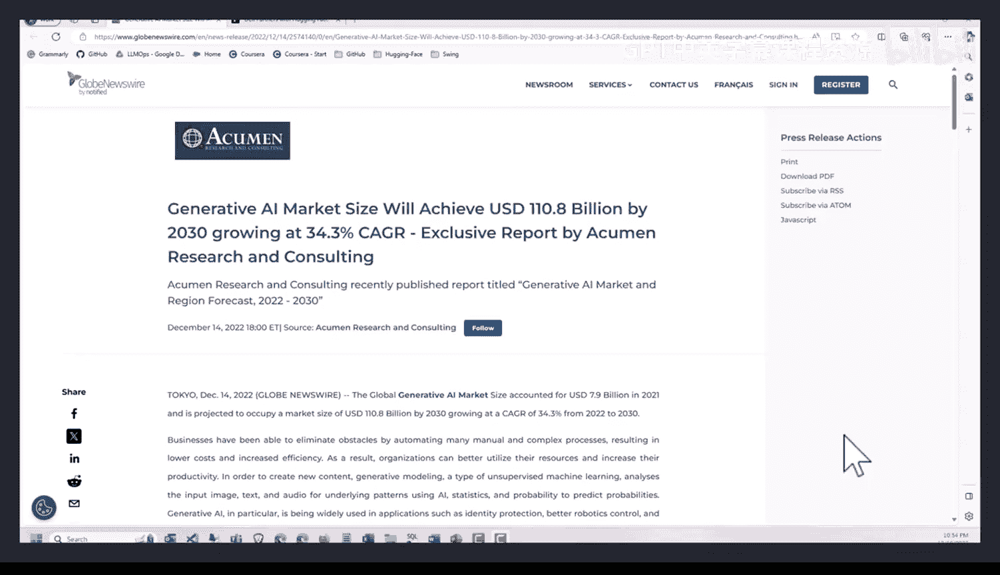
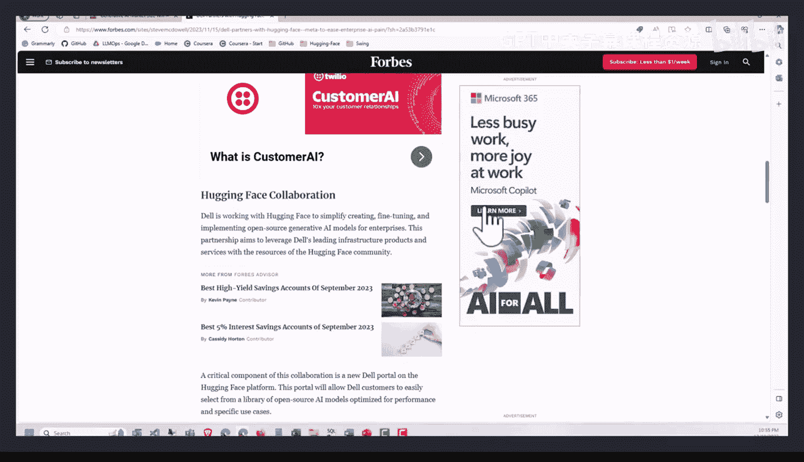
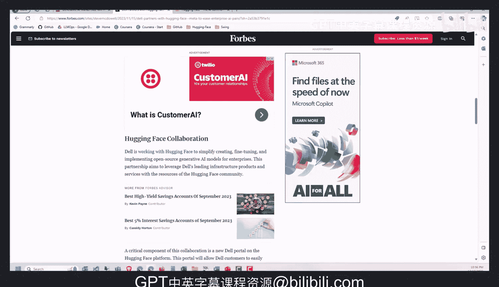

# 大型语言模型实践：P73：人工智能商业环境 📈

在本节课中，我们将了解生成式AI当前的商业环境与市场趋势。课程将展示相关的市场数据、企业合作案例，并解释这些动态对学习者和从业者的意义。

在进入下一个模块之前，有一点需要指出：学习过程可能具有挑战性。但生成式AI技术不会消失，它正持续发展。课程阅读材料中包含了一些相关文章，建议你仔细阅读。为了让你快速把握要点，我将直接展示其中的关键结论。你可以从咨询市场报告等渠道找到大量类似信息。

以下是当前生成式AI市场的支出情况。如图所示，目前支出已达数十亿美元级别。并且，在接下来的几年里，这一数字预计只会持续增长。

因此，学习本课程、掌握相关技能将使你处于有利位置。你正在为未来的发展做正确的准备。接下来，我想强调一些关键的企业合作与收购案例。这不仅关乎学习OpenAI的工具，本课程后续将介绍的其他工具也将为你未来的成功奠定基础。

接下来我们看下一篇文章。戴尔公司在2023年11月宣布与Hugging Face建立合作伙伴关系。

Hugging Face是一个开源模型提供商。

该平台汇集了大量机器学习模型，许多开源模型都发布于此。如今，平台上生成式AI模型也越来越多。根据文章所述，戴尔的计划是通过合作，旨在简化我们在之前视频中探讨过的模型微调等过程。这表明，生成式AI正在被广泛采纳，许多企业都在采取各种策略，无论是使用OpenAI的技术还是开源方案。而本课程将为你做好充分准备，以迎接未来几年即将爆发的市场。

这是一个绝对需要密切关注的市场趋势。即使学习过程有时略显艰难，也请保持信心。

本节课中，我们一起学习了生成式AI的商业环境。我们看到了市场支出的快速增长、重要的企业合作案例，并理解了掌握相关技能在未来市场中的重要性。这是一个持续发展的领域，保持学习将为你带来显著优势。