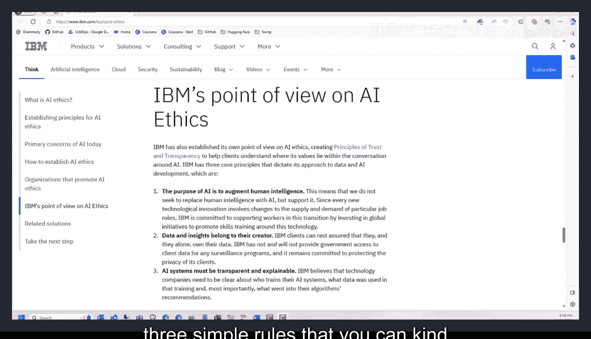
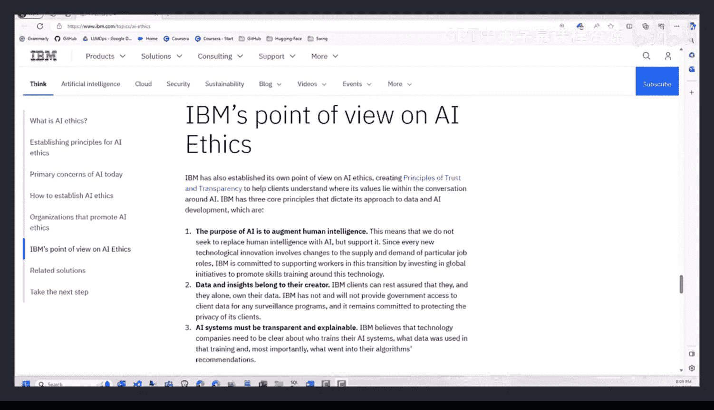
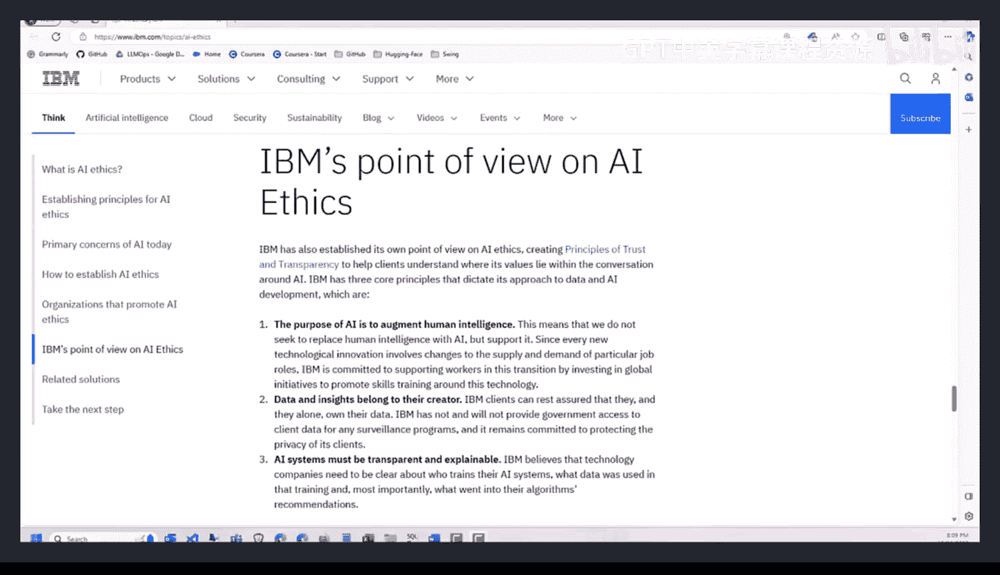
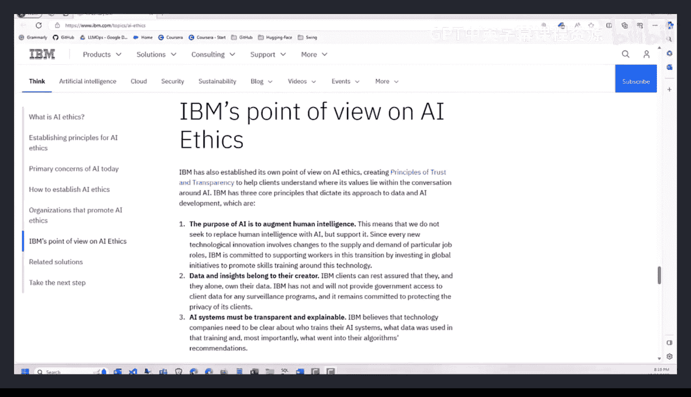

# 大型语言模型实践：P74：人工智能伦理原则 🤖

在本节课中，我们将学习人工智能伦理的基本原则。课程将介绍IBM提出的可信与透明原则，这些原则为负责任地开发和使用AI提供了一个简洁的框架。

在继续本课程后续模块之前，我们有必要花一点时间关注人工智能伦理。网络上关于此话题的资料很多，但IBM提出的原则非常实用。这些原则为思考AI伦理提供了一个良好的起点，特别是当你开始使用开源工具或部署定制模型时。从AI伦理的角度来看，遵循这些原则至关重要。

上一节我们提到了关注AI伦理的重要性，本节中我们来看看IBM提出的具体原则框架。

## IBM人工智能可信与透明原则

正如刚才提到的，我非常欣赏这些原则。它们提供了一个简单的框架，包含三条简单的规则。在进行任何AI相关工作之前思考这些规则，通常能确保你的方向正确。

以下是三条核心原则：

1.  **AI的目的是增强人类智能。** 我们并非要取代工作，也不希望仅仅为了裁员而开发系统。我们必须牢记这一点，AI应使我们更高效、更具生产力，而非替代我们。

2.  **数据和洞察属于其创造者。** 关于这一点，我能想到的最佳例子是：如果马克·吐温的作品仍受版权保护，而你用其作品大量训练模型，那么模型生成的回应将是独特的。这与使用完全公开的数据（如推特）训练出的结果截然不同。原始作品的创造者有权享有其成果，我认为这条原则很好地体现了这一点。

3.  **AI系统必须透明且可解释。** 我完全同意这一点，尤其是当你开始用AI审批贷款或类似性质的事务时。我认为这条原则对此概括得非常到位。

课程文档中提供了更多阅读材料，但以上是我想重点强调的原则。

## 总结

本节课中，我们一起学习了IBM提出的人工智能伦理三大核心原则：**增强人类智能**、**尊重数据与洞察的归属权**，以及**确保系统的透明与可解释性**。这些原则为负责任地实践AI技术提供了重要的指导基础。