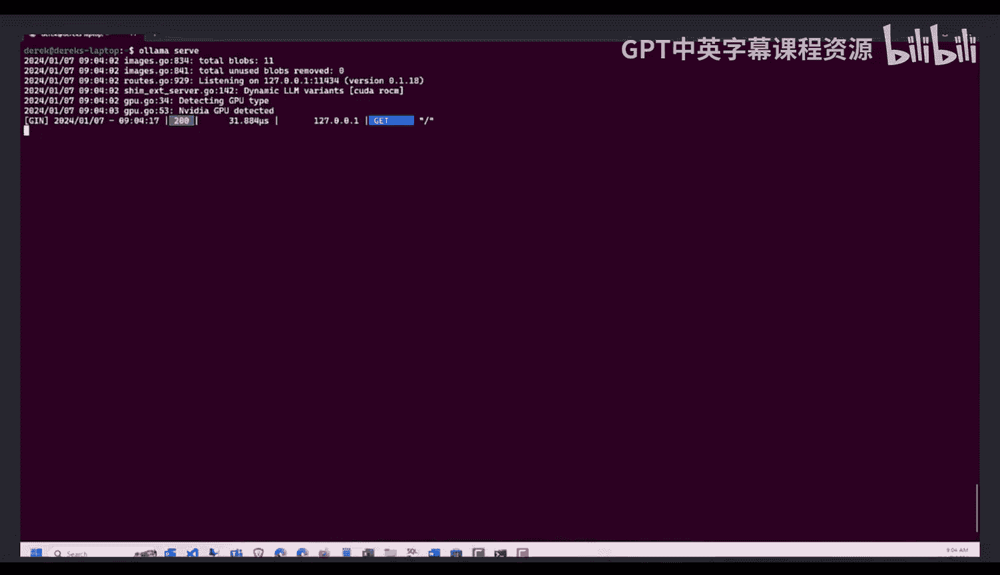
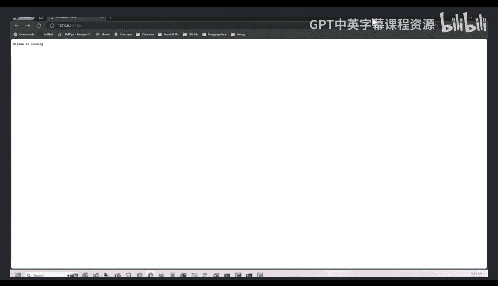
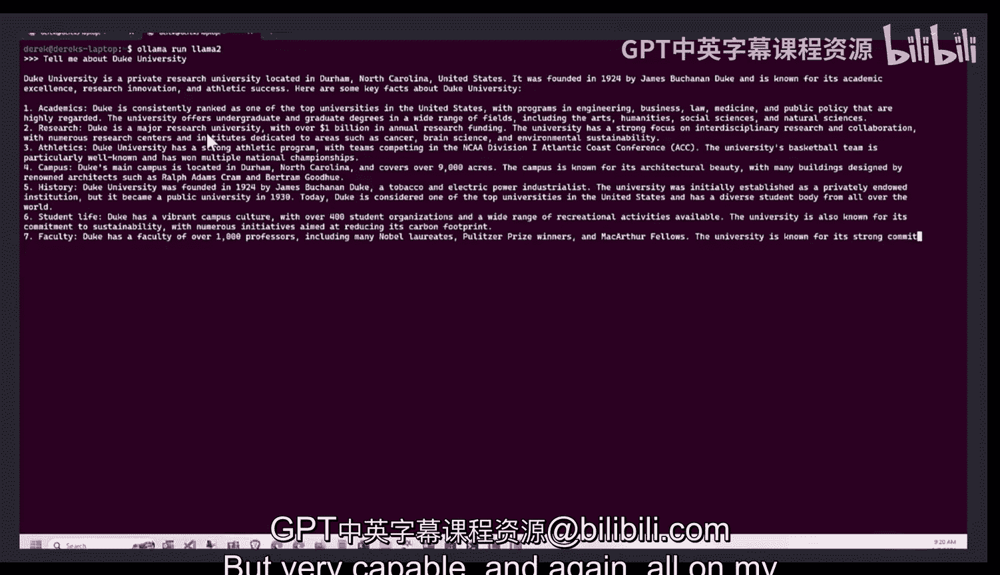

# 大型语言模型实践：P75：本地机器学习模型与下门课程预览 🚀

在本节课中，我们将探讨一个日益重要的趋势：本地运行大型语言模型。我们将了解其优势，并通过一个实际演示，预览如何在本地机器上运行LLM。

---

## 概述

上一节我们讨论了商业环境，本节中我们来看看一个额外的趋势：本地大型语言模型。本地LLM正变得越来越流行，这主要得益于模型更易获取（例如通过Hugging Face平台），并能有效降低业务风险。这是一个新兴领域，依赖第三方服务可能面临服务商存续时间不确定、服务费用变动等风险。因此，越来越多的用户选择在自己的基础设施上运行模型。本节课我们将切换到Windows的Linux子系统，演示如何完全在本地机器上运行这些模型，这也是对下一门更深入课程的预览。

---

## 本地LLM的优势

以下是本地运行大型语言模型的几个关键优势：

*   **降低业务风险**：避免因依赖第三方服务商而产生的存续性和稳定性风险。
*   **控制成本**：在下载模型（通常是开源免费的）后，无需支付持续的服务费用。
*   **避免速率限制**：在本地强大硬件上运行，不受云服务可能存在的请求速率限制。
*   **数据隐私与安全**：所有数据处理均在本地进行，增强了敏感数据的控制力。

---

## 实战演示：在WSL中运行Ollama

接下来，我们将在Windows子系统Linux中，使用Ollama平台来运行一个本地LLM。Ollama是一个专为在本地运行大型语言模型而设计的尖端平台。

首先，我们需要安装Windows子系统Linux。最简便的方法是通过Microsoft Store进行安装。关于此部分更详细的教程将在后续的本地LLM课程中提供，此处仅作预览。

安装完成后，我们打开终端。以下是运行Ollama及Llama 2模型的核心命令步骤：

1.  **获取并安装Ollama**：
    ```bash
    curl -fsSL https://ollama.ai/install.sh | sh
    ```
    此命令会下载安装脚本并执行，整个过程可能需要几分钟。

2.  **启动Ollama服务**：
    ```bash
    ollama serve
    ```
    运行此命令后，Ollama会启动一个本地服务，并检测你的计算机资源。请注意终端中显示的本地IP地址（通常是 `http://127.0.0.1:11434`）。

3.  **拉取并运行模型**：
    ```bash
    ollama run llama2
    ```
    这个命令会下载著名的Llama 2大型语言模型，并启动一个交互式聊天会话。之后，你就可以直接在终端与模型进行对话了。



---



## 演示结果与潜力

执行上述命令后，模型成功加载并运行。所有文本生成任务都完全在我的本地笔记本电脑上完成，不涉及任何云服务费用。虽然当前演示是在CPU上运行，但如果你拥有更强大的机器（如配备GPU），性能将得到显著提升，且完全不受云服务的速率限制。

在下一门课程中，我们将更深入地探讨如何调整这些模型的参数、进行微调等高级操作。但如演示所示，本地运行的模型已经具备了相当强大的文本生成能力。

---

## 总结



本节课中，我们一起学习了本地运行大型语言模型的趋势与优势。我们了解到，本地化部署可以更好地控制成本、规避风险并提升数据安全性。通过使用Ollama平台在Windows Linux子系统中的实战演示，我们预览了完全在本地机器上运行如Llama 2这样先进模型的可能性。这为后续深入学习如何构建和定制本地LLM应用奠定了坚实的基础。