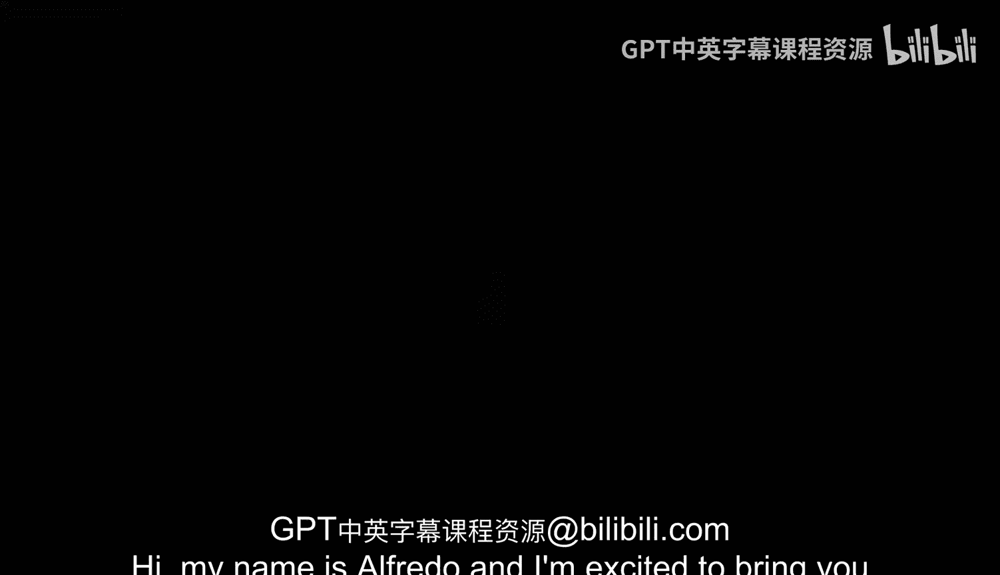

# 大型语言模型实践：01：认识讲师阿尔弗雷德·德萨

在本节课中，我们将认识本课程的讲师阿尔弗雷德·德萨，并了解他的专业背景与课程内容的关联。

大家好，我是阿尔弗雷德·德萨。我很高兴为大家带来这门关于Azure平台上大型语言模型的课程。

我的经验和背景主要在自动化编程领域。我是一名资深的Python开发者，最近也在大量使用Rust编程语言进行开发。

此外，我在云技术领域有非常长时间的工作经验。这些年来，我的工作重点一直是自动化和构建健壮的基础设施。

我认为我的工作重点在于关注监控，以及在流程（例如一个流水线）运行过程中捕获细节。

在本课程中，当我们学习不同类型的内容时，你们会清楚地看到如何应用我过去的这些经验。

有趣的是，我们将学习如何将过去行之有效的方法，例如自动化、监控、密切关注细节，以及我们构建健壮且可靠的基础设施和应用程序的方法，应用到像大型语言模型这样的新技术上。

因此，结合我的背景，以及我在微软的工作经验，我希望你们能够对在Azure上运行的大型语言模型有一个非常透彻的理解。

---

本节课中，我们一起认识了讲师阿尔弗雷德·德萨，了解了他深厚的自动化编程与云技术背景，以及这些经验将如何帮助我们深入理解并实践Azure上的大型语言模型。