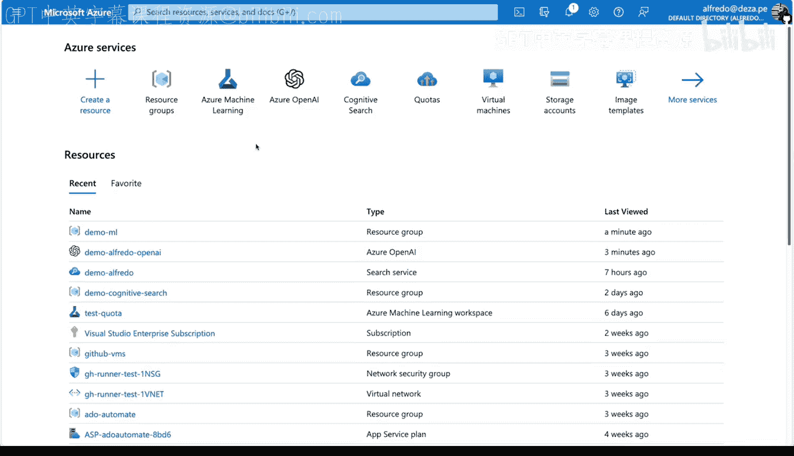
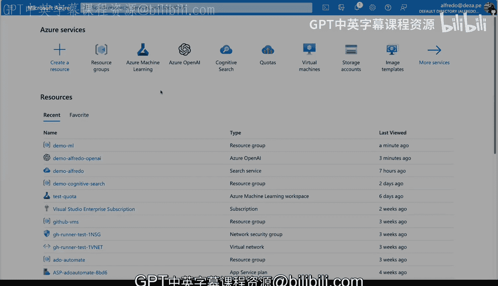

# 大型语言模型实践：04：Azure门户介绍 🚪

在本节课中，我们将学习Azure门户的基础知识。Azure门户是管理和使用所有Azure服务的统一Web界面。了解其布局和核心功能，是高效使用Azure（包括Azure OpenAI服务）的第一步。

## 概述

上一节我们介绍了课程背景，本节中我们来看看Azure的门户界面。Azure门户是与Azure云平台交互的主要图形界面。无论您是要创建资源、管理服务还是查看账单，都需要通过这个门户进行操作。熟悉它的布局和功能，能帮助您更顺畅地开展后续工作。

## 门户首页布局

当您登录Azure门户后，首先看到的是首页。首页经过定制，会显示您最近访问过的服务和资源，方便快速跳转。

以下是首页的主要区域：

*   **常用服务区域**：此区域会显示您最近访问过的服务。例如，在我的门户中，显示了存储账户、资源组和Azure OpenAI服务。
*   **资源列表**：此区域显示您创建的具体资源实例及其名称。请注意“服务”与“资源”的区别：服务是一个类别（如Azure OpenAI），而资源是该类别下的一个具体实例（如一个名为“demo-alfredo-openai”的OpenAI服务）。

## 查看与管理资源

现在，让我们具体看看如何查看一个资源。如果我想查看Azure OpenAI服务，可以点击首页上对应的服务卡片。

进入Azure OpenAI服务页面后，您可以看到已创建的所有OpenAI资源实例。在这个页面，您可以管理该服务的各种设置。例如，您可以找到访问服务所需的**密钥**和**终结点**，这些信息对于后续通过代码调用API至关重要。我们将在后续课程中详细探讨这些功能。

## 搜索功能

如果您在首页没有找到需要的服务或资源，可以使用顶部的全局搜索栏。

例如，如果我需要找到“Azure机器学习”服务，只需在搜索栏中输入名称即可。搜索功能支持模糊匹配，输入“Azure machine learning”后，它会列出相关结果。点击结果即可进入对应的服务页面。如果尚未创建任何资源，页面会引导您开始创建。

## 资源组的概念与管理

在Azure中工作时，理解“资源组”的概念非常重要。资源组是一个逻辑容器，用于将相关的Azure资源（如虚拟机、数据库、存储账户）组合在一起进行统一管理。

资源组的主要优势在于生命周期管理。您可以将为一个项目或演示创建的所有资源放入同一个资源组。

例如，我有一个名为 `demo-ml` 的资源组，其中包含了我为某个机器学习演示创建的所有资源：一个存储账户、一个密钥保管库、一个应用程序洞察实例等。

当项目结束，需要清理所有资源时，您无需逐个删除每个服务。只需**删除整个资源组**，Azure就会自动删除该组内的所有资源。这极大地简化了资源清理工作。

在门户中删除资源组的操作如下：
1.  进入目标资源组页面。
2.  点击“删除资源组”按钮。
3.  在弹出的确认框中输入资源组名称进行确认。
4.  确认后，该资源组及其包含的所有资源将被永久删除。

## 其他管理工具

最后需要了解的是，Azure门户并非管理Azure的唯一方式。根据您的习惯和自动化需求，还可以选择其他工具：

*   **Azure CLI**：基于命令行的工具，适合脚本化和自动化任务。
*   **Azure SDK**：支持多种编程语言（如Python, .NET），允许您通过代码来创建和管理Azure资源。

## 总结

本节课中，我们一起学习了Azure门户的核心功能。我们了解了门户首页的布局，学会了如何查找和管理服务与资源，掌握了使用搜索功能快速定位目标，并深入理解了**资源组**作为逻辑容器对于资源管理的重要性。最后，我们还了解到除了门户，还可以使用Azure CLI和SDK进行管理。掌握这些基础知识，将为您后续在Azure上部署和操作大型语言模型打下坚实基础。