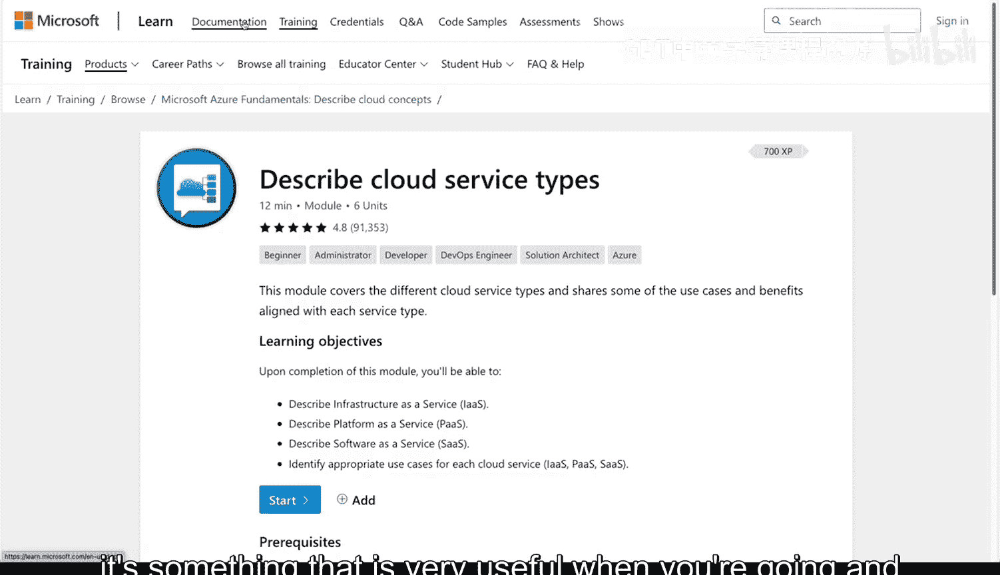
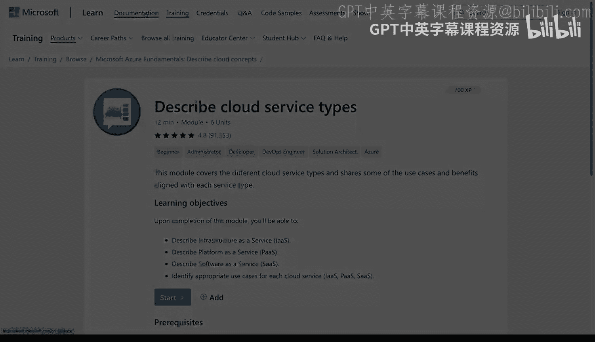

# 大型语言模型实践：P82：05_01_04_使用 Microsoft Learn 📚

在本节课中，我们将学习如何有效利用 Microsoft Learn 平台。该平台是学习和使用 Azure 服务，特别是与大型语言模型（LLM）相关服务的重要资源。我们将了解其核心组成部分，包括代码示例、技术文档和培训路径，并掌握如何通过这些资源来加速你的学习和开发进程。

## 概述 Microsoft Learn 平台

Microsoft Learn 是一个综合性的学习平台，其网址是 `learn.microsoft.com`。当你使用 Azure 或学习我们即将介绍的 LLM 运维及大型语言模型相关内容时，这个平台会是你熟悉且重要的工具。实际上，对于任何与 Azure 相关的工作，你都应该访问这个平台。

## 平台的核心组成部分

Microsoft Learn 的首页提供了多种资源，例如动手实践、技术文档等。我们可以将这些资源大致分为几个非常重要的部分：**文档**、**培训**和**代码示例**。

上一节我们介绍了平台的整体情况，本节中我们来看看具体的资源类型。

### 代码示例

首先，让我们从代码示例开始。点击页面上的“代码示例”入口。

进入后，你可以通过搜索找到特定主题的示例。例如，搜索“Open AI”并回车。

搜索结果中会显示相关的代码项目，例如“使用 Azure SQL 和 Azure OpenAI 进行向量相似性搜索”。点击该项目，你可以看到具体的代码示例。

这些示例可以帮助你扩展在特定领域的知识。例如，这个示例展示了如何将 Azure SQL 和 Azure OpenAI 服务集成在一起，以及如何创建向量表。如果你对这方面感兴趣，这些示例是非常好的学习材料。

### 技术文档

那么，代码示例和文档有什么区别呢？现在，让我们进入“文档”部分。

同样，你可以进行搜索。例如，搜索“Azure OpenAI 服务”并回车。

你将获得与该特定服务紧密相关的详细文档。例如，你会看到一个关于 Azure OpenAI 服务的文档首页，其 URL 类似于 `learn.microsoft.com/azure/ai-services/openai`。

这个页面是关于该服务所有文档的根目录。它提供了各种内容，例如快速入门指南和详细的功能说明。

以下是文档页面通常包含的内容结构：

*   **快速入门**：帮助你快速开始使用服务。
*   **概念**：解释服务的核心原理和组件。
*   **教程**：提供分步指导的实践指南。

让我们快速浏览一下教程。假设你想学习如何对 GPT-3.5 Turbo 模型进行微调。

点击相关教程后，它会引导你完成所需的所有步骤。文章会列出所有先决条件，并提醒你可能遇到的一些限制和注意事项。这非常有用。

有时，文档还会针对不同编程语言（如 Python）提供特定的实现细节。

### 培训与学习路径

最后一部分是“培训”。点击进入后，你会看到各种“学习路径”。

学习路径允许你按照特定的知识体系进行系统学习。你需要登录以跟踪学习进度。

虽然培训路径很有用，但我建议首先从代码示例和文档入手。这两者是你在使用 Azure 进行 LLM 开发时，取得进展和解决问题的非常有用的第一站。

## 总结

本节课中，我们一起学习了如何利用 Microsoft Learn 平台。我们了解了它的三个核心部分：**代码示例**、**技术文档**和**培训路径**。对于初学者，建议优先查阅代码示例来获得实践灵感，并通过详细的技术文档来深入理解特定服务（如 Azure OpenAI）的用法。这个平台是学习和掌握 Azure 云上大型语言模型相关技术不可或缺的助手。