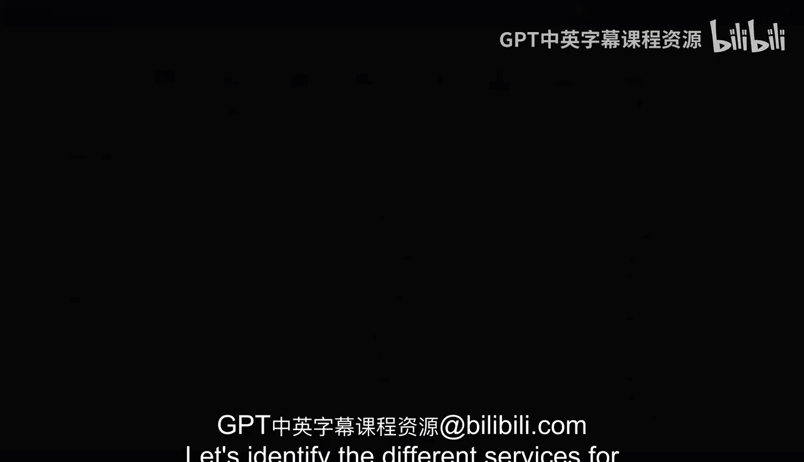
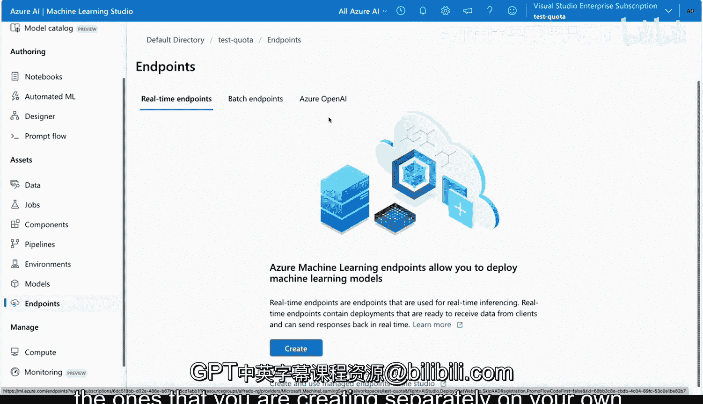

# 大型语言模型实践：P83：识别Azure AI解决方案 🔍

在本节课中，我们将学习如何在Azure平台上识别和区分两种核心的机器学习服务：**Azure OpenAI服务**和**Azure机器学习**。我们将了解它们各自的功能、定位以及适用场景。

---

## Azure OpenAI服务 🤖

上一节我们介绍了课程目标，本节中我们来看看第一种服务：Azure OpenAI服务。该服务允许你在Azure环境中直接部署和使用来自OpenAI的模型。

在Azure门户中，你可以找到“Azure OpenAI服务”。我已经创建了一个实例。我们无需深究创建细节，但可以快速浏览其功能。

进入Azure OpenAI Studio后，你将看到可以与OpenAI模型交互的能力。**关键点在于：Azure OpenAI服务中的模型并非运行在OpenAI的服务器上，而是运行在Azure内部**。这意味着这些模型部署在你自己的Azure订阅中，是一个独立的服务。

以下是该服务的主要特点：
*   你可以选择并部署一系列OpenAI模型。
*   这些模型会持续更新和刷新。
*   你可以完全独立地管理这些模型，并设置任何你想要的约束和配置。

---

## Azure机器学习 🧠

了解了专注于OpenAI模型的Azure OpenAI服务后，我们再来看看功能更广泛的Azure机器学习服务。

回到Azure门户，进入“Azure机器学习”。这里我已经有一个服务实例。点击进入并启动“Azure机器学习工作室”。这个平台与Azure OpenAI服务不同，它提供了更广泛的模型和工具。

在Azure机器学习工作室中，你不仅可以访问一些语言模型，还能使用包括视觉模型在内的其他类型模型。更重要的是，它提供了一系列工具，让你能够从头开始创建和定制自己的模型。

以下是该平台提供的一些核心工具：
*   **自动化机器学习**：你可以上传自己的数据，让Azure在后台自动尝试构建和优化模型。
*   **教程与资源**：平台提供了丰富的学习资源，例如如何创建你的第一个分类模型或生成准确预测的教程。
*   **设计与提示流**：还有其他工具（如设计器和提示流），它们能帮助你创作模型，并在需要实时推理时进行部署。

目前，我还没有部署任何端点，因此系统提示我创建一个。这正体现了该平台的核心功能之一：部署你自己创建或管理的模型端点。

---

## 服务对比与总结 📊

本节课中，我们一起学习了Azure平台上两种关键的AI服务。

*   **Azure OpenAI服务**：专门用于部署和管理来自OpenAI的预训练模型。它提供了一个直接、集成的环境来使用这些先进的生成式AI模型。
*   **Azure机器学习**：是一个功能更全面的机器学习平台。它不仅允许你部署包括OpenAI模型在内的多种模型，更重要的是，它提供了强大的工具集（如自动化机器学习），支持你使用自己的数据从头开始构建、训练和部署自定义模型。

理解这两者的区别非常有用。简单来说，**Azure OpenAI服务专注于OpenAI模型的托管与使用，而Azure机器学习是一个支持全生命周期（从构建到部署）的综合性机器学习平台**。