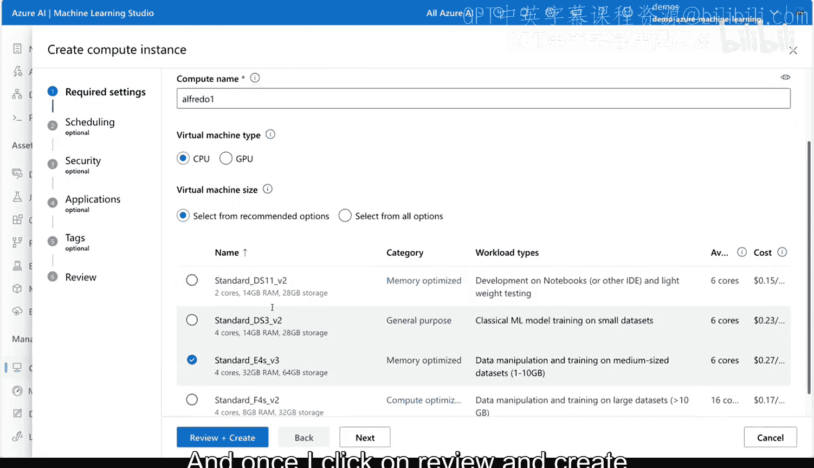
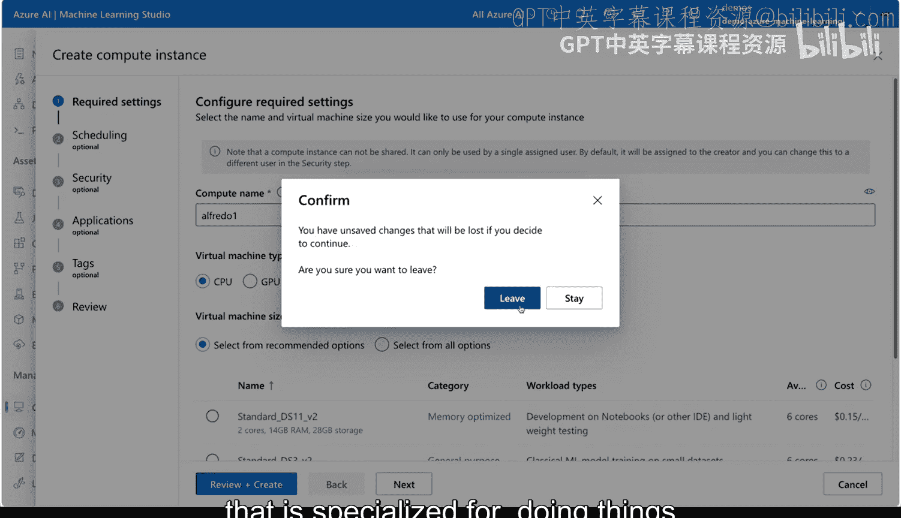
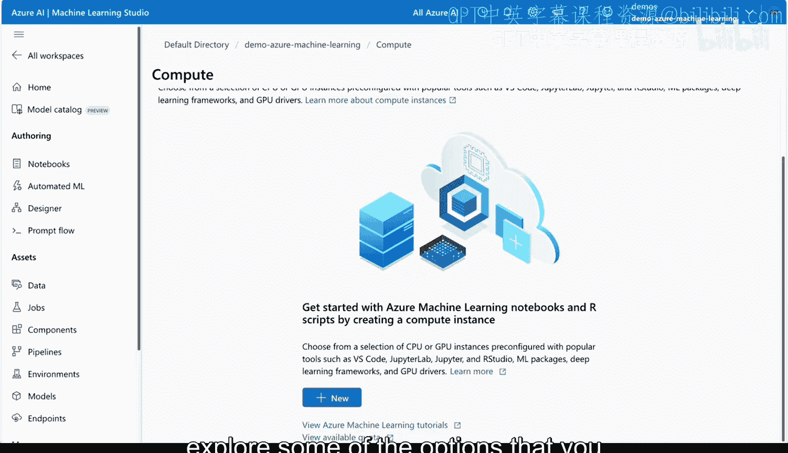

# 大型语言模型实践：P84：Azure机器学习简介 🚀

在本节课中，我们将学习如何在Azure门户中开始使用Azure机器学习工作室。我们将创建一个新的机器学习工作区，并探索其核心功能，包括模型管理、计算资源设置等。

## 概述

Azure机器学习是一项云服务，用于加速和管理机器学习项目生命周期。本节将指导你完成创建工作区、了解其界面以及配置基本计算资源的过程。

## 创建工作区

上一节我们介绍了Azure机器学习的定位，本节中我们来看看如何创建一个新的工作区实例。

首先，在Azure门户中，你需要找到Azure机器学习服务。如果它没有显示在“最近使用的服务”列表中，你可以通过顶部搜索栏进行查找。

输入“Azure Machine Learning”进行搜索，然后从结果中选择该服务。

进入服务页面后，你可以看到之前创建的所有工作区。为了进行演示，我们将创建一个新的工作区。点击“创建”按钮开始。

创建工作区时，需要填写一些基本信息。为资源组选择一个有意义的名称非常重要，这有助于你日后管理和识别资源。例如，可以命名为 `demo-azure-machine-learning`。

创建工作区时，Azure会自动创建一些必需的关联资源，包括：
*   **存储账户**：用于存储数据、模型和日志。
*   **密钥保管库**：用于安全地管理密钥和机密。
*   **Application Insights**：用于监控应用程序性能。

需要注意的是，容器注册表默认不会自动创建。如果你需要构建和使用Docker容器，可以在此处选择创建新的注册表。在本演示中，我们保持默认的“无”选项。

填写完所有信息后，点击“审阅并创建”。系统会进行验证，并确认部署区域。确认无误后，点击“创建”。部署过程需要几分钟时间。

## 探索机器学习工作室

创建工作区后，点击“转到资源”。在资源页面，最重要的操作是点击“启动工作室”，这将打开Azure机器学习工作室的Web界面。

工作室界面左侧是导航栏，提供了各种功能的入口。例如，“笔记本”部分允许你创建和运行Jupyter Notebooks。系统还提供了丰富的教程和示例，是初学者入门的好帮手。

在“模型”目录中，你可以看到包括Azure OpenAI模型在内的多种模型。但需要注意的是，若要部署Azure OpenAI模型（如GPT系列），系统会引导你到专门的Azure OpenAI资源中去完成，而不是直接在机器学习工作室内部署。

## 管理模型与计算资源

上一节我们浏览了工作室界面，本节中我们来看看如何管理模型和配置计算资源。

在“模型”页面，你可以注册、上传或导入自己训练的模型。如果从本地文件上传，可以使用 `上传文件` 功能。

“终结点”页面用于管理已部署的模型服务，你可以创建实时终结点或批处理终结点。

“计算”部分是配置算力的核心。以下是主要的计算类型：

*   **计算实例**：一种完全托管的云工作站，主要用于数据探索、模型开发和测试。适合作为交互式开发环境。
*   **计算集群**：可自动缩放的虚拟机集群，用于大规模训练作业或批处理推理。当没有作业运行时，可以自动缩放到零节点以节省成本。
*   **Kubernetes集群**：可用于高级部署和模型服务场景。
*   **附加计算**：允许你附加Azure中已有的计算资源（如虚拟机或Kubernetes集群）。

创建计算实例时，你可以选择不同的虚拟机类型。例如，如果需要GPU加速，可以在筛选器中选择“GPU”。选择适合的规格后，点击“创建”即可。

## 总结

本节课中我们一起学习了Azure机器学习的基础操作。我们创建了一个新的工作区，探索了Azure机器学习工作室的界面，并了解了如何管理模型以及配置计算实例和集群等核心计算资源。这些是使用Azure平台进行机器学习项目开发的第一步。