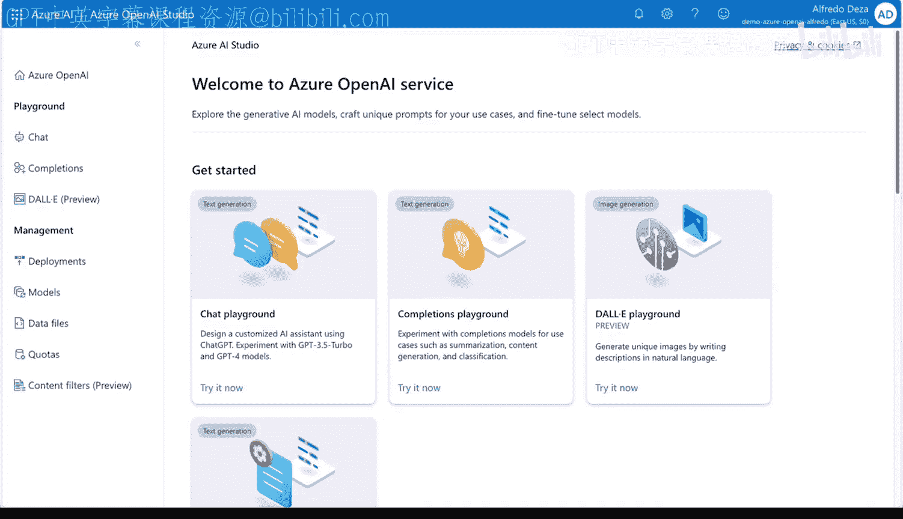

# 大型语言模型实践：1.1：Azure OpenAI服务简介 🚀

在本节课中，我们将学习如何在Azure门户中创建和配置Azure OpenAI服务实例。我们将从访问门户开始，逐步完成资源创建、配置网络选项，并最终在Azure OpenAI Studio中部署一个聊天模型进行交互。

---

## 访问Azure门户与服务

首先，我们需要回到Azure门户并找到OpenAI服务。

如果你最近使用过该服务，可以在资源列表中找到它。如果你已经部署或创建了一个Azure OpenAI服务实例，它会直接显示在资源列表中。

如果你尚未部署或访问过Azure OpenAI服务，则需要通过搜索或服务列表来定位它。我将点击该服务进入。

假设我目前没有任何现有资源，我将创建一个新的实例。

---

## 创建新资源

以下是创建新资源的具体步骤。

**1. 选择订阅与资源组**
在创建过程中，你需要选择一个订阅，并决定是创建一个新的资源组还是复用现有的。本例中，我选择创建一个新的资源组。

**2. 命名资源组**
我将这个新资源组命名为 `demo-azure-openai`。请注意，`OpenAI`的拼写要正确。点击“确定”以确认创建，这有助于后续统一管理和清理所有相关资源。你可以看到，我之前删除其他资源组时收到了相应的通知。

**3. 选择区域**
区域选择非常重要，因为配额（Quota）是按区域分配的。点击区域下拉菜单，你可以看到所有可用区域。请确保你选择了拥有配额的正确区域。

**4. 填写实例详情**
接下来填写实例详情。我将服务实例名称也设为 `demo-azure-openai`。请注意，服务实例名称不必与资源组名称相同，但如果该名称在Azure OpenAI服务的全局域名中已被占用，你会遇到问题。

这是因为服务会创建一个唯一的子域名（DNS记录）。我通常会在名称中加入自己的名字（例如 `demo-azure-openai-alfredo`）来确保其唯一性。

**5. 选择定价层**
目前只有一个“标准（Standard）”定价层可供选择。你可以点击查看完整定价详情，这会打开一个新标签页。我选择标准层，然后点击“下一步”。

---

## 配置网络与安全

上一节我们完成了基本设置，本节中我们来看看如何配置网络访问。

在配置步骤中，系统会询问你希望如何公开即将部署的模型。这是Azure OpenAI服务特有的设置，使其与其他服务区分开来。

你有几个选项：可以将其完全置于防火墙后，或配置私有端点来完全禁用公共访问。你也可以选择特定网络并配置Azure AI服务的网络安全性。

考虑到演示目的，我将保持所有网络开放。点击“下一步”继续。

---

## 完成创建与部署

接下来是可选的标签步骤，用于在Azure中标识服务，我将其留空。最后，点击“审阅并提交”，然后点击“创建”。

这将初始化并提交部署任务。你会看到部署进度，资源开始被配置。我们等待部署完成。

部署已成功。点击“转到资源”按钮。

---

## 获取密钥与终结点

一个重要的注意事项是：密钥和终结点信息会显示在资源的概览页面上，而不是在Azure OpenAI Studio中。

点击进入后，你可以在这里找到通信所需的终结点（Endpoint）。这就是所有模型的统一访问地址。同时，你还需要使用密钥（Keys）进行身份验证。

让我们回到概览页，点击“在Azure OpenAI Studio中探索”。

---

## 使用Azure OpenAI Studio

一旦Azure OpenAI Studio加载完成，你会看到聊天游乐场（Chat Playground）、补全游乐场（Completions Playground）等界面。

我们重点看一下聊天游乐场，这可能是你最感兴趣的部分。要开始使用，你需要先创建一个新的部署。

**1. 创建部署**
在这里，你可以选择模型和版本，并为其命名。例如，我将其命名为 `test-chat`。你还可以为令牌（Tokens）设置高级选项，因为计费是基于令牌使用量进行的，这一点我们后续会详细讲解。

**2. 开始交互**
部署完成后（这个过程非常快），你就可以选择助理角色、设置系统消息，并开始聊天了。例如，我输入“Hi chatbot”，它回复“Hello! Can I assist you today?”。这样，你立即就拥有了一个可以交互的AI助手。

---

## 管理部署与模型

除了交互，你还可以管理部署和配置参数。

**1. 部署管理**
在管理部分，你可以看到我的 `test-chat` 部署，包括模型名称、版本、部署类型、容量和状态。

**2. 模型库**
进入“模型”部分，你可以看到可用的各种模型。你还可以创建自定义模型或上传数据文件，以便对模型进行微调（Fine-tuning）。这对于定制化需求非常有用，但如果你不熟悉微调概念，可能会有些复杂。

**3. 配额与使用量**
“配额（Quotas）”部分非常实用，你可以在这里查看使用量限制。例如，部署了 `gpt-35-turbo` 模型后，其使用限制就会显示在这里。

**4. 内容过滤器**
“内容过滤器（Content Filters）”也很有用。你可以创建自定义的内容过滤器，或者在配置模型时添加默认的内容过滤策略。

---

## 总结

本节课中，我们一起学习了Azure OpenAI服务的完整创建与配置流程。我们从访问Azure门户开始，逐步创建了资源组和服务实例，配置了网络选项，并最终在Azure OpenAI Studio中成功部署并测试了一个聊天模型。Azure OpenAI服务提供了丰富的管理功能，包括模型部署、配额管理和内容过滤，使得构建和定制AI应用变得简单快捷。