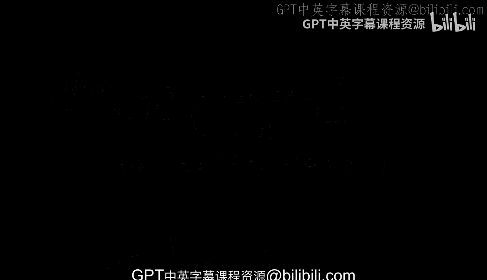
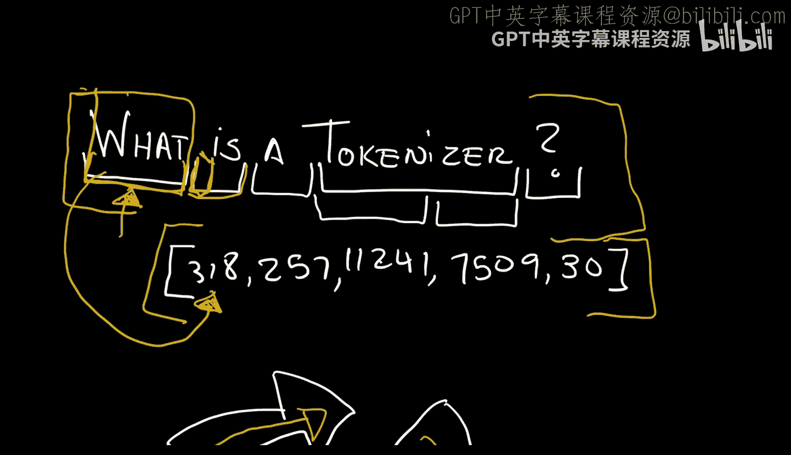
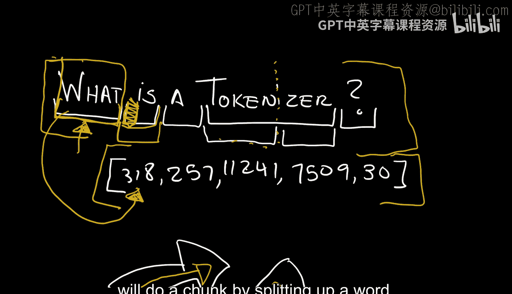
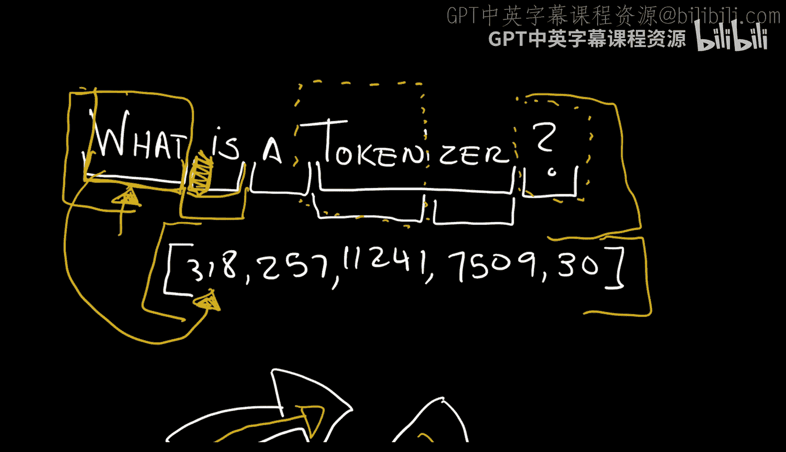
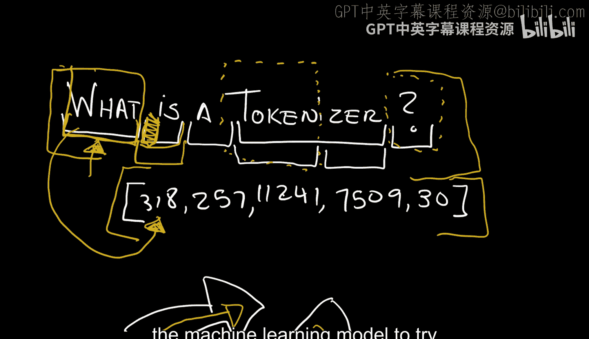
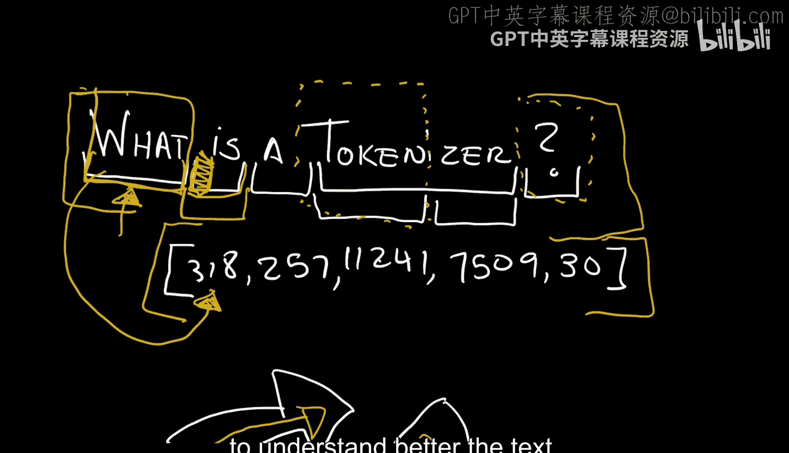
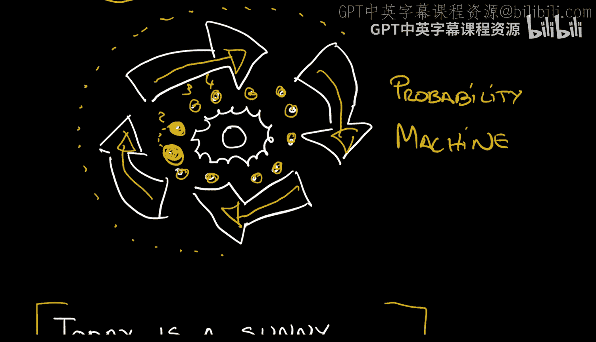
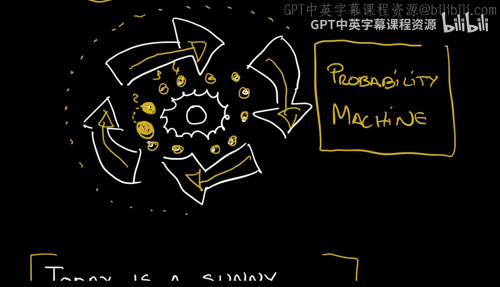
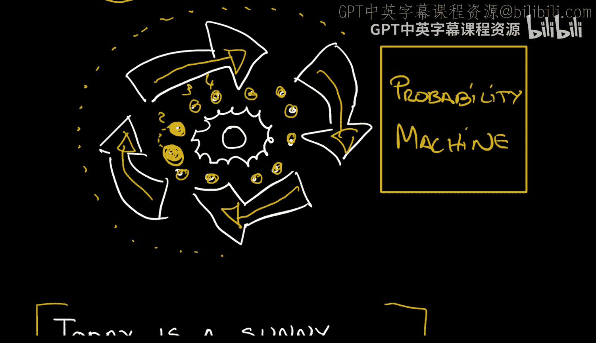
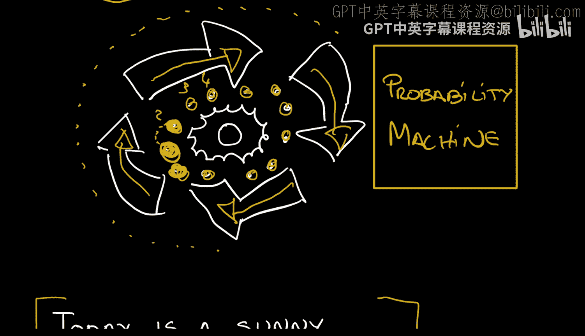

# 大型语言模型实践：1.1：什么是大语言模型及其工作原理 🧠

在本节课中，我们将要学习大语言模型（LLM）的基本概念及其核心工作原理。我们将从理解文本如何被模型处理开始，逐步揭示其作为“概率机器”的本质。

要理解大语言模型及其确切的工作原理，我们首先需要从“词元”开始，理解什么是“词元化器”。我们有一段文本提出了问题：“什么是词元化器？”其确切含义是，词元化器是一个将文本（例如这里的这个短语）转换为数字的过程。大语言模型将以文本作为输入，并生成文本作为输出。

但这是如何发生的呢？其过程是处理像这样的一个短语，并将其分割成更小的块。例如，其中一个块可能是什么？其中一个片段将被转换为一个数值。在这种情况下，“what”这个词或许会被转换为一个数值，比如318。所有这些片段最终都将被转换为数字，并被放入一种数组中。这是机器随后能够处理它们并尝试更好地识别它们的方式。通过使用数值来表示这些片段，我们创建了一种索引。这个索引是原始文本块的编码。

我们之所以说“块”或“片段”，是因为它不一定按单词划分。在这里，我们可能会说“what is a”是一个块。但它也可能包含一些空格，空格本身也可能被表示为一个完整的块。有时，词元化器甚至会将一个单词分割成两部分。像这样的问号也可能构成一个块。所有这些表示方式将使机器学习模型更容易理解文本。否则，对于机器来说，这是目前理解文本的最佳方法。

以上是分析部分，或者说，是将这些文本块分割并转换为数值的过程。那么，我们这里处理的究竟是什么？我喜欢称之为“概率机器”。为什么是概率机器？它只是试图理解所有这些较小的文本块（或者说词元），并尝试预测从一个词元到下一个词元的精确概率。例如，从这个词元到第二个词元，再到第三个、第四个，依此类推。因此，以一种过度简化的方式解释，它本质上只是一个概率问题。基于海量的文本，我们将看到一个机器学习模型试图确定，给定一段文本，所有后续词元的概率是什么。

这就是为什么我想强调这正是一台概率机器。这样思考这些模型也很容易，因为有时它们表现得非常出色，像一台能输出事实的机器。即使某些生成的文本看起来准确、正确且符合现实，我们也不应将其视为事实机器。因为它的本质只是概率：给定特定的输入，基于训练文本的数量，下一个输入、下一个块、下一个片段、下一个词元是什么的概率。

以“今天是个晴天，并且……”这样的短语为例。这个短语是理解“……”部分将是哪个特定单词的概率的完美方式。在这种情况下，“今天是个晴天，并且……”后面很可能是一个“好”字。这意味着什么？基于训练文本的数量、文本本身、将文本分解为词元的过程以及生成的所有索引，机器理解到，你很可能想要的是“好”这个词，甚至可能前面还有一些空格，以便生成的文本能被正确表示。

所以，本质上，这就是具有大语言生成能力的机器学习模型、大语言模型和文本生成的工作原理：首先通过分解文本来创建索引，然后作为一台概率机器运行。

---

本节课中，我们一起学习了：
1.  **词元化**：文本被分割成“词元”并转换为数值索引的过程。
2.  **概率本质**：大语言模型的核心是基于海量文本数据，计算并预测下一个最可能出现的词元。
3.  **工作原理**：模型通过“词元化-索引化”处理输入，再以“概率机器”的方式生成连贯的文本输出。

理解这些基础概念是掌握大语言模型后续应用与操作的关键。