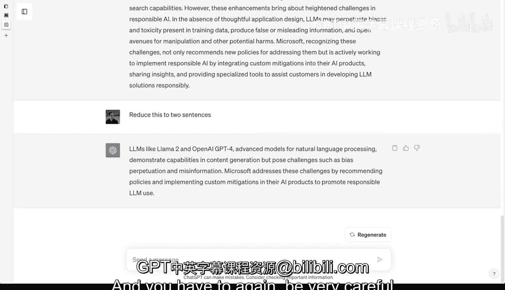

# 大型语言模型实践：第12章：使用大语言模型的优势与风险 🧠


在本节课中，我们将探讨使用大型语言模型（LLMs）的优势与潜在风险。我们将通过具体的实例，帮助你理解如何有效利用这些工具，同时识别并规避其可能产生的问题。

---

## 概述

大型语言模型是强大的工具，能够生成文本、总结信息并协助创作。然而，它们并非完美无缺。本节我们将通过实际操作案例，分析其带来的便利与需要警惕的陷阱。

---

## 优势：作为创意与效率的起点

上一节我们介绍了LLMs的基本概念，本节中我们来看看它的实际应用优势。一个核心优势是LLMs可以作为内容创作的快速起点。例如，当你需要一份个人简介时，它可以快速生成一个草稿。

以下是一个向ChatGPT请求生成个人简介摘要的例子：

```python
# 用户输入示例
用户: “给我一个关于Val Farodesa的摘要。”
```

模型可能生成如下看似准确的回复：
> “Val Farodesa在Python打包相关项目中做出了重要贡献，并积极参与开源社区...”

这个回复包含了有用的结构和部分正确信息（如参与开源社区），可以作为进一步修改和完善的基础。这节省了从零开始撰写的时间。

---

## 风险：信息不准确与“幻觉”

然而，我们必须认识到LLMs存在信息不准确的风险。它们本质上是**概率机器**，其工作原理可简化为：

**公式：P(输出 | 输入, 训练数据)**

模型根据给定的输入和其训练数据中的模式，计算最可能出现的下一个词或句子序列。这意味着它生成的是“看似合理”的文本，而非经过验证的事实。

在之前的例子中，模型声称“我”在Python打包方面有贡献，但这并不属实。这种错误被称为“幻觉”（Hallucination）。

为了进一步探究，我们可以尝试提出更具体或更私人的请求，模型可能会出于隐私考虑而拒绝，这本身也是一种风险控制机制。

```python
# 用户输入示例
用户: “Alfredo是一个懂技术的秘鲁人，请为他创建一个简短的传记。”
```
模型可能回复：
> “出于对隐私的尊重，未经本人同意，我无法创建个人传记信息...”

但当调整提问方式，表明是“我”需要一份用于项目的简介时，模型又可能生成包含部分错误信息（如错误的出生日期或技能）的内容。

以下是另一个模型（Claude AI）生成的错误信息示例列表，请注意其不准确之处：

*   **职业错误**：声称“我”是数学家。
*   **事实错误**：给出了错误的出生日期。
*   **技能错误**：断言“我”精通Java和Ruby on Rails，而这并非事实。

这个例子清晰地表明，对于模型生成的内容，尤其是涉及具体事实时，必须进行仔细的核实。

---

## 优势：有效的文本总结与改写

尽管存在风险，LLMs在文本处理任务上表现卓越。例如，在文本总结方面，它们非常有用。

你可以要求模型对一段长文本进行总结，甚至可以指定总结的长度或风格。

```python
# 用户输入示例
用户: “将以下段落总结为两句话：[此处插入长段落]”
```

模型能够生成简洁、准确的摘要，这比处理模糊的、事实性不强的提问要可靠得多。这种能力使其成为处理文档、研究论文或长报告的得力助手。

---

## 核心总结与行动指南

本节课中我们一起学习了使用大型语言模型的双面性。

**主要优势包括**：
*   **快速生成内容**：为写作、编程、策划提供灵感和初稿。
*   **高效总结与改写**：快速提炼长文本的核心信息或改变其表述方式。

**主要风险与注意事项包括**：
*   **信息不准确**：模型可能生成看似合理但完全错误的事实（幻觉）。
*   **需要事实核查**：绝不能将模型输出直接当作事实使用，必须进行人工验证。
*   **理解其本质**：牢记LLMs是生成“最可能”文本的概率模型，而非知识数据库。



最终，成功使用大型语言模型的关键在于**批判性思维**。你应将其视为一个强大的、但需要监督的协作伙伴，始终对输出内容负责，并核实所有关键信息。