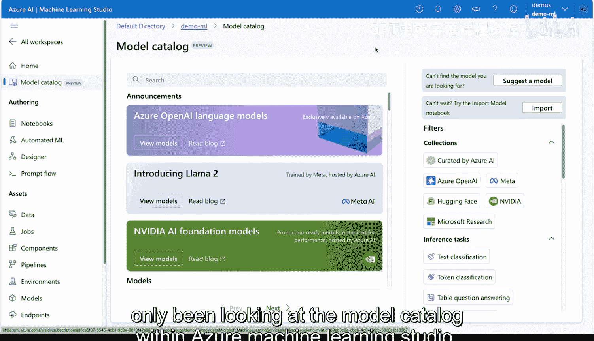

# 大型语言模型实践：P94：在Azure中发现与评估大语言模型

## 概述
在本节课中，我们将学习如何在Azure门户中探索和评估可供使用的大语言模型。我们将了解如何导航至Azure机器学习工作室，使用模型目录筛选模型，并理解不同模型来源（如Hugging Face和Azure OpenAI）的部署要求。

---

## 导航至Azure机器学习工作室
首先，我们需要进入Azure门户。您可以通过点击页面上的“Azure服务”或直接查找已部署的Azure机器学习实例来访问。

以下是如何操作的步骤：
1.  在Azure门户中，找到并选择您的Azure机器学习实例。
2.  根据您的订阅，您会看到所有实例列表。在本例中，我们选择名为“demoMl”的订阅。
3.  最后，点击“启动工作室”，这将跳转至一个独立的网站界面。

现在，我们已经进入了Azure机器学习工作室的仪表板界面。

---

## 探索模型目录
上一节我们介绍了如何进入Azure机器学习工作室，本节中我们来看看其核心功能之一——模型目录。请注意，该网站界面和仪表板布局可能经常更新，因此您看到的界面可能与教程略有不同。

模型目录会展示Azure云平台内所有可供我们使用的模型选项。

首先，请注意页面上的几个选项：
*   您可以“建议一个模型”。
*   也可以“导入模型笔记本”，这是一个有趣的功能。

当现有模型不完全符合您的需求时，这些是您可以考虑的选项。

---

## 使用筛选器查找模型
进入模型目录后，您会看到各种模型集合。页面顶部通常会有公告，介绍新模型如何被集成到Azure中，例如NVIDIA的模型或Azure OpenAI语言模型。

右侧的筛选器功能非常强大。您不仅可以通过“集合”来筛选，例如，如果您特别喜欢Hugging Face的模型，只需点击它。

应用筛选器后，页面将只显示来自Hugging Face的模型。但您可能不想局限于单一来源。

微软研究院也提供了自己的模型，如Phi-1.5和Phi-2，它们专注于文本生成，性能非常出色。

以下是按任务类型筛选的步骤：
1.  您可以看到“推理任务”筛选器。
2.  根据您的任务需求，可以筛选出特定模型。例如，“文本摘要”是一个常见任务。
3.  点击该任务后，左侧的筛选器会生效。此时，您不仅会看到Hugging Face的模型，还会看到来自其他来源的、能完成该任务的所有模型。

---

## 关于Hugging Face模型的说明
您可能会好奇，既然Hugging Face有自己的平台和网站来托管众多模型，为什么还会出现在这里？

这是因为Azure模型目录中的所有模型都经过审核，确保它们能在Azure云上正确运行并达到一定标准。这就是它们被收录的原因。

目录中有大量的Hugging Face模型，继续向下滚动，您还会看到其他来源的模型，例如Mistral AI和Cohere的模型。您可以点击进入任一模型查看更多详情。

我们不会详细探讨这里的所有选项，但了解模型目录提供的多种能力是非常有益的。

---

## 部署Azure OpenAI模型
最后，我想提一下Azure OpenAI模型。如果您在目录中查找并点击例如GPT-4这样的模型，准备部署时，系统会要求您转到Azure OpenAI服务。

例如，点击GPT-4后，如果部署选项不可用，则意味着您需要在当前Azure机器学习工作室工作区所在的区域，拥有一个可用的Azure OpenAI服务实例。

这一点需要特别注意，它说明了Azure机器学习工作室内的模型目录与独立的Azure OpenAI服务之间存在区别。在本课中，我们主要关注的是Azure机器学习工作室内部的模型目录。

---

## 总结
本节课中，我们一起学习了如何在Azure机器学习工作室中发现和评估大语言模型。我们掌握了导航至工作室的方法，探索了模型目录，并学会了使用集合和任务类型筛选器来缩小模型选择范围。我们还了解了不同模型来源（如Hugging Face）的集成方式，以及部署特定模型（如Azure OpenAI服务中的模型）时需要注意的区域兼容性要求。