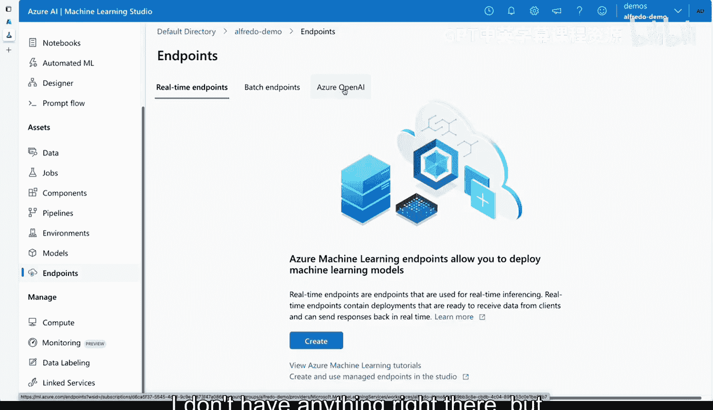
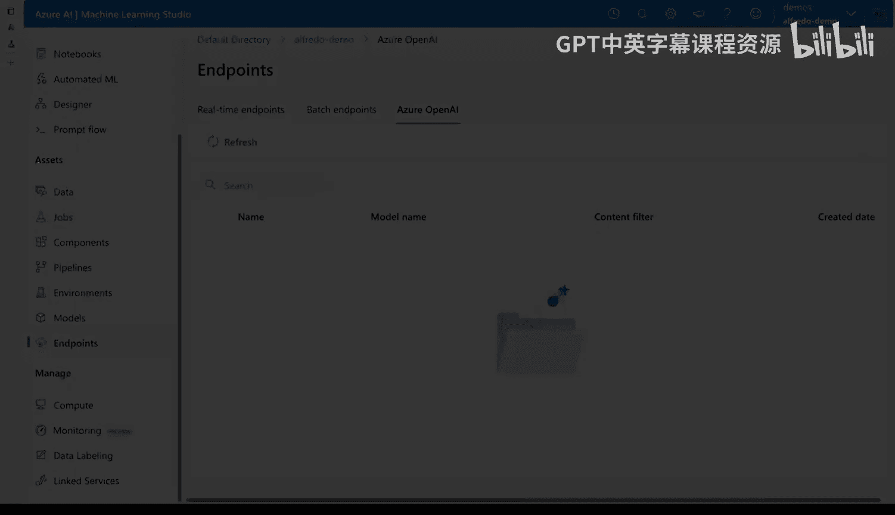

# 大型语言模型实践：P95：推理部署选项

## 概述
在本节课中，我们将学习在 Azure 机器学习工作室中进行模型推理部署的主要选项。我们将了解如何创建实时与批量端点，如何配置计算资源，以及部署过程中的关键设置。

## Azure 机器学习工作室的推理选项
我们首先打开 Azure 机器学习工作室。在主页或登录页面上，我们可以看到所有可用的模型和其他资源。无论我们想进行何种操作，都可以从这里开始。

例如，如果我们想部署某个模型，可以快速点击进入部署部分。

## 部署端点类型
在部署部分，我们主要有两种选择：**批量端点** 和 **实时端点**。大多数情况下，我们会尝试部署类似实时端点的服务。

如果我们选择创建实时端点，系统可能会提示我们没有足够的配额来创建虚拟机。某些模型需要特定类型的配额。我们可以通过点击相关链接，找到部署所需的确切资源。

例如，部署某些模型可能需要强大的 GPU，如果我们没有足够的配额，就无法进行。如果我们有配额，可以看到“实例计数”选项非常有趣，因为它允许我们进行扩展。我们甚至可以将实例数从 1 调整到 3。此外，我们还可以选择不同的配置选项。

## 部署配置详情
部署时，我们会遇到一些配置项，例如数据收集和模型打包。我们可以找到关于这些选项的更多信息，并根据需要选择。部署完成后，我们会获得一个特定的终结点域名，以及如何消费该模型的说明。不过，我们在此不深入这些细节。

如果我们愿意，还可以获得一系列可供选择的虚拟机。以上就是我想展示的第一个方面。

## 模型部署示例
接下来，我们转到“模型”部分，点击并选择一个模型。例如，这里有一个我上传的名为 **SqueezeNet** 的模型。这是一个 **ONNX** 模型。

对于这类模型，部署限制较少，流程更直接，我们在选择上有更大的自由度。

## Kubernetes 部署选项
如果我选择创建实时端点，实际上可以选择使用 **Kubernetes** 进行部署。这非常有趣，因为部署到 Kubernetes 唯一需要做的就是点击这个按钮，然后我们需要部署一个 Kubernetes 集群。这可以通过 Azure Kubernetes 服务完成。

由于我没有现成的集群，我需要点击“管理”来创建一个。这很方便。

## 身份验证与访问设置
身份验证类型默认已配置好。在 Azure 中，我们可以创建身份验证机制来防止未授权访问。我们可以选择基于令牌或基于密钥的身份验证。这两种方式有所不同，我们可以根据偏好选择。

基于密钥的身份验证会提供一个不会过期的主密钥和辅助密钥，这是它与基于令牌验证的一个区别。

接下来是公共网络访问设置，我们可以选择是否将终结点公开暴露。

## 部署参数配置
完成上述设置后，我们将选择要部署的模型，然后进入部署配置。在这里，我们可以设置超时时间。例如，如果评分过程超过 60 秒，请求就会超时，不会返回结果。当然，我们可以修改这个值，比如设置为 90 秒。

我们可以设置超过 90 秒（即一分半钟）的超时。但可以想象，让用户等待超过 90 秒可能会使其失去耐心。

## 计算资源配置
配置完这些选项后，我们就可以进行部署了。不过，在点击部署之前，我想展示最后一点：计算资源部分。

在“计算”部分，我们可以配置用于部署的 GPU 或 CPU 资源。这里会提供选项让我们选择想要部署的机器类型。

当使用 CPU 时，根据我们的配额，会有不同的选项可供选择。我们可以根据需要挑选。

如果想要 GPU，这里会显示可选的 GPU 机型。同样，我目前没有某些机型的配额。但我们可以根据需求，在这里挑选一些推荐的计算规格，价格信息也会直接显示在旁边。

除此之外，我们还可以在 CPU 选项下，从所有其他规格中进行选择。如果某些规格不在推荐列表中，比如这个只有 2 个核心和 14 GB 内存的选项，我们也可以手动选择并完成配置。

## 部署完成与管理
以上就是在 Azure 机器学习工作室中进行不同类型部署的一些有趣选项。

一旦我们部署了类似的计算资源，当尝试部署模型时，这些资源就会变为可用。模型部署完成后，它们会出现在“终结点”部分。我们创建的实时端点会显示在这里。

即使我们想查看一些 Azure OpenAI 相关的资源，也能在这里找到。虽然我目前没有任何已部署的资源，但如果我们有，就可以在这里看到它们。

## 总结
本节课中，我们一起学习了在 Azure 机器学习工作室中进行模型推理部署的核心流程。我们了解了如何选择实时或批量端点，如何配置计算资源（包括 CPU 和 GPU），以及设置身份验证、网络访问和超时等关键参数。掌握这些选项，是成功将机器学习模型投入生产应用的重要一步。