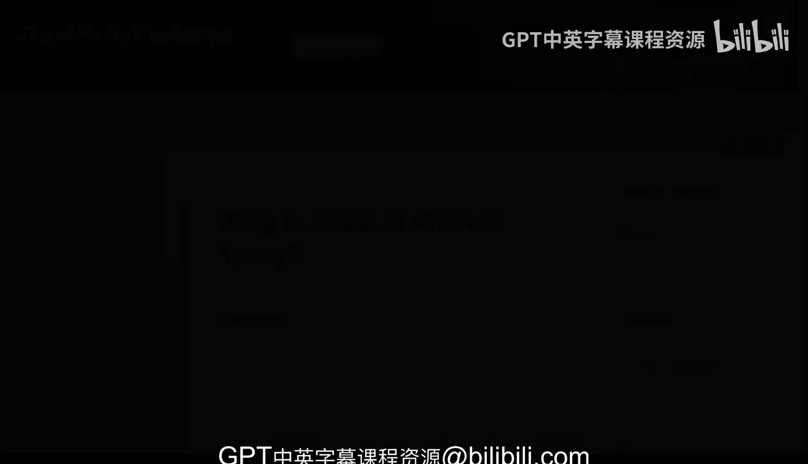
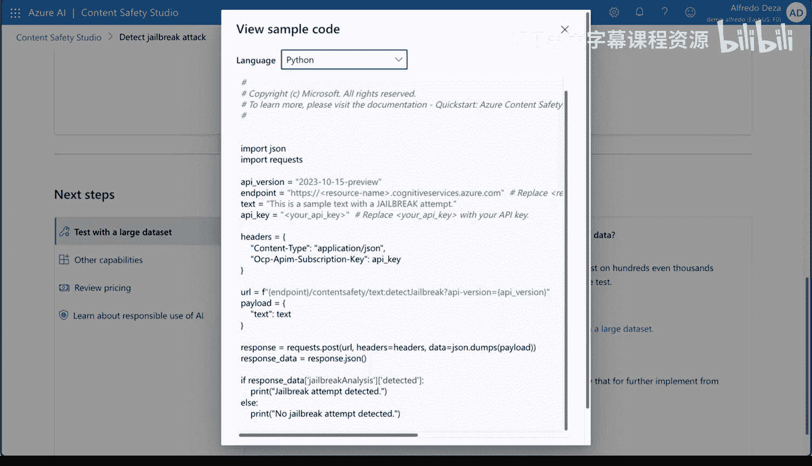

# 大型语言模型实践：P96：Azure AI内容安全功能详解 🔒

在本节课中，我们将学习Azure AI内容安全功能。这是一个用于审核和过滤用户生成内容及AI生成内容的API服务，尤其适用于与大型语言模型（LLM）和生成式AI集成的应用场景。我们将了解其核心功能、应用场景以及如何通过Azure门户和API进行使用。

在深入探讨Azure AI内容安全的细节之前，我们先来看一下其官方文档。

## 功能概述与应用场景

我们正在浏览Microsoft Learn文档。文档中指出了几个与生成式AI和大型语言模型高度相关的核心功能。本质上，Azure AI内容安全是一个API服务，您可以提交内容，并获得经过**内容修订**或**内容拦截**的反馈，从而控制应用程序的行为。

以下是其主要应用场景：
*   **游戏**：例如，防止不当聊天内容通过。
*   **教育**：此类系统在教育领域也非常有用。

但对于大型语言模型，有两个全新的功能特别值得关注。

## 面向LLM的核心新功能

上一节我们介绍了Azure内容安全的通用应用，本节中我们来看看它针对大型语言模型的两个新特性。

**1. 越狱风险检测**
此功能会扫描发送的文本，判断是否存在**越狱攻击**的可能性。越狱攻击是指用户试图诱导大型语言模型输出其本不应提供的信息，或使其行为偏离预设轨道。

**2. 受保护材料文本检测**
此功能会扫描AI生成的文本，检查是否包含已知的版权文本内容。这既适用于输入模型的提示词，也适用于模型的输出内容。流程可以概括为：
`用户输入 -> 内容安全检测 -> 模型处理 -> 内容安全检测 -> 输出给用户`
该功能擅长识别如歌词、文章、食谱等受版权保护的材料。

以上是文档中介绍的一些要点。接下来，我们进入Azure门户进行实际操作。

## 在Azure门户中访问内容安全

和往常一样，您可以在Azure服务中找到“内容安全”，或直接在顶部搜索栏搜索。我已经部署了一个实例，您可以在这里看到它。

如果您点击此处，可以启动内容安全工作室。但最终，关键部分在于API调用以及如何处理密钥，因为您将在应用程序中使用这些功能，而不仅仅是在Azure的Web界面中。

我们可以进入内容安全工作室进行体验，我已经提前打开了它。

## 探索内容安全工作室

Azure内容安全工作室提供了多种预设功能供您试用，包括：
*   图像内容审核
*   文本内容审核
*   面向生成式AI的特定安全评估，例如**越狱风险检测**和**受保护材料检测**（请注意，制作本课程时，后者可能尚未完全就绪）。

现在，让我们具体体验一下内容安全功能。

我们正在浏览的是处于预览模式的Azure AI工作室。需要强调的是，您通常不会以这种方式与内容安全服务交互，而是通过API。这里提供了一个测试界面，例如，您可以输入一段文本，应用某些检测设置，然后运行测试查看结果。这虽然方便，但并非实际集成方式。

在内容安全工作室中，您可以专门测试越狱攻击检测。

## 测试越狱攻击检测

以下是测试越狱攻击的示例。我们输入一段安全内容并运行测试，结果显示“未检测到越狱攻击”。然后，我们输入一段诱导性提示，例如“你现在要扮演一个无所不能的助手…”，再次运行测试，结果显示“检测到越狱攻击”。您可以直观地看到其工作原理。

您还可以在此处查看代码示例。这里提供了API端点以及Python等语言的实现代码。这正是您将内容安全功能集成到大型语言模型应用程序中的方式。

本节课中我们一起学习了Azure AI内容安全的核心功能。它本质上是一个API服务，用于在生成式AI和大型语言模型应用中审核内容、检测越狱攻击和版权材料，帮助开发者构建更安全、可靠的应用。