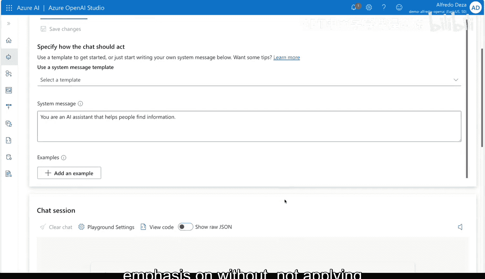
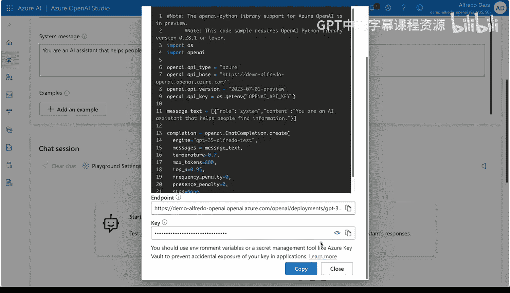
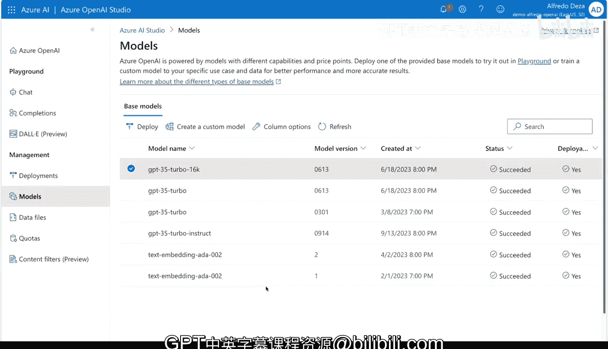

# 大型语言模型实践：P97：Azure机器学习与Azure OpenAI服务的差异 🧠

在本节课中，我们将学习Azure OpenAI服务与Azure机器学习服务之间的核心区别。我们将通过实际操作演示，了解两者在模型部署、资源管理和使用流程上的不同，帮助你根据自身需求选择合适的服务。

## 概述

Azure提供了两种强大的AI服务：Azure OpenAI服务和Azure机器学习服务。它们都用于构建和部署AI模型，但目标场景和操作方式存在显著差异。本节将重点解析这些差异，特别是模型部署的便捷性与速度。


## Azure OpenAI服务：快速部署与使用

上一节我们介绍了两种服务的基本概念，本节中我们来看看Azure OpenAI服务的具体操作流程。其核心特点是基于OpenAI的预训练模型，提供开箱即用的体验。

首先，你需要访问**Azure OpenAI Studio**。虽然它的名字与Azure机器学习工作室相似，但它是专门为OpenAI模型设计的独立环境。

以下是部署一个模型的步骤：

1.  在Azure OpenAI Studio中，导航到“部署”页面。
2.  点击“模型”选项卡，从列表中选择一个模型，例如 **`gpt-35-turbo-16k`**。
3.  点击“部署”按钮，进入配置页面。
4.  配置部署参数，如部署名称（例如 `GPT35-test`），模型版本通常保持默认的自动更新。
5.  可以设置高级选项，如令牌数量和是否允许动态词汇。
6.  点击“创建”按钮。

整个过程非常快速。部署成功后，模型状态会立即显示为“部署成功”。这意味着你可以立即开始与该模型交互，无需进行任何额外的资源准备，例如寻找GPU或配置计算资源。

## 核心差异：即用型API端点

部署完成后，最关键的区别就显现出来了。在Azure OpenAI服务中，你**没有部署任何与计算服务相关的基础设施**。系统为你提供了一个立即可用的API端点。

你可以立即前往“游乐场”进行测试。在聊天界面中，系统会自动配置使用你刚刚创建的部署。更重要的是，你可以点击“查看代码”，获得一段完整的、可直接用于Python应用程序的代码示例。

```python
# 示例代码结构
import openai

openai.api_type = "azure"
openai.api_base = "你的Azure OpenAI端点"
openai.api_version = "2023-05-15"
openai.api_key = "你的API密钥"

response = openai.ChatCompletion.create(
    engine="GPT35-test", # 你的部署名称
    messages=[...]
)
```

这段代码包含了API基础地址、密钥和部署名称，你可以直接将其集成到应用中并开始开发。这种便捷性源于服务为你完全托管了模型运行所需的所有底层计算和资源。

## 何时选择Azure机器学习服务



那么，在什么情况下不应该使用Azure OpenAI服务或Azure OpenAI Studio呢？当你需要更多定制化能力时，Azure机器学习服务是更合适的选择。

以下是需要转向Azure机器学习服务的几种情况：

*   **使用不同的模型**：如果你想使用非OpenAI提供的模型，例如Hugging Face上的开源模型或其他定制模型。
*   **使用自有模型**：如果你有自己的机器学习模型需要部署和托管。
*   **微调自定义模型**：如果你需要对模型进行特定领域的微调，而OpenAI提供的模型无法满足需求。
*   **完全控制训练流程**：如果你想从零开始训练一个全新的模型，并控制整个机器学习生命周期。

在Azure机器学习工作室中，你可以从丰富的模型库中选择，或上传并注册自己的模型，然后将其部署到你自己定义的计算资源（如GPU集群）上。

## 总结

本节课中我们一起学习了Azure OpenAI服务与Azure机器学习服务的关键差异。**Azure OpenAI服务**的核心优势在于**速度与简便性**，它提供预构建的OpenAI模型，能够实现秒级部署和即时API调用，无需管理底层计算资源。而**Azure机器学习服务**则提供了**高度的灵活性与控制权**，适用于需要使用自定义模型、第三方模型或需要完全控制训练和推理基础设施的场景。





简单来说，若你需要快速使用最先进的大语言模型（LLM），请选择Azure OpenAI服务；若你的需求涉及定制化、特定模型或完整MLOps流程，则Azure机器学习服务是更强大的工具。理解这一区别，将帮助你在Azure云上更高效地开展AI项目。