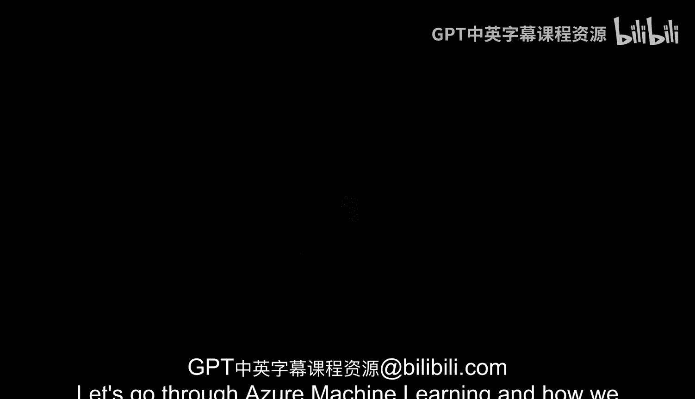

# 大型语言模型实践：1：引言与Azure机器学习概述

在本节课中，我们将学习如何在Azure机器学习平台，特别是Azure机器学习工作室中，使用和操作大型语言模型。我们将从了解GPU资源开始，到实际部署模型并使用其推理API，为您提供一个完整的入门指引。

## 🎯 课程目标概述

我们将首先探索Azure机器学习平台及其对大型语言模型的支持。接着，我们会深入了解一个关键前提：GPU配额与可用性。最后，我们将动手实践，学习如何部署一个模型并通过HTTP API与之交互。

## 💻 探索Azure机器学习工作室

上一节我们介绍了本课程的整体目标，本节中我们来看看我们的主要操作环境：Azure机器学习。

我们将使用Azure机器学习，特别是其集成开发环境Azure机器学习工作室，来开展大型语言模型的相关工作。这个平台提供了管理模型生命周期所需的工具和界面。

## ⚙️ GPU配额与可用性

理解了操作平台后，一个实际且关键的步骤是确保我们有足够的计算资源。本节我们将重点关注GPU资源。

部署大型语言模型时，大多数情况（并非全部）都需要大量的GPU算力。因此，了解Azure平台，特别是Azure机器学习工作室中GPU配额的管理规则和可用性，对于我们后续成功部署模型至关重要。

## 🚀 模型部署与推理API使用

在确保资源就绪后，我们就可以进入核心的模型部署环节了。本节我们将实际操作并观察一个模型的部署过程。

我们将看到在Azure机器学习工作室中部署一个模型的具体步骤。部署完成后，我们会学习如何使用其推理API。

我们将通过HTTP API与已部署的模型进行交互。以下是使用该API的典型流程：

1.  向模型端点发送HTTP请求。
2.  请求中需包含符合模型要求的输入数据（通常是JSON格式）。
3.  接收模型返回的HTTP响应，其中包含推理结果。

## 🌐 在Azure门户中创建与管理资源

模型部署并运行后，我们需要知道如何管理它。本节我们将在Azure门户中进行实际操作。

我们将在Azure门户中创建必要的云资源。我们会看到如何对部署在Azure机器学习工作室中的模型进行这些管理操作。

## 📚 课程总结

本节课中我们一起学习了在Azure机器学习平台操作大型语言模型的入门知识。我们从平台概述开始，明确了GPU资源的重要性，并逐步完成了从模型部署到通过API进行交互的完整流程，最后还了解了在Azure门户中进行资源管理的基本方法。