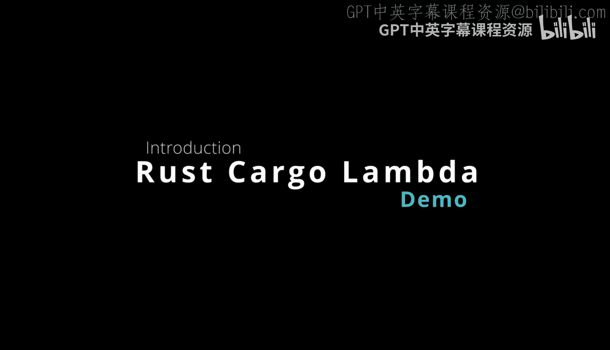
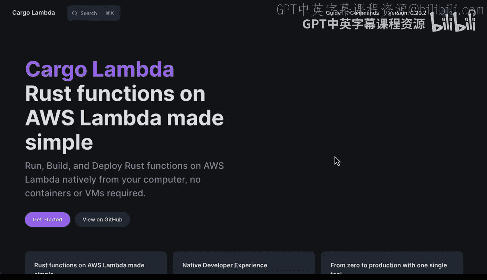

# 大型语言模型实践（高级数据工程、AWS、Databricks和本地LLM）：P100：34_04_02_CargoLambda简介 🚀



在本节课中，我们将要学习 Cargo Lambda，这是一个在无服务器计算领域带来显著进步的工具。我们将了解它如何简化 Rust 语言在 AWS Lambda 上的开发与部署流程。

## 概述

Cargo Lambda 解决了无服务器开发中的一些常见痛点。它最大的优势之一是无需依赖容器或虚拟机，这对于开发环境受限的情况尤其有用。例如，你的计算机可能不支持容器化或虚拟化技术，或者存在资源限制。使用 Cargo Lambda，你可以直接在本地计算机上构建和部署 Lambda 函数。

## Cargo Lambda 的核心优势

上一节我们介绍了 Cargo Lambda 的基本概念，本节中我们来看看它的具体优势。

Cargo Lambda 使得 Rust 函数的开发变得简单，其背后由新兴的系统编程语言 Zig 提供支持。它为开发者提供了原生的开发体验，并且安装过程非常简单。这是笔者最喜欢的与 AWS Lambda 协作的方式之一。

以下是 Cargo Lambda 的主要特点：
*   **无外部依赖**：无需容器或虚拟机。
*   **原生开发体验**：安装和使用都非常简单。
*   **集成 Cargo 生态**：作为 Cargo 的一个子命令，无缝融入 Rust 开发生态。
*   **功能全面**：支持构建、部署、初始化、调用和监控等完整开发流程。

## 安装与初探

现在，让我们开始动手实践。首先需要安装 Cargo Lambda。

安装过程非常简单。在 AWS Cloud9 环境、Linux 或 macOS 上，你只需要执行以下命令：
```bash
brew install cargo-lambda
```
安装完成后，在终端输入 `cargo lambda` 命令，你会看到一个帮助菜单。这表明 Cargo Lambda 已经成功安装，并且它被描述为一个用于在本地处理 AWS Lambda 函数的 CLI 工具。

## 创建新项目

安装好工具后，下一步是创建一个新的 Lambda 项目。

创建一个新项目非常简单。只需执行以下命令：
```bash
cargo lambda new lambda_project
cd lambda_project
```
执行命令后，CLI 会询问几个问题来配置项目，例如是否是一个 HTTP 函数（可由 API Gateway 等触发），或者是否是一个事件驱动的函数。对于初学者，可以直接按回车键使用默认选项。

## 项目结构解析

创建项目后，让我们看一下生成的项目结构。这有助于理解 Cargo Lambda 为我们搭建的基础。

Cargo Lambda 自动生成了 `Cargo.toml` 配置文件，其中已经配置好了必要的运行时依赖。它使用了 `serde` 库进行序列化，`tokio` 用于异步处理，并默认启用了追踪功能。一切都已经准备就绪。

在 `src` 目录下，你可以找到 `main.rs` 文件，这是函数的主文件。文件底部是函数的主要逻辑部分，即 `handler` 函数。你的 Rust Lambda 函数的大部分工作都将在这里发生。它的代码结构清晰，甚至有点像 Python 代码。文件中的 `tokio::main` 部分会调用执行实际工作的函数，这部分是样板代码。

## 本地运行与测试

了解了项目结构后，本节中我们来看看如何在本地运行和测试我们的 Lambda 函数。

在本地运行函数非常简单。首先，使用 `watch` 命令在本地启动一个模拟 Lambda 环境：
```bash
cargo lambda watch
```
然后，要测试一个基本函数，可以使用 `invoke` 命令。这是一个非常方便的功能，让你能在本地完成所有测试。例如：
```bash
cargo lambda invoke
```
在编译并创建二进制文件后，你可以输入测试数据，例如 “hi, hi, hi”。命令会调用本地的 Lambda 函数并返回结果。整个过程非常直观。此外，你也可以模拟来自 API Gateway 的请求进行测试。

## 构建与部署

本地测试通过后，下一步就是将函数部署到 AWS Lambda。

构建用于生产环境的发布版本同样简单：
```bash
cargo lambda build --release
```
这个命令会构建一个可以部署到 AWS Lambda 的版本。

部署到 AWS 只需要一个命令：
```bash
cargo lambda deploy
```
部署成功后，你可以在 AWS 管理控制台的 Lambda 服务中看到一个以你项目名命名的函数（例如 `new_lambda_project`）。你可以直接在 AWS 上调用它，验证部署是否成功。

## 总结



本节课中我们一起学习了 Cargo Lambda 工具。它提供了一种非常直接的方式来开始用 Rust 编写 Lambda 函数。通过消除对容器或虚拟机的依赖，Cargo Lambda 让本地开发变得异常轻松，使得构建、测试和部署 Rust 无服务器函数的流程变得高效而简单。