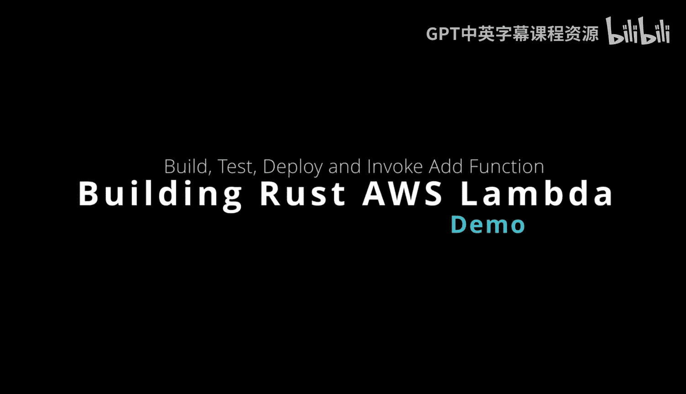
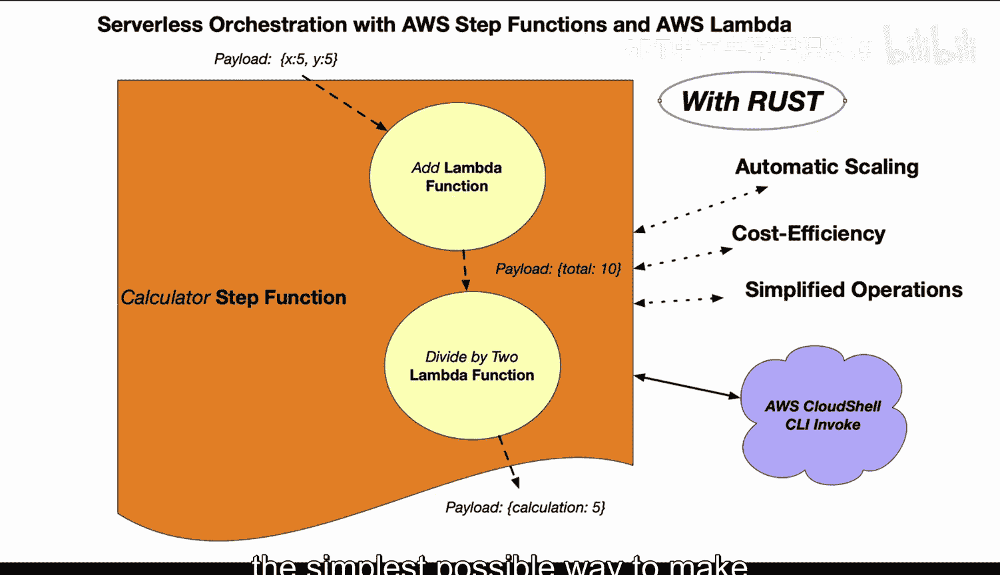
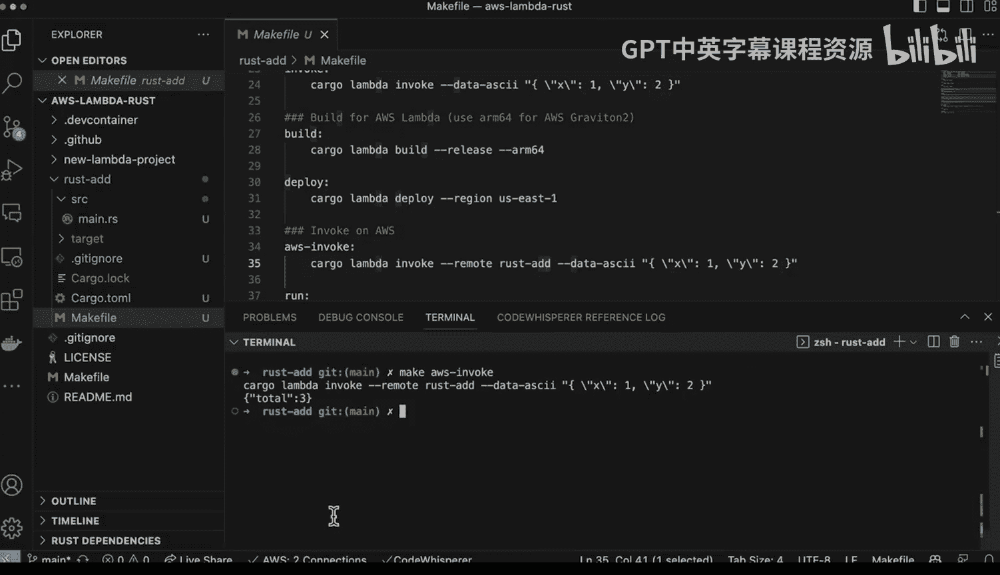
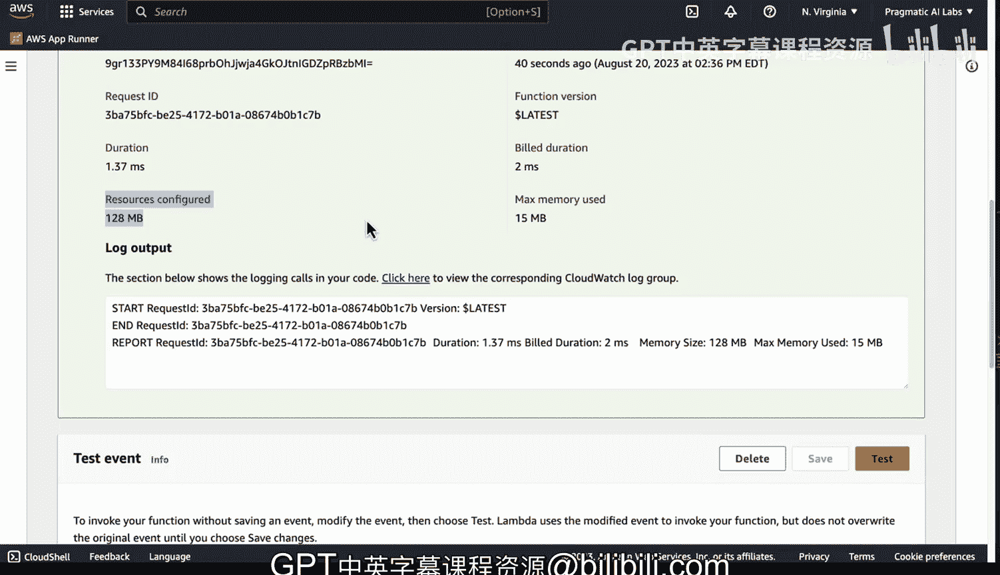

# 大型语言模型实践（高级数据工程、AWS、Databricks和本地LLM）：P101：构建Rust版AWSLambda加法函数 🦀

## 概述

在本节课中，我们将学习如何使用Rust语言构建一个简单的AWS Lambda函数。这个函数将执行加法运算，我们将从创建项目、编写代码、本地测试，一直讲解到部署和远程调用。通过这个简单的例子，你将了解Rust在构建低成本、高性能Lambda函数方面的优势。

## 项目架构与启动

首先，我们来看一个非常简单的Lambda函数系列架构，这些函数最终将被包装在一个Step Function中。但第一步，我将从Rust开始，构建一个名为`add`的函数。

这个函数非常简单：它接收一个`x`和一个`y`，然后返回它们的总和。我喜欢使用Rust的原因是，它可能是实现成本效益最高的Lambda调用的最简单方式。

接下来，让我们看看具体如何操作。这里我们有一个AWS Lambda项目。我能够创建这个项目，是通过使用`cargo-lambda`工具。

如果你输入`cargo lambda`，它会显示一系列选项，包括`new`。这就是我创建的新项目。

现在，让我们看一下项目的树状结构。这里我们主要有一个`main.rs`文件和一个`Cargo.toml`文件。自动生成的`Cargo.toml`文件已经填充了所有必要的依赖项，如序列化、异步、编码、追踪和运行时库，一切都已为你设置好。

## 编写Lambda函数逻辑

为了使用这个Lambda，我在函数内部添加了一些逻辑。让我们逐步了解它的功能。

首先，我添加了一条注释，说明我们正在构建一个简单的加法函数。这特意设计得很简单，以便我能解释Rust Lambda的工作原理。

请注意这里的这个结构体（struct），它将作为传入的请求。它包含`x`和`y`两个字段。我们需要在`derive`部分定义它。

接下来是响应结构体。这是我完成后将要返回的内容。你可以把它看作是`x + y`的结果，即`total`。

最后，在主要的逻辑部分，我们有一个异步的Rust函数。除了`async`关键字外，这个函数本身内容不多。`async`关键字允许我们使用Tokio库进行异步通信。此外，我们还有`function_handler`函数，它将完成所有内部工作。它接收这个Lambda请求，并返回一个结果对象。

目前看来，这与脚本语言没有太大区别。负载（payload）在此函数外部被解析。同样，我们可以看到这个负载来自这里的请求。

然后我们将数字相加。代码是：`let total = x + y;`。

为了返回响应，我们只需创建`let response`并传入那个总和，以便将其返回。然后，我们使用`Ok`包装这个响应。这就是结果响应错误。

现在，剩下的唯一事情就是通过这个主处理器（main handler）将所有东西连接起来。实际上，你不需要做任何事情，它已经为你设置好了。它所要做的就是调用那个`function_handler`函数，该函数同样在这里定义。

## 本地开发与测试

为了使用它，实际上相当简单，如果你掌握一些技巧的话。我喜欢做的事情之一是创建一个Makefile。

我喜欢创建Makefile的原因是我只想快速构建，而不愿过多思考。本地开发的方法之一是使用`cargo lambda watch`命令。

所以我只需输入`make watch`。这样它就会运行，并让我在本地进行任何需要的操作。

现在，如果我点击这个分屏终端，我们可以更多地尝试并实际运行这个调用。

这与Python等脚本语言非常不同，因为你需要使用Docker并进行各种设置。但实际上，由于无需安装第三方工具，一切都已经为你设置好了。

如果我想继续并输入`make invoke`，这将实际调用我的本地二进制文件。看，你可以看到具体发生了什么。我传入了一个`x`和`y`。我们已经知道它能工作，不需要再做更多了。

因此，真正的下一步将是停止这个进程，并实际构建它以进行部署。

## 构建与部署

那么我们如何构建呢？再次使用`cargo lambda build --release`。不过这里有一个技巧：如果你只使用基本的Rust代码，并且相当确定它不会做任何复杂的事情，那么使用ARM 64架构可能是一个很好的选择，因为你的构建成本会更低。

所以我实际上要在这里构建最便宜的Lambda。我只需输入`make build`。好了。

一旦我构建完成，部署就变得微不足道了。我再次使用`cargo lambda deploy`，我甚至可以指定区域（region）。所以我们可以直接说`make deploy`。

由于这个二进制文件非常小，部署再次变得非常简单。

## 远程调用与验证

现在，情况变得更好，因为我甚至可以在不做任何额外操作的情况下远程调用它。

所以我要继续并关闭另一个终端，以获得更多空间。让我们关掉它。

现在看看这个：我只需像之前一样输入`cargo lambda invoke`，但加上`--remote`和函数名，就这样。

所以让我们继续这样做，我们可以直接输入`make aws-invoke`。好了。

现在你可能会想，哦，我们确定这能工作吗？让我们继续检查一下。让我们双重确认我们实际上是在调用已部署的函数。这总是一个好主意。

如果我们往下看，我们可以通过监控来做到这一点。查看最近调用是查看它的更简单方法之一。事实上，我们刚刚看到一个，持续时间是0.89毫秒，相当快。

我们实际上可以看到关于它的一切。我们可以看到持续时间再次小于1毫秒，这简直不可思议。实际上，分配的内存大小也很小。

如果我们想在控制台中实际测试它，这是另一种很好的方法。我们到这里，注意我在这里创建了一个包含`x`和`y`的事件。所以此时我们要做的就是回到测试部分，点击这个按钮，我们可以看到，事实上它也返回了结果。再次强调，持续时间非常非常短，只有1.37毫秒，我们可以看到构建持续时间是2毫秒。

这也是Rust相对于Python等语言的优势之一，Python的默认内存使用量是Rust的70倍，而Rust只使用了15 MB。

我们为什么关心这个？因为你的费用是按内存使用量计算的。所以默认配置允许你以Python不可能达到的成本效益执行许多Rust操作，这确实是使用Rust构建AWS Lambda函数的主要优势之一。

## 总结

本节课中，我们一起学习了如何使用Rust构建和部署一个简单的AWS Lambda加法函数。我们从项目创建开始，详细讲解了函数逻辑的编写、本地测试方法，以及如何利用`cargo-lambda`工具高效地进行构建、部署和远程调用。通过对比，我们看到了Rust在运行速度、内存占用和成本效益方面的显著优势，这使其成为构建高性能、低成本Serverless应用的优秀选择。