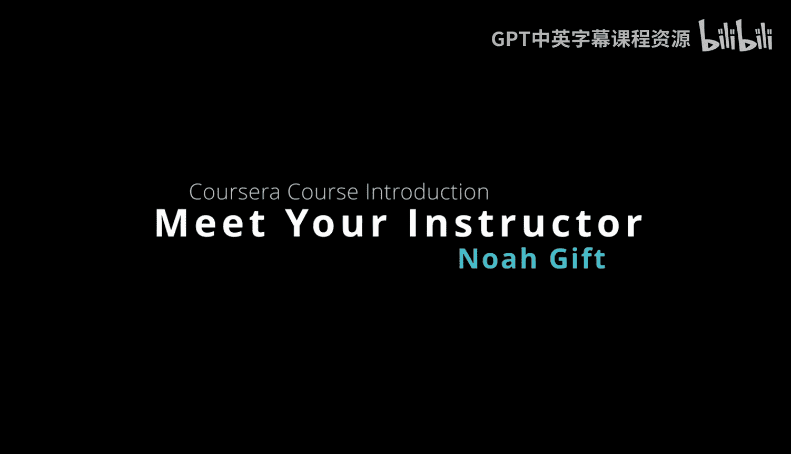

# 大型语言模型实践（高级数据工程、AWS、Databricks和本地LLM）：P102：01_01_01：认识你的课程讲师诺亚·吉夫特 👨‍🏫

在本节课中，我们将认识本课程的讲师诺亚·吉夫特，并了解他的专业背景以及本课程将要涵盖的核心内容。

大家好，我的名字是诺亚·吉夫特，我是本课程的讲师。

本课程将涵盖广泛的内容，从 Databricks 开始，一直到使用本地大型语言模型。

首先介绍我的背景。我是一位多产的 Coursera 讲师，在 Coursera 平台上已经创作了相当于一个硕士学位课程量的内容。目前，我是杜克大学的驻校高管。这意味着我与研究生数据科学项目以及“产品创新人工智能”项目合作，围绕数据工程、云计算、机器学习运维开发内容，并进行现场教学。

我拥有大约30年的行业经验，涉足领域广泛，从游戏、电影到软件即服务，再到生产环境中的机器学习。我将把这些技能全部融入我在 Coursera 平台上创作的内容中。

本课程有很多内容需要学习。让我们立即开始吧。时间宝贵，不容浪费。

---

本节课中我们一起学习了课程讲师诺亚·吉夫特的背景，他是一位经验丰富的行业专家和资深教育者，并了解了本课程将围绕 Databricks、AWS 和本地大型语言模型等主题展开。