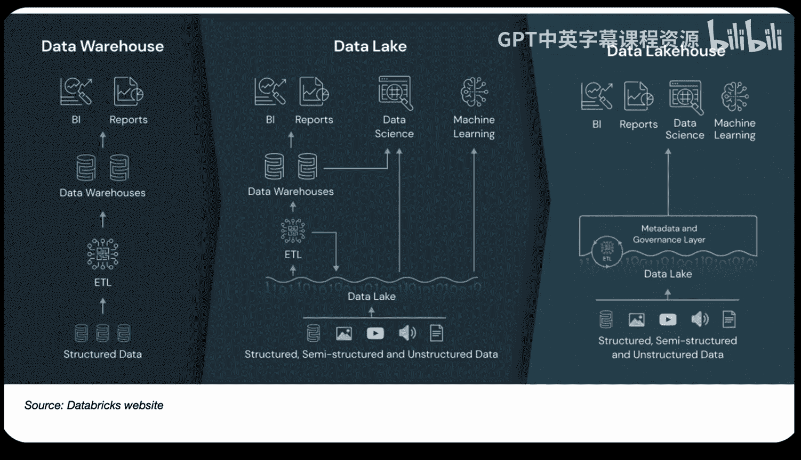

# 大型语言模型实践（高级数据工程、AWS、Databricks和本地LLM）：P103：02_01_03_Databricks湖仓平台简介

在本节课程中，我们将学习数据架构的演进历程，并重点介绍湖仓一体（Lakehouse）这一现代数据平台概念。我们将了解其定义、关键特性、优势以及当前存在的局限性。

首先，让我们回顾数据架构的演进过程。在左侧的图表中，我们可以看到从数据仓库到数据湖，再到湖仓一体的发展路径。这种演进的一个原因是，传统数据仓库在处理大规模非结构化数据时存在局限性。同时，数据湖的某些承诺因缺乏治理而未能完全实现。

上一节我们介绍了数据架构的演进背景，本节中我们来看看湖仓一体的具体定义。

湖仓一体是一种将数据仓库的优势与数据湖相结合的新架构。数据仓库的优势包括生成商业智能报告和执行ETL（提取、转换、加载）流程。湖仓一体在一个新的架构中融合了这些优势。

以下是湖仓一体与数据湖的一些关键区别：
*   在湖仓一体中，除了数据分析，你还可以进行数据科学和机器学习工作。
*   它支持处理结构化、半结构化和非结构化数据。
*   它在提供分析和机器学习所需治理、质量和性能的同时，也保持了架构的灵活性。

湖仓一体也采用了传统云数据仓库的做法，即将存储与计算资源分离。这种分离带来了更好的扩展性和成本效益。

了解了基本定义后，我们来看看湖仓一体的关键属性。

湖仓一体的关键属性包括：
*   支持ACID事务和模式强制，这与传统的SQL解决方案类似。
*   基于低成本对象存储的开放格式。例如在AWS上，这类似于S3服务。
*   统一支持批处理、流处理、SQL查询和机器学习工作负载。
*   具备企业级能力，如安全性、访问控制和审计。这些对于合规性和正确的数据治理至关重要。

接下来，我们总结一下湖仓一体相较于过去系统的优势。

湖仓一体带来的主要益处包括：
*   **架构极大简化**：取代了多个专用系统。
*   **更快的洞察时间**：无需复制或移动数据。
*   **成本节约**：运营单一系统的基础设施。
*   **灵活性高**：支持从商业智能到人工智能的多样化分析。

最后，我们也要客观看待湖仓一体当前的局限性与未来展望。

湖仓一体目前的一些局限性包括：
*   **成熟度早期**：可能在某些方面落后于旧系统。
*   **查询性能**：可能存在优化空间。
*   **非SQL工具支持**：可能需要更好地支持非SQL工具和用户角色。

在选择这些新解决方案时，需要认识到这些差距将随着时间的推移而逐渐缩小，同时湖仓一体所具备的简洁性和成本优势将得以保留。

总而言之，湖仓一体代表了当前数据架构发展的一个演进阶段。这种演进模式在众多技术创新的历史中屡见不鲜。

本节课中我们一起学习了数据架构从数据仓库、数据湖到湖仓一体的演进，明确了湖仓一体的定义、核心特性、主要优势以及现阶段的挑战。理解这一现代数据平台概念，对于后续在Databricks等平台上进行高级数据工程和LLM实践至关重要。