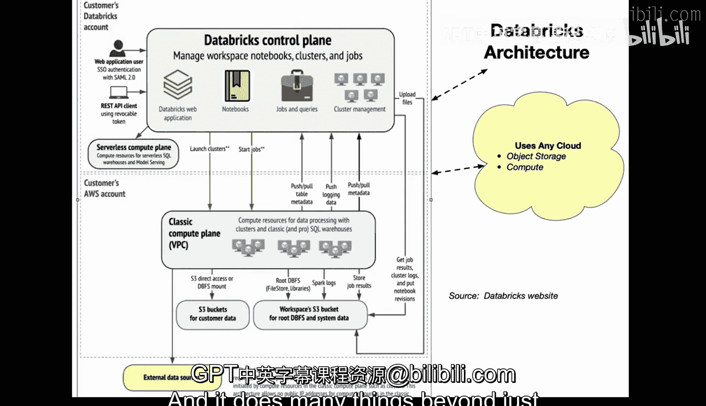

# 大型语言模型实践（高级数据工程、AWS、Databricks和本地LLM）：P104：03_01_04_Databricks架构概述 🏗️

在本节课中，我们将要学习Databricks平台的核心架构。我们将了解其如何通过分离控制平面与计算平面来组织工作，以及这种设计如何为用户带来安全、灵活和高效的数据处理体验。

## 架构总览

上图展示了Databricks架构的总体概览。其核心结构分为**控制平面**和**计算平面**。

## 控制平面与计算平面

上一节我们介绍了架构总览，本节中我们来看看这两个核心组件的具体职责。

*   **控制平面**：由Databricks公司管理和维护。它是所有管理操作发生的地方，负责处理后端服务，例如存储笔记本和作业。
*   **计算平面**：运行在客户的云环境中。它负责处理客户的数据和工作负载。在本例中展示的是AWS，但它也可以是Azure、GCP或其他云平台。

这种职责分离意味着Databricks负责管理控制平面服务以减轻客户负担，而客户则保持对其业务数据的所有权和控制权。这与AWS的**共享责任模型**非常相似，在该模型中，您管理资源的某些部分（如云配置），而AWS管理其他部分（如物理数据中心）。

## 数据流与工作负载

了解了基础架构后，我们来看看数据是如何在其中流动和处理的。

连接器负责集成外部数据以供摄取，随后数据湖将数据安全地存储在客户的云存储中。因此，Databricks架构构建在对象存储和计算资源之上。在AWS的案例中，这对应着S3和EC2。

一个典型的工作流程如下：
1.  数据通过连接器从源端摄取到云存储（如S3）中。
2.  计算资源按需启动，以处理和分析这些数据。
3.  交互式工作负载、笔记本、批处理作业和SQL查询都共享同一架构。
4.  处理结果输出回由客户控制的云存储。

## 架构优势 🎯

基于上述设计，Databricks架构带来了多项关键优势：

以下是Databricks架构的主要优点：
*   **完全托管的控制平面**：降低了运维开销。
*   **客户云账户提供安全与隔离**：保障了数据主权和安全性。
*   **灵活处理多样化数据工作负载**：能够适应不同的数据处理需求。
*   **按使用计算付费**：通过无服务器产品，只为实际使用的计算资源付费。

总而言之，借助Databricks，您可以通过利用其顶层的控制平面来管理复杂的工作流。该控制平面包含Web应用程序、笔记本、作业与查询以及集群管理等功能。它的能力远不止于数据工程，还包括**MLOps（机器学习运维）**等。

本节课中我们一起学习了Databricks的核心架构，包括其控制平面与计算平面分离的设计、典型的数据工作流以及该架构带来的主要优势。理解这些是有效利用Databricks平台进行大规模数据工程和机器学习操作的基础。