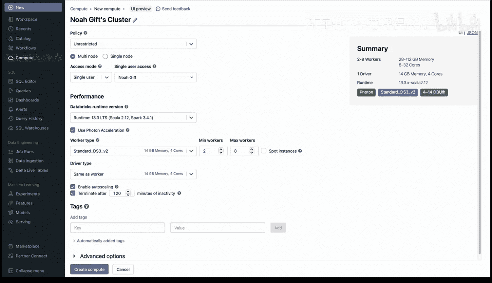
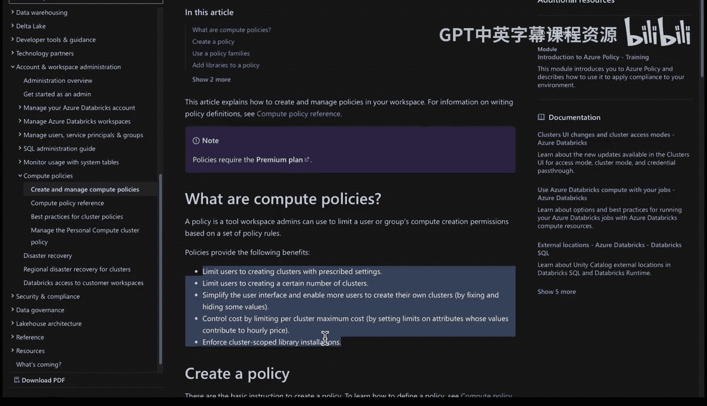
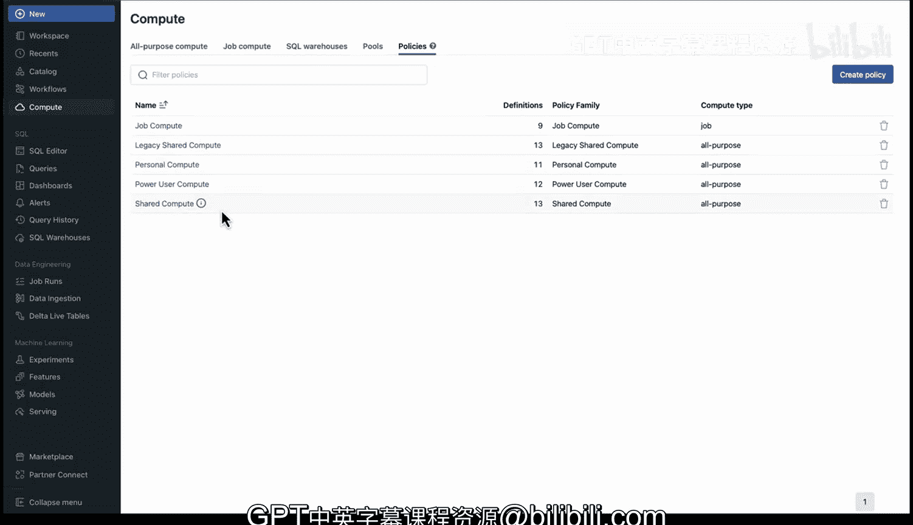

# 大型语言模型实践（高级数据工程、AWS、Databricks和本地LLM）：P105：04_01_05：创建和管理集群

在本节课中，我们将学习如何在Databricks环境中创建和管理计算集群。这是管理Databricks环境的重要任务之一。

## 计算界面概览

让我们首先查看Databricks界面中的“计算”选项卡。你可以看到有几个不同类别的选项。

第一个是“通用计算”。如果你打算使用笔记本或执行基本的数据工程操作，可以从这里开始。例如，图中显示了一个名为“thrifty”的正在运行的集群。要启动它，只需点击并确认即可。

## 创建新集群

如果我们想从头创建一个集群，可以点击“创建计算”并查看选项。

你会看到我使用的是“无限制策略”。这是Databricks的一项新功能，用于控制用户允许执行的操作。策略的目的是限制用户只能使用预设设置创建集群。

例如，如果你的公司GPU资源有限，你可能希望限制单个用户使用的资源量。策略还可以简化界面、控制成本，甚至强制使用特定库，例如只允许组织成员使用你创建的库。这些都是很好的控制选项。

## 访问模式与运行时

回到访问模式，你可以选择“多节点”或“单节点”。Databricks的主要目的是进行集群计算，因此在许多场景下你会需要多节点。单节点主要用于原型设计。切换到单节点模式只会启动一台机器，而多节点模式的优势在于能够扩展Hadoop文件系统的磁盘和计算能力。

接下来看默认运行时。运行时已经为你预先配置好，包含了最新版本的Scala和Spark。你可以根据需求切换版本。对于常规的笔记本操作和SQL查询，你会需要这个标准运行时。如果你想进行高级的机器学习操作，请注意这里有GPU选项，以及不同版本的Spark和预配置的库，这样你就不需要手动选择安装内容。运行时允许你在标准数据工程问题和机器学习之间切换，并自动为你配置正确的库。

## 工作节点与自动缩放

我们还可以看到可以调整最小工作节点数或最大工作节点数。默认设置通常就很好用。但如果你知道需要处理大量数据，可能需要增加最小工作节点数，例如始终使用至少四个工作节点。你也可以将最大工作节点数调得更高。所有这些调整都会根据云服务商提供的资源得到反馈。

我们也可以查看驱动程序类型。在这种情况下，我们希望它与工作节点相同。至于自动缩放，这个按钮允许你使用设置的最小和最大值。

## 终止策略与标签

另一个非常重要的设置是：是否在一段时间后终止集群。对于进行大量临时演示和探索的情况，你通常会希望启用此功能。另一方面，如果你运行的是24/7不间断的集群，则应关闭此功能，因为不活动时终止可能会导致其他用户的操作中断。这完全取决于你的环境需求。

你还可以在这里添加标签。例如，你可以添加一个“团队：数据科学”的标签，以明确标识集群的用途。

## 集群管理与监控

一旦集群开始运行，回到“计算”界面，你可以查看其详细信息。你可以查看与之关联的笔记本和库，安装新库，还可以查看Spark用户界面，了解作业运行情况，查看指标。这在运行作业时非常重要，可以帮助你判断是否需要更大的规模，例如是否需要增加最大节点数，因为CPU、磁盘或内存可能已过载。你可以从这里查看所有信息。因此，计算界面是管理基本计算所需一切的一站式商店。

## 其他计算选项

此外，还有“计算作业”选项，允许你执行和管理临时作业。还有“SQL仓库”，这是另一个选项。我们还有“池”，它允许你逻辑分组以分配计算能力。你也可以将自动缩放池中的集群分配给某个团队或单位。最后，你可以在这里创建自定义策略，例如简化启动流程或限制使用GPU的能力。所有这些都可以直接在Microsoft Azure Databricks、AWS Databricks或你使用Databricks的任何平台界面中进行管理。

## 总结

本节课中，我们一起学习了如何在Databricks中创建和管理计算集群。我们介绍了计算界面的各个部分，包括创建集群时的策略、访问模式、运行时选择、工作节点配置、自动缩放、终止策略和标签管理。我们还了解了如何监控运行中的集群，并简要介绍了其他计算选项，如作业、SQL仓库和池。掌握这些知识对于有效利用Databricks进行数据工程和机器学习任务至关重要。