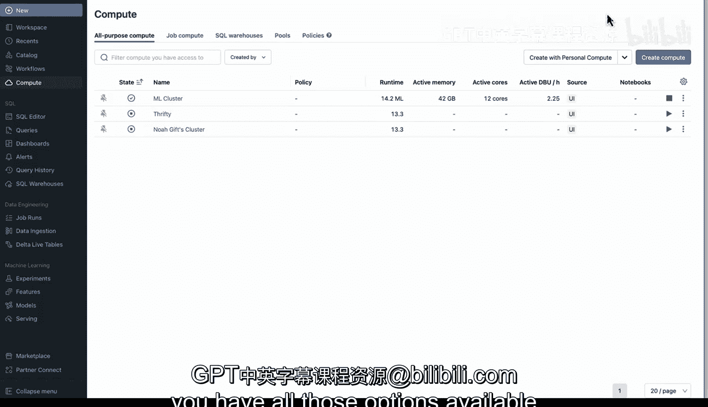

# 大型语言模型实践（高级数据工程、AWS、Databricks和本地LLM）：P106：05_01_06：配置集群运行时 🚀

在本节中，我们将学习如何在Databricks中配置集群运行时。我们将了解不同类型的运行时及其适用场景，并演示如何在界面中进行选择和配置。

## 概述

Databricks提供了多种预配置的集群运行时，这些运行时针对不同的工作负载进行了优化。使用这些托管运行时可以节省大量维护和配置时间，因为Databricks会自动管理底层细节。

## Databricks运行时类型

以下是Databricks提供的主要运行时类型及其用途。

### 标准运行时

标准运行时是通用型运行时，适用于ETL操作、数据管道和批处理任务。例如，如果你有一个需要按特定时间间隔运行的调度作业，通常可以使用标准运行时。它支持多种编程语言，包括Python、R、Scala和SQL。

### Photon运行时

Photon运行时专为处理海量数据和表扫描进行了优化。它非常适合在PB级别数据上进行ETL操作，能提供更高的性能。

### 机器学习运行时

机器学习运行时预装了进行机器学习任务所需的库。它包含了TensorFlow、PyTorch、Keras等深度学习框架，也支持如pandas等常规机器学习API。这使得数据科学家可以立即开始工作，而无需手动安装大量依赖。

### SQL分析运行时

SQL分析运行时针对SQL查询和商业智能用例进行了优化。它与标准运行时的主要区别在于，你可以调整语言和库的属性、内存、I/O、CPU、查询引擎以及并发限制等参数。这些细粒度的调整由Databricks管理，用户无需关注底层细节。

## 界面操作演示

上一节我们介绍了各种运行时的概念，本节中我们来看看如何在Databricks界面中进行实际操作。

在Databricks界面中，你可以看到不同运行时集群的运行实例。例如，一个正在运行的ML集群会明确显示使用的是ML运行时，以区别于常规运行时。这种设计的好处是，用户无需自行安装大量库，许多常用工具已经预装完毕。

如果你想创建一个新的计算集群，可以按照以下步骤操作：

1.  导航至创建新计算集群的选项。
2.  在配置过程中，浏览并选择所需的运行时类型，如“标准”、“ML”或“未分类”等。
3.  你还可以切换到SQL运行时或池的选项，这里有多种不同的配置可供选择。

最终，由你决定需要创建多少种不同类型的集群，例如一个用于机器学习的集群、一个用于数据处理的基础集群，以及一个用于SQL分析的集群。所有这些选项都可以在Databricks界面中灵活配置。

## 总结

本节课中我们一起学习了Databricks集群运行时的配置。我们了解了标准、Photon、机器学习和SQL分析这几种主要运行时类型的区别与适用场景，并通过界面演示了如何选择和创建配置了不同运行时的集群。利用这些托管运行时，用户可以高效地开展多样化的工作，而无需在环境维护上花费过多时间。