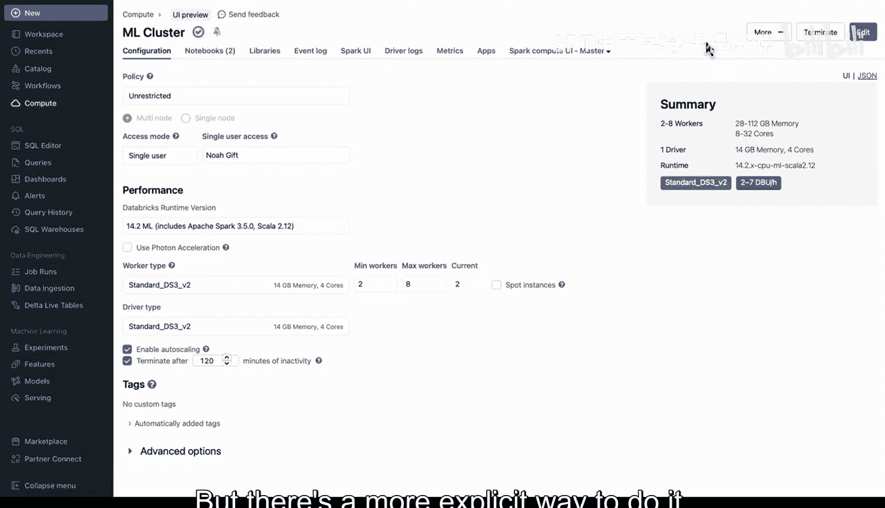
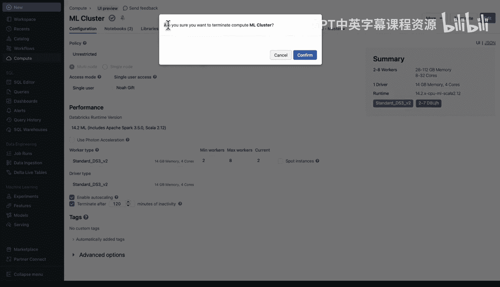
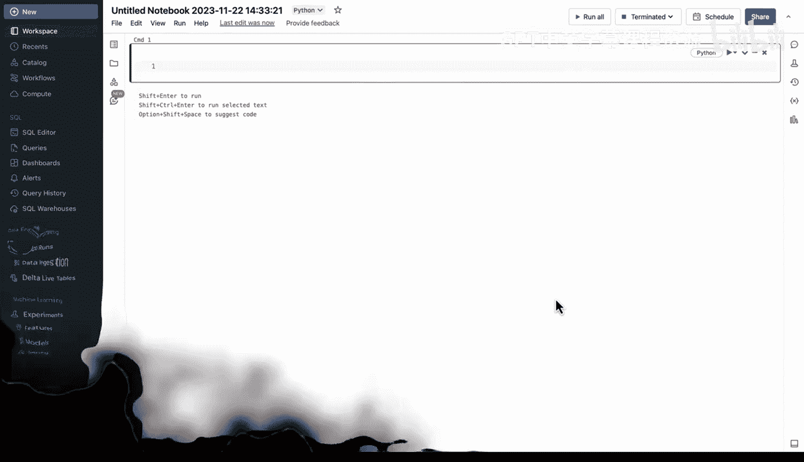

# 大型语言模型实践（高级数据工程、AWS、Databricks和本地LLM）：P107：06_01_07_终止集群

在本节课中，我们将学习如何在Databricks环境中终止一个正在运行的集群。我们将介绍通过集群管理界面和直接从笔记本界面终止集群的两种主要方法，并解释“终止”与“删除”操作的关键区别。

## 通过集群管理界面终止集群

上一节我们介绍了Databricks集群的基本概念，本节中我们来看看如何通过集群管理界面来终止一个集群。

在Databricks界面中，有一个集群已经在运行。可以看到有几个笔记本与此集群相关联。同时，这里也有一个新集群正在启动。如果我想控制这个集群，终止它的方法之一是先选中它。

首先，如果你启用了自动终止功能，即使你什么都不做，集群也会在闲置一段时间后自动停止。例如，你可以看到这里设置了“120分钟后终止”，这意味着当集群处于非活动状态（即你没有进行任何操作）时，它将自动终止。

但是，有一种更明确的手动终止方式。如果你转到这个区域并点击“终止”按钮，系统会询问“你确定要立即终止集群吗？”。这个操作将直接停止集群。

## 其他控制选项与“终止”与“删除”的区别

请注意，界面上还有其他控制选项。如果我们点击这里，你还可以“克隆”这个集群，或者“重启”它。

然而，“删除”操作会永久地移除集群，包括其全部配置信息。因此，“终止”和“删除”的关键区别在于：
*   **终止**：只是**`停止`**集群的运行，其配置被保留，以后可以重新启动。
*   **删除**：是**`永久移除`**集群及其所有配置。

## 从笔记本界面终止集群

除了从集群列表管理，还有其他方式可以终止集群。其中一种更便捷的方法是从笔记本内部进行操作。

现在，让我们转到“新建”选项，然后选择“笔记本”。注意，此时“em”集群已被选中，并且显示为绿色，表示正在运行。

那么，我该如何终止它呢？我可以将鼠标悬停在界面上的“em”集群名称上。这时，你会看到我拥有直接从此界面终止它的能力。这是更便捷的方法之一。

假设你已经完成了一个项目，并且正在笔记本内部，你已经保存了工作，或许还将其提交到了版本控制系统。此时，要停止集群，你只需选择“终止”，然后点击“确认”。系统将开始执行终止流程，你可以在这里看到终止请求已被发出。

## 总结

本节课中我们一起学习了在Databricks中终止集群的两种主要方法：通过集群管理界面手动终止，以及从活动的笔记本界面直接终止。我们明确了“终止”（临时停止，保留配置）与“删除”（永久移除）操作的根本区别。掌握这些操作有助于有效管理计算资源，在完成任务后及时停止集群以控制成本。