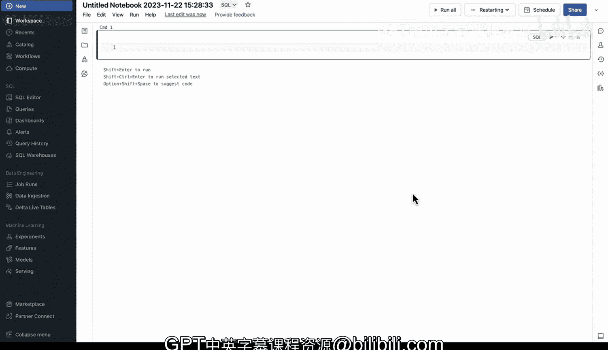

# 大型语言模型实践（高级数据工程、AWS、Databricks和本地LLM）：P108：07_01_08_重启集群 🔄

在本节课中，我们将学习如何在Databricks环境中重启计算集群。当集群出现异常行为、过载或内存不足等问题时，重启是一个有效的解决手段。我们将介绍两种不同的重启方法。

---

## 重启集群的必要性

上一节我们介绍了集群的基本管理。本节中我们来看看如何重启一个集群。有时，计算集群可能表现异常、过载或内存不足。重启操作可以将其置于全新状态，清除内存中的所有遗留问题，从而解决这些故障。

## 方法一：通过集群列表重启

以下是第一种重启方法，通过Databricks工作区的集群管理界面进行操作。

1.  在Databricks工作区中，定位到需要重启的集群（例如，名为“thrifty”的集群）。
2.  点击该集群右侧的菜单按钮。
3.  从弹出的菜单中选择“重启”选项。
4.  确认操作后，集群将进入重启流程。这将使集群重新启动，所有内存状态和运行进程都将刷新。

## 方法二：通过关联的笔记本重启

除了直接从集群列表操作，我们还可以通过与之关联的笔记本来重启集群。这种方法在您正在使用笔记本时可能更加便捷。

以下是具体步骤：

1.  打开一个与目标集群关联的Databricks笔记本。
2.  在笔记本界面中，找到并点击当前所选集群的名称。
3.  在弹出的集群列表中，将鼠标悬停在目标集群上。
4.  点击出现的“重启”按钮。
5.  通过此方式，您可以从笔记本内部直接完成集群重启，效果与方法一完全相同。

---

## 总结

本节课中我们一起学习了在Databricks中重启计算集群的两种方法：通过集群列表直接重启，以及通过关联的笔记本界面重启。这两种方法在您遇到集群性能问题时都非常实用，可以帮助您快速恢复集群的正常工作状态。