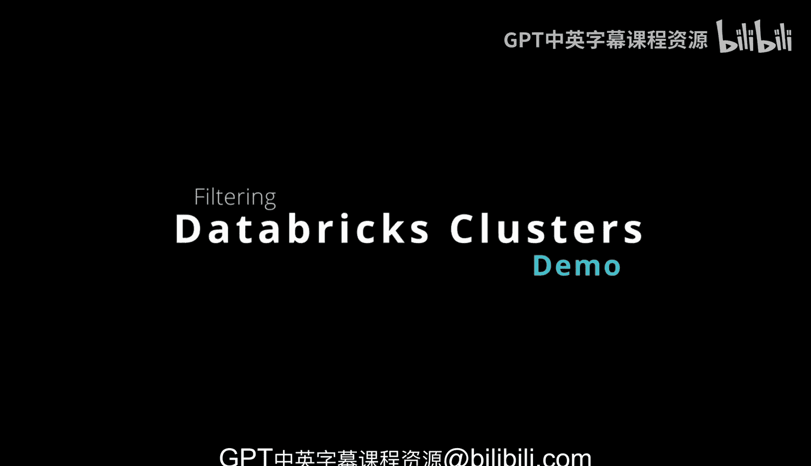
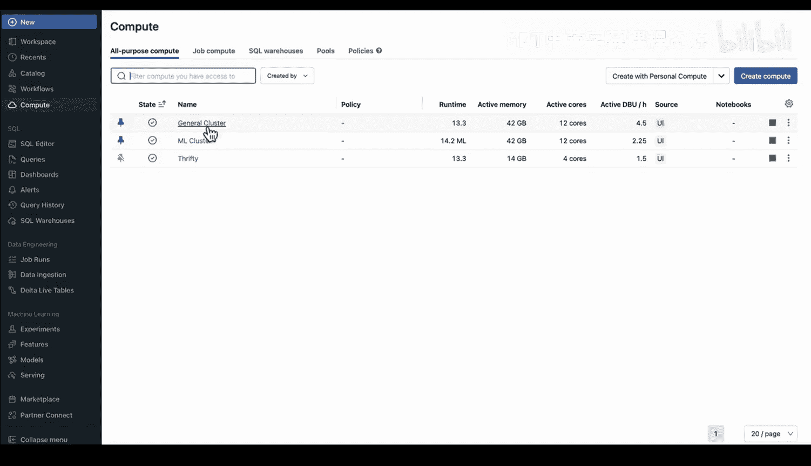

# 大型语言模型实践（高级数据工程、AWS、Databricks和本地LLM）：P109：08_01_09_过滤集群列表

在本节课程中，我们将学习如何在Databricks的计算界面中高效地管理和筛选计算集群。当您管理的集群数量庞大时，快速找到特定集群至关重要。

## 界面概览与按名称筛选

这里是Databricks的计算界面。当前显示了三个不同的集群。如果您需要管理数百个集群，您需要能够根据名称或运行时环境进行快速筛选。

以下是实现快速筛选的方法之一：您可以使用界面上方的“筛选计算资源”菜单。当我们点击该菜单并输入“ML”时，可以立即筛选出名称中包含“ML”的集群。

## 按运行时版本筛选

另一个常见的需求是根据特定的运行时版本来查找集群。例如，您知道某个ML运行时具有特定的版本号。

您可以直接在筛选框中输入版本号，例如“14.2”。或者，对于其他版本，可以输入“13.3”或“13.2”。输入“13.2”可能没有匹配项，但输入“13.3”时，我们看到有两个集群匹配。这个功能让您能够在拥有数百个运行时环境的大型组织中快速切换和定位。

## 收藏常用集群

结合筛选功能，另一个非常有用的操作是“收藏”您常用的集群。

同样，如果您有20、30甚至40个不同的集群，除了使用筛选，您还可以将最常使用的两个集群“置顶”或收藏。这样，默认情况下，您就能始终快速访问这些常用集群。

## 本节总结

本节课中，我们一起学习了在Databricks中管理计算集群的实用技巧。我们介绍了如何通过名称和运行时版本快速筛选集群，以及如何收藏常用集群以提升工作效率。这些功能对于在拥有大量计算资源的环境中高效工作非常有帮助。