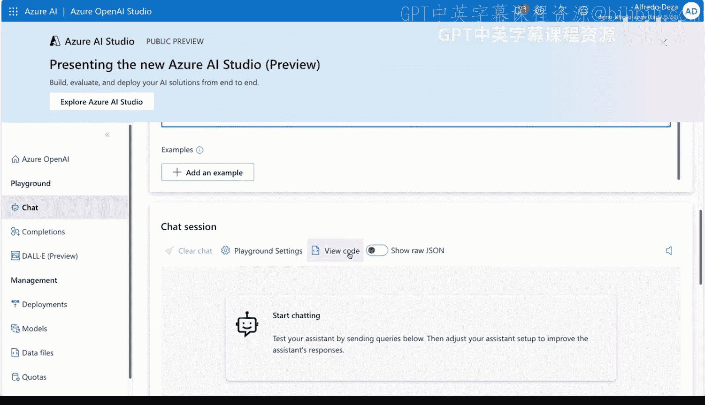
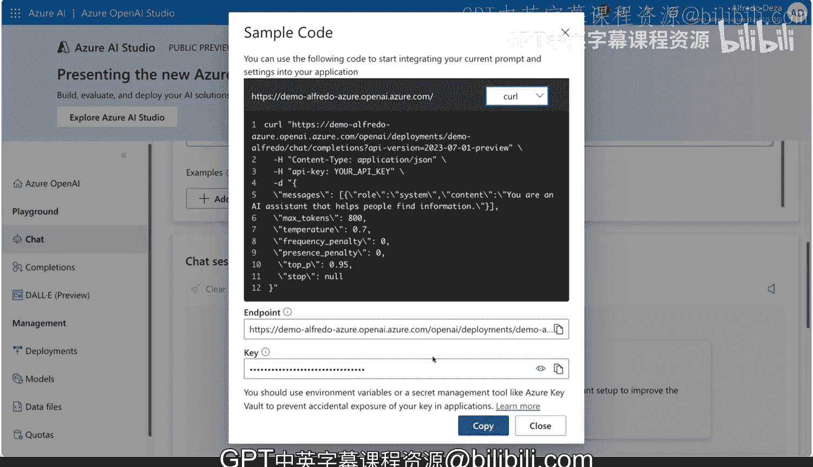

# 大型语言模型实践：P112：使用密钥与端点 🔑


在本节课中，我们将学习如何在Azure OpenAI服务中使用API密钥和端点。我们将了解如何查找和管理这些关键信息，以及根据不同的使用场景（如Python库或直接API调用）如何正确配置它们。

## 概述

上一节我们介绍了Azure OpenAI服务的基本概念。本节中，我们来看看如何获取和使用访问服务所必需的密钥与端点。这是与模型进行编程交互的基础。

## 查找密钥与端点

在Azure门户中管理OpenAI服务资源时，可以找到密钥和端点信息。


以下是具体步骤：

1.  在资源管理页面，可以找到“密钥和终结点”部分。
2.  此处会显示**端点**、**区域位置**以及两个**API密钥**。
3.  密钥管理功能允许你重新生成密钥或复制密钥值。

例如，如果你不小心泄露了密钥，或者像在演示中担心密钥被暴露，可以在此处重新生成。

## 理解端点类型

现在你还可以查看模型部署。密钥和端点信息就在这里。但有一个需要注意的地方：这里显示的端点是通用的，并不特定于我实际部署的模型。

在我的案例中，我已经部署了模型，但它们没有显示在这里。这会在某些情况下显示。让我们看看这些情况是什么。

我将转到Azure AI Studio，进入“模型”部分。这里列出了我已部署的几个模型以及可用的模型。然后我进入“部署”部分，可以看到我已经部署的几个模型。

让我们查看名为 `demo-alfredo` 的部署。它运行的是 `gpt-35-turbo` 模型，这符合我们的需求。

## 在代码中使用端点

现在让我转到Playground。我点击“打开Playground”，选择聊天模式，然后立即打开这个部署。我想向你展示的是，在聊天会话中点击“查看代码”。



当你想使用Python等语言时，你将能够使用 `openai` 库。你会看到需要定义这些变量。这个代码示例需要一个特定版本，这没问题。但我想让你看看这里的 `openai.api_base`。

在这个例子中，它是 `https://devs-demo-alfredo.openai.azure.com/`。这就是我们之前看到的通用端点，它并不具体。那么，Azure如何知道我们指的是哪个具体模型呢？


对于Python这样的场景，你需要这个通用的API基础地址，这没问题。但对于其他情况，你将需要特定的端点。我知道这可能会让人困惑。

关键在于，你看到这里的 `engine` 参数，它写着 `demo-alfredo`。这指的是我们实际部署并命名为 `demo-alfredo` 的模型。如果我给它起了不同的名字，这里也会不同。

令人困惑的是，你既获得了一个端点，也获得了一个密钥（你只获得一个密钥。如果你想使用另一个密钥，可以返回OpenAI服务的上一个仪表板）。但你是否注意到，这里的端点实际上是特定的？

这是因为当你通过不使用OpenAI库的方式与API通信时，你可以使用这个特定端点。如果我们在这里查看cURL命令行示例，你会看到它实际上使用了完整的、特定的API。



这是使用 `https` 的实际端点。对于Python的OpenAI库，它在幕后为你构建了这个地址。你可以在这里看到 `preview1`，然后 `demo-alfredo` 出现在这里。

## 核心要点总结

以下是需要牢记的几点：

*   **密钥管理**：始终在Azure门户中安全地管理你的API密钥，并可以在必要时重新生成。
*   **端点类型**：存在两种端点：
    *   **通用端点**：格式通常为 `https://{your-resource-name}.openai.azure.com/`。当使用OpenAI客户端库（如Python的 `openai` 库）时使用，库会帮你处理具体模型的路径。
    *   **特定模型端点**：格式为 `https://{your-resource-name}.openai.azure.com/openai/deployments/{deployment-name}/...`。当直接调用REST API（如使用cURL、Postman或其他不依赖特定SDK的客户端）时使用。
*   **模型标识**：在代码中，通过 `engine` 或 `deployment_id` 参数来指定你要使用的具体模型部署（例如 `demo-alfredo`）。

## 代码示例对比

**使用Python `openai` 库（通用端点 + 引擎参数）**
```python
import openai

openai.api_type = "azure"
openai.api_base = "https://devs-demo-alfredo.openai.azure.com/"  # 通用端点
openai.api_version = "2023-05-15"
openai.api_key = "YOUR_API_KEY"

response = openai.ChatCompletion.create(
    engine="demo-alfredo",  # 在此指定具体部署
    messages=[...]
)
```

**使用cURL直接调用API（特定模型端点）**
```bash
curl https://devs-demo-alfredo.openai.azure.com/openai/deployments/demo-alfredo/chat/completions?api-version=2023-05-15 \
  -H "api-key: YOUR_API_KEY" \
  -H "Content-Type: application/json" \
  -d '{"messages":[ ... ]}'
```


本节课中，我们一起学习了如何在Azure OpenAI服务中定位和管理API密钥与端点，并理解了通用端点与特定模型端点的区别及其在不同调用方式中的应用。正确配置这些信息是与大型语言模型成功交互的关键第一步。