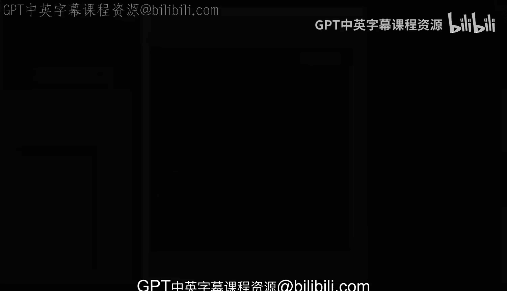
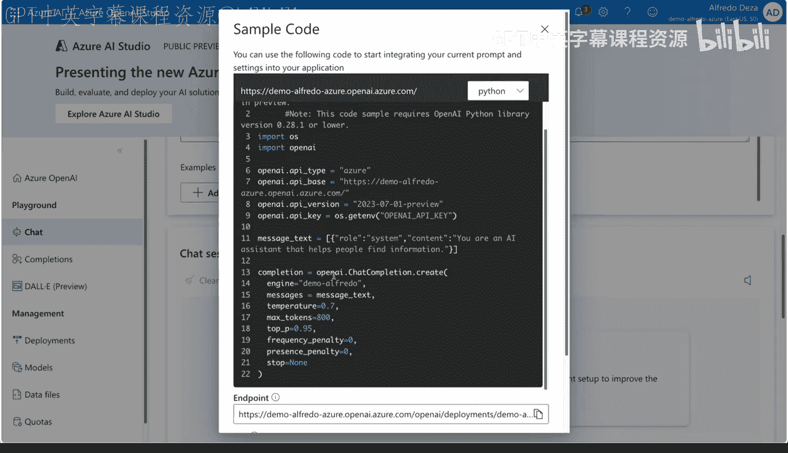
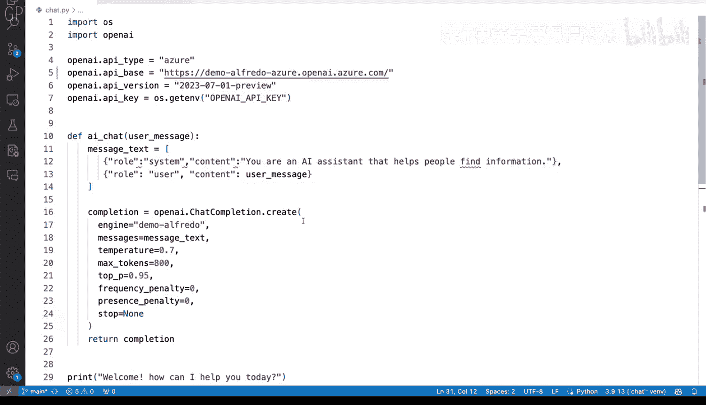

# 大型语言模型实践：第2课：创建简单Python示例 🐍



在本节课中，我们将学习如何使用Python与OpenAI的API进行交互，创建一个简单的聊天机器人示例。我们将从环境设置开始，逐步讲解代码结构，并演示如何运行它。

---

上一节我们介绍了API的基本概念，本节中我们来看看如何用Python代码实现一个简单的交互程序。

我们保留了示例代码，现在开始与它交互，并使用Python。关于Python有几点需要注意。如果你直接复制这里的代码，它可能无法工作。代码示例要求`openai` Python库的版本为0.28.1或更低。因此，你一开始可能会在Python包管理上遇到挑战。如果你从未使用过Python，建议你使用这里提供的`curl`示例，它使用在大多数Unix系统终端（如苹果电脑、Linux电脑或Windows的WSL子系统）中可用的`curl`命令。

不过，让我们看看如何使用Python，并了解其具体操作。我将快速切换到我的文本编辑器，向你展示如何操作。这段代码是自上而下的，没有函数，只是代码。让我们看看我整合到一个脚本中的样子。

好的，这是相同的内容，但有一些区别。这里有一些声明。你可以看到`openai_api_key`是一个环境变量。我确保在打开这个脚本之前已经导出了它，稍后会展示具体做法。


然后，我没有采用自上而下的方式，而是创建了一个非常小的函数，并做了一些小的改动。我将添加一个`user_message`参数，当我传递它时，它会被附加在这里。这是模型与我交互的方式。我会说系统角色是“你是一个帮助人们查找信息的AI助手”，用户角色意味着“嘿，我是一个用户，我要传递一条消息”。然后，我将调用`completion`，它会有这些预先设置好的参数，与我们在Azure门户上看到的代码示例相同。



接下来，我将创建一个无限循环。我会要求用户输入消息，然后将用户消息传递给函数。然后，我会执行这里的操作，即从`completion.choices`中获取第一个选项，再从该选项中获取`message`，最后从该消息中获取`content`。这是因为在Python中，这背后是一个字典结构。我们不会深入Python的细节，只是说明它将如何工作。

好的，这看起来没问题。现在，我想展示另一件事，即`requirements`文件。我将关闭这些文件，你可以看到我已经按照要求安装了`openai==0.28.1`。双等号意味着我固定了这个版本，即精确选择版本0.28.1。

我将切换到我的终端。在终端中，我已经激活了一个虚拟环境。虚拟环境是Python中的一个概念，如果你从未使用过，可以执行类似`python3 -m venv venv`的命令来创建一个，然后使用`source venv/bin/activate`（在Windows上是`venv\Scripts\activate`）来激活它。激活后，你就可以安装依赖项了。在这个例子中，我们将使用`pip`并通过`-r requirements.txt`来安装。

本视频不会详细介绍Python的所有细节，只是快速演示。我已经预先安装好了所有依赖项。现在，我将运行`python chat.py`。

好的，程序启动了：“欢迎，我今天能帮你什么？” 我可以说：“我觉得Python依赖管理有点棘手。”

消息被发送出去，然后收到了回复。很快，我们得到了回复：“Python依赖管理可能具有挑战性，尤其是在处理复杂项目时。一个流行的Python工具是Pip，我们一直在使用它。” 就是这样。

回到聊天程序，我们做了一点修改，使用了`while True`循环，这允许我们保持对话进行，不断添加更多消息并获取更多回复。你可以做类似的事情，或者添加你自己的变体。


---

以下是实现此功能的关键步骤和代码结构：

**1. 环境变量设置**
在运行脚本前，需要设置OpenAI API密钥为环境变量。
```bash
export OPENAI_API_KEY='your-api-key-here'
```

**2. 依赖管理**
创建一个`requirements.txt`文件来固定库版本。
```
openai==0.28.1
```

**3. 核心Python脚本**
主要代码逻辑封装在一个函数中，并包含一个交互循环。
```python
import os
import openai

openai.api_key = os.getenv("OPENAI_API_KEY")

def get_completion(user_message):
    messages = [
        {"role": "system", "content": "You are an AI assistant that helps people find information."},
        {"role": "user", "content": user_message}
    ]
    response = openai.ChatCompletion.create(
        model="gpt-3.5-turbo",
        messages=messages,
        temperature=0.7,
        max_tokens=150
    )
    return response.choices[0].message.content

while True:
    user_input = input("You: ")
    if user_input.lower() in ['quit', 'exit']:
        break
    reply = get_completion(user_input)
    print(f"Assistant: {reply}")
```

---

本节课中我们一起学习了如何用Python创建一个简单的OpenAI API交互程序。我们涵盖了从设置环境变量、管理依赖到编写核心交互代码的完整流程。关键点包括使用特定版本的`openai`库、通过环境变量管理密钥、构建消息列表以及处理API响应。通过这个基础示例，你可以进一步扩展功能，构建更复杂的应用。



