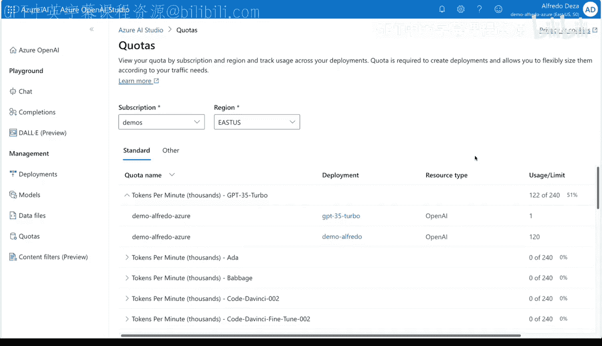

# 大型语言模型实践：第2章第4节：审查用量与配额 📊

在本节课中，我们将学习如何在Azure OpenAI服务中查看和管理你的模型使用量与配额。这对于监控成本、了解资源消耗以及规划后续使用至关重要。

上一节我们介绍了如何部署和调用模型，本节中我们来看看如何监控其使用情况。

我已经与Azure OpenAI服务进行了一些交互，部署了一个模型并使用了它。现在，我将去查看配额。配额选项就在“管理”栏目下，点击它并等待加载。

加载完成后，页面会显示我的部署具体使用了多少资源。我们等待它加载完毕。

加载已经完成。这里显示的是每分钟的令牌使用量（以千为单位），对应的是我实际部署的`gpt-35-turbo`模型。

目前，我的使用量是122，而总限额是240。这意味着在刚才简短的交互中，我已经使用了总限额的51%。这就是查看配额的方法。

你还可以看到这里列出了其他几项，因为我确实可以部署很多不同的模型。我将滚动到顶部，看看具体有哪些信息。

以下是配额页面的主要组成部分：
*   **按部署分离**：我的使用量是按不同部署分开显示的。
*   **使用量限制**：这里显示了我有一个部署的使用量是122，另一个是120，它们共同构成了我这个模型的总使用量。

对于同一个模型（本例中是`gpt-35-turbo`），你可以创建多个部署。目前，我为这个模型创建了两个部署。

需要记住的是，收费是基于使用量，而不一定是基于计算资源。这一点非常巧妙，因为它允许你专注于部署，只需担心API的消耗，而不必过多考虑底层计算资源。这提供了很大的灵活性。

这种机制让你能够密切关注正在使用的资源，并设置一些限制。

本节课中我们一起学习了如何在Azure OpenAI门户中查看配额和使用量报告，理解了按部署监控消耗的方式，以及基于使用量（而非纯计算）的计费模式带来的灵活性。这有助于你有效地管理和控制项目成本。