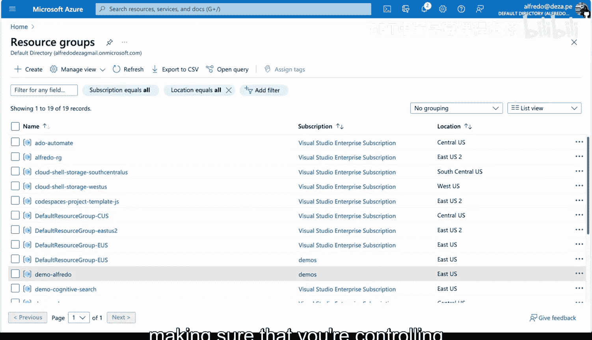

# 大型语言模型实践：第2章第5节：清理Azure资源 🧹

在本节课中，我们将学习如何在Azure平台上清理已使用的资源，特别是与Azure OpenAI服务相关的资源。我们将重点介绍如何使用**资源组**来高效、安全地批量删除资源，以避免产生不必要的费用。

上一节我们介绍了如何部署和使用Azure OpenAI服务。本节中，我们来看看如何在使用完毕后，系统地清理这些云资源。

## 理解资源组的概念

在Azure中，**资源组**是一个核心管理概念。它可以将多个服务于同一目的的资源（例如虚拟机、数据库、AI服务）逻辑上组合在一起。这极大地简化了资源的管理和生命周期操作。

**核心公式**：`资源组 = 逻辑容器（包含多个相关的Azure资源）`

## 清理资源的步骤

以下是清理资源的推荐流程，其核心是通过删除整个资源组来一次性移除所有关联资源。

1.  **定位资源组**
    登录Azure门户，在左侧导航栏中找到并点击“资源组”。页面会列出您账户下所有订阅中的资源组。为了便于管理，建议在创建演示或测试资源时，为资源组使用统一的命名前缀（例如“demo-”）。

2.  **确认资源组内容**
    点击您想要删除的资源组名称（例如“demo-alfredo-azure”）。在资源组详情页面，您可以查看该组内包含的所有资源列表。这有助于在删除前进行最终确认。

3.  **删除资源组**
    在资源组的工具栏或概览页面中，找到并点击“删除资源组”按钮。系统会要求您输入资源组的名称以确认操作。**请注意，此操作不可逆，将永久删除该资源组内的所有服务。**

4.  **等待删除完成**
    确认删除后，Azure会开始异步删除过程。您会看到资源组的状态变为“正在删除”。此过程可能需要一些时间，具体取决于组内资源的数量和类型。删除完成后，所有相关资源及其产生的消费都将停止。

## 总结

本节课中我们一起学习了Azure资源清理的最佳实践。关键要点是：利用**资源组**对相关资源进行逻辑分组，并通过删除整个资源组来高效、彻底地清理所有资源。这种方法避免了逐个查找和删除单个服务的繁琐，并能有效控制云服务成本，特别适用于实验和演示环境的资源管理。请务必在删除前仔细确认资源组内容。