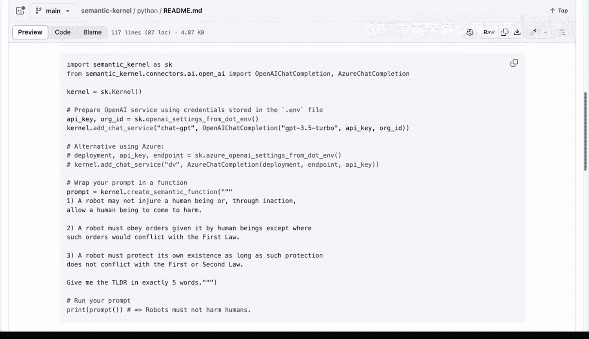

# 大型语言模型实践：1.2：什么是语义内核 🧠

在本节课中，我们将要学习什么是语义内核（Semantic Kernel）。它是一个由微软提供的框架，旨在帮助开发者更灵活、更统一地与不同的大型语言模型进行交互和集成。

## 概述

语义内核是一个多语言支持的框架。它的核心能力在于允许开发者对不同模型（特别是大型语言模型）的交互功能进行**抽象和泛化**。这意味着你可以创建自己的组件和扩展，完全掌控如何与模型交互，而不会被强制绑定到某个特定的模型提供商。

## 语义内核的核心概念

上一节我们介绍了语义内核的基本定义，本节中我们来看看它的核心组成部分。框架的核心被称为 **Kernel**。

在 Kernel 这个核心框架内，你将拥有一个**上下文（Context）**。你可以向其中提供、添加或放入内容，供大型语言模型使用。此外，你将能够创建**函数（Functions）**、进行**规划（Planning）**、实现**记忆召回（Recall Memory）** 等功能。

一个特别重要的概念是**原生函数（Native Function）**。这是一种通过调用本地代码来扩展大型语言模型功能的方式。

## 支持的语言与我们的重点

以下是语义内核框架目前支持的编程语言：
*   C#
*   Python
*   Java

在本课程中，我们将重点使用 **Python** 来创建API和运行示例。我们会确保所有操作都基于 **Azure** 的聊天补全服务，而不是直接使用OpenAI的接口，但两者的差异不会造成理解上的困难。

## 与其他工具的对比

如果觉得语义内核的概念难以掌握，需要知道市场上存在其他类似的选择。其中一个著名的、开源的、并非微软专属的替代品是 **LangChain**。不过，本课程将专注于讲解和使用语义内核。

## 总结

本节课中我们一起学习了语义内核。**本质上，语义内核是一个框架**。它使我们能够以统一的方式与多种大型语言模型（如Azure部署的模型或OpenAI的模型）进行交互，并构建包含自定义函数、规划和记忆等高级功能的应用。接下来，我们将尝试使用它，并探索如何让其与Azure协同工作。