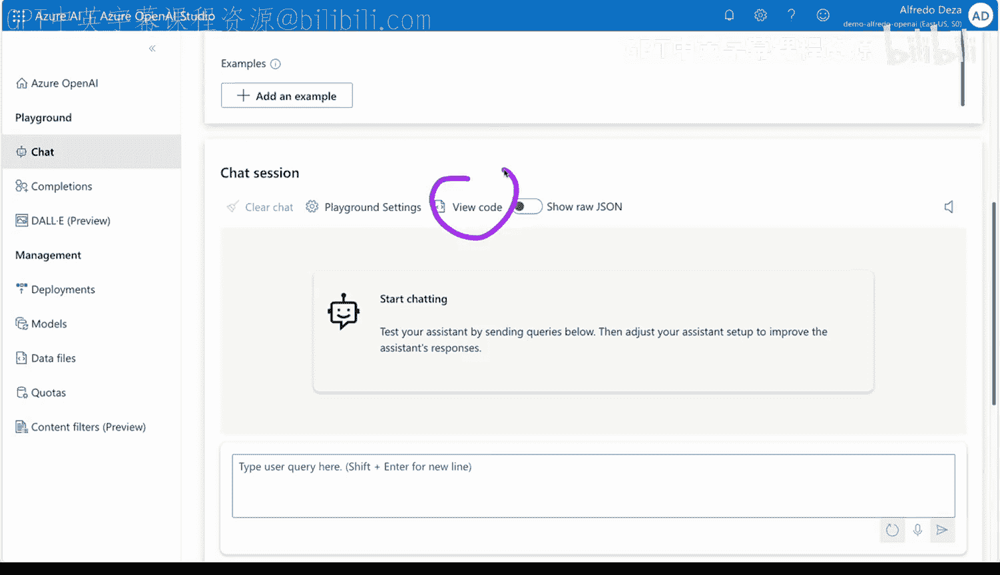
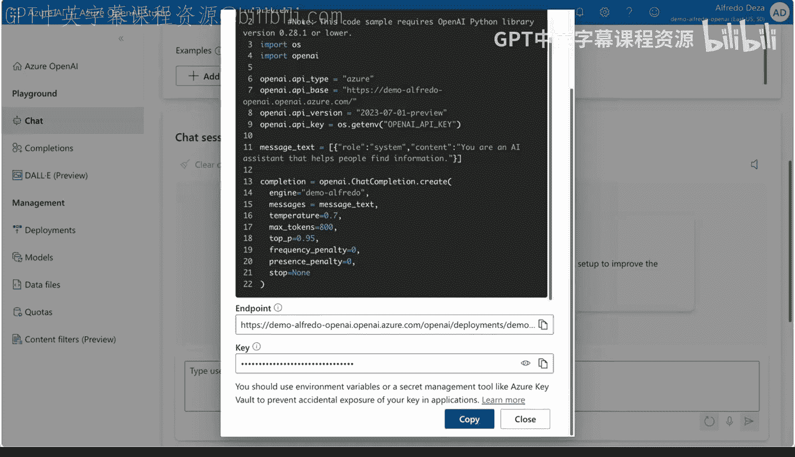
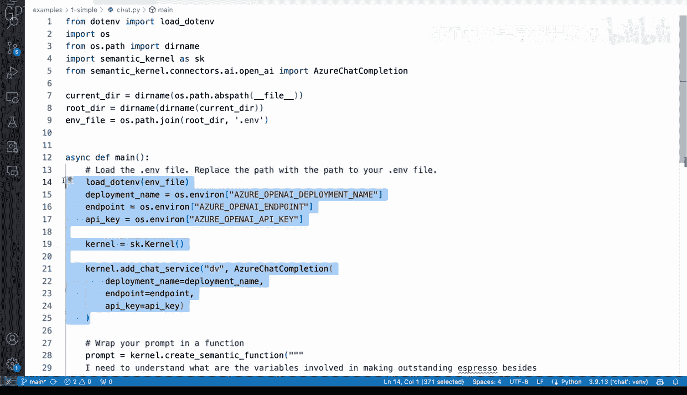
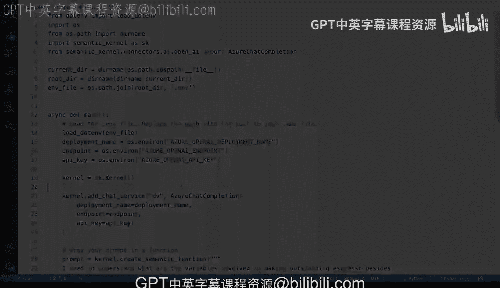

# 大型语言模型实践：第3课：在Azure中使用语义内核 🚀


在本节课中，我们将学习如何通过语义内核框架，在Azure OpenAI服务上构建一个简单的聊天应用。我们将从获取必要的Azure配置信息开始，逐步完成代码的编写与执行。

## 概述

语义内核是一个用于构建AI应用的框架。要让它与Azure OpenAI服务协同工作，我们需要从Azure门户获取特定的配置信息，并在代码中进行正确设置。本节教程将引导你完成这一过程。

## 从Azure门户获取配置

上一节我们介绍了语义内核的基本概念，本节中我们来看看如何从Azure门户获取必要的连接信息。



首先，我们需要登录Azure OpenAI服务门户，查看已部署的模型。

1.  在Azure门户中，找到并点击你的部署。本示例中使用的是名为 `demodallfredo` 的部署。
2.  点击部署名称，进入详情页。这一步非常重要，错误的配置会导致后续步骤失败。
3.  在详情页中，打开“Playground”界面。
4.  在Playground中向下滚动，直到找到“代码”示例部分。我们需要从这里获取两个关键信息：**端点**和**密钥**。

关于端点地址，需要注意语义内核的调用方式可能造成混淆。在代码示例中，你可能会看到一个完整的URL，例如：
`https://demodallfredo-openai.openai.azure.com/`

然而，语义内核框架在配置时，通常只需要URL的特定部分作为“基础端点”。具体需要哪一部分，我们将在代码中明确。

接下来，复制你的API密钥。这些信息需要被妥善保存，我们将在下一步将其放入代码的配置文件中。

## 设置开发环境与依赖

获取配置信息后，我们现在切换到开发环境来编写代码。你可以使用任何喜欢的编辑器，这里以VS Code为例。

首先，确保安装了正确版本的语义内核库，这对于代码的稳定运行至关重要。你可以通过终端命令查看已安装的版本。



以下是检查版本的命令：
```bash
pip show semantic-kernel
```

确认版本后，我们开始编写主要的聊天应用文件。这个应用将是一个独立的Python脚本。

## 编写聊天应用程序

现在，我们来逐步构建这个聊天应用。核心步骤包括导入库、加载密钥、初始化内核以及执行查询。

首先，我们需要导入必要的模块，其中 `AzureChatCompletion` 是用于连接Azure服务的核心类。

为了避免将敏感的API密钥和端点硬编码在脚本中，我们将它们存储在一个单独的 `.env` 配置文件中。这需要使用 `python-dotenv` 库来读取。

以下是如何在代码中加载配置文件的示例：
```python
from dotenv import load_dotenv
import os

# 加载 .env 文件中的环境变量
load_dotenv()

# 从环境变量中读取配置
api_key = os.getenv("AZURE_OPENAI_API_KEY")
endpoint = os.getenv("AZURE_OPENAI_ENDPOINT")
deployment_name = os.getenv("AZURE_OPENAI_DEPLOYMENT_NAME")
```

配置文件 `.env` 的内容如下所示，请替换为你自己的值：
```
AZURE_OPENAI_API_KEY=你的API密钥
AZURE_OPENAI_ENDPOINT=你的端点URL
AZURE_OPENAI_DEPLOYMENT_NAME=你的部署名称
```

回到主脚本，初始化过程遵循语义内核的规范：
1.  创建一个内核实例。
2.  添加一个基于Azure的聊天完成服务，并传入部署名称、端点和API密钥。
3.  准备用户输入的问题。
4.  调用内核来获取模型的回复。

以下是执行查询的核心代码片段：
```python
import asyncio
from semantic_kernel.connectors.ai.open_ai import AzureChatCompletion
from semantic_kernel import Kernel

async def main():
    # 初始化内核
    kernel = Kernel()
    
    # 添加Azure聊天服务
    chat_service = AzureChatCompletion(
        deployment_name=deployment_name,
        endpoint=endpoint,
        api_key=api_key,
    )
    kernel.add_chat_service("chat_completion", chat_service)
    
    # 定义用户输入
    user_input = "你的问题在这里"
    
    # 调用模型并获取回复
    reply = await kernel.invoke_chat_async(chat_service, user_input)
    print(reply)

# 运行异步主函数
asyncio.run(main())
```

## 运行与测试

代码编写完成后，我们可以在终端中运行它来测试是否一切正常。

使用以下命令运行脚本：
```bash
python chat_app.py
```

如果配置正确，脚本将通过HTTP请求与Azure OpenAI模型交互，并将模型的回答打印到终端。例如，对于关于如何制作出色咖啡的问题，模型可能会返回涉及烘焙、研磨、水温等变量的详细步骤。

## 总结





本节课中我们一起学习了在Azure上使用语义内核框架的完整流程。关键步骤包括：从Azure门户获取端点和密钥、在开发环境中设置依赖、通过配置文件管理敏感信息、初始化语义内核并添加Azure聊天服务，最后执行查询并获取结果。请特别注意端点的配置方式以及密钥的安全管理，这是成功连接服务的基础。