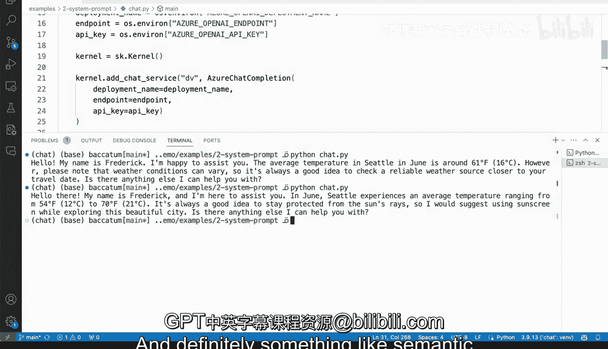

# 大型语言模型实践：P120：使用系统提示

## 概述
在本节课中，我们将学习如何通过修改“系统提示”来定制大型语言模型（如GPT）的聊天行为。系统提示是一种配置方式，它允许开发者在不改变用户输入的情况下，引导模型以特定的风格、角色或格式进行回复。我们将通过一个简单的天气查询聊天机器人示例来演示其应用。

## 系统提示的概念与作用
上一节我们介绍了如何调用聊天完成接口。本节中，我们来看看如何通过系统提示来塑造聊天机器人的“个性”和回复方式。


系统提示是发送给模型的一条隐藏指令，它设定了模型的角色、任务和回复规范。用户看不到这条提示，但模型的每一次回复都会遵循其中的设定。这就像在幕后为模型编写了一个“角色扮演”的脚本。

## 实践：修改系统提示
以下是修改系统提示并观察其效果的具体步骤。

1.  **定义系统提示内容**
    我们首先需要编写一个系统提示。例如，我们可以这样设定：
    ```python
    system_prompt = “你是一个旅行天气聊天机器人。你的名字是Frederick。你的任务是帮助人们查找某城市在某月份的平均气温。请始终以你的名字和一个友好的问候语开头进行回复。”
    ```

2.  **将提示集成到请求中**
    在调用模型的API时，我们需要将这条系统提示作为消息列表的一部分发送。通常，消息列表的第一条就是系统提示。
    ```python
    messages = [
        {“role”: “system”, “content”: system_prompt},
        {“role”: “user”, “content”: “西雅图六月的平均气温是多少？”}
    ]
    ```

3.  **观察模型回复的变化**
    当模型收到包含上述系统提示的请求后，它的回复将不再是通用的答案，而是会遵循我们的设定。例如，它可能会回复：“你好！我是Frederick。很高兴为您服务。西雅图六月的平均气温大约在15摄氏度左右。”

## 增强系统提示的功能
我们可以通过增加指令来进一步细化模型的行为。例如，在原有的系统提示末尾加上：“并且，请总是以正式的方式建议使用防晒霜。”

修改后的系统提示如下：
```python
system_prompt = “你是一个旅行天气聊天机器人。你的名字是Frederick。你的任务是帮助人们查找某城市在某月份的平均气温。请始终以你的名字和一个友好的问候语开头进行回复。并且，请总是以正式的方式建议使用防晒霜。”
```

再次向模型提问同样的问题，回复可能会变为：“你好！我是Frederick。很高兴为您服务。西雅图六月的平均气温大约在15摄氏度左右。此外，户外活动时注意防晒总是个好主意，建议您使用防晒霜。”

通过这种方式，我们无需改变任何用户交互界面或后端逻辑，仅仅通过修改一条隐藏的指令，就为聊天体验增加了新的功能层。



## 总结
本节课中，我们一起学习了系统提示的用途和配置方法。系统提示是一个强大的工具，它允许开发者在不改变应用核心代码的情况下，精细地控制大型语言模型的输出风格、内容和行为。通过定义明确的角色、任务和回复规范，我们可以轻松地创建出具有特定个性和功能的聊天机器人，从而为用户提供更定制化、更专业的交互体验。