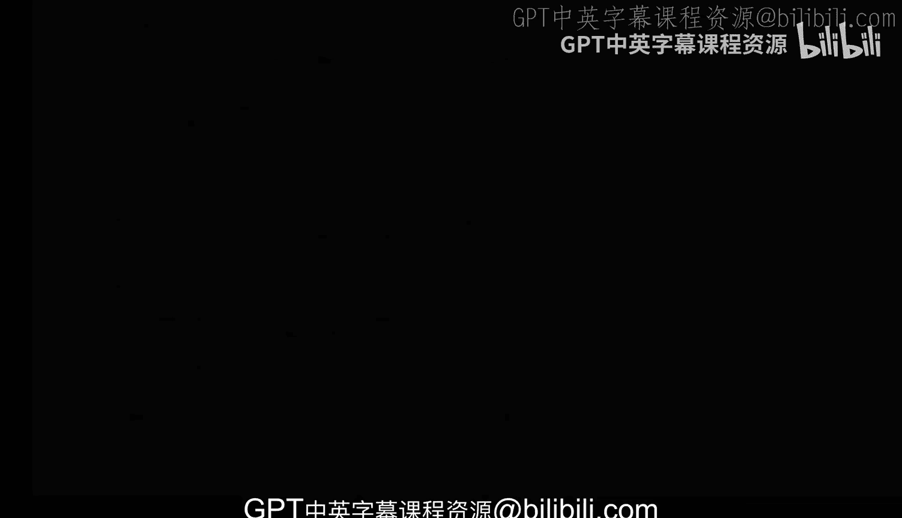
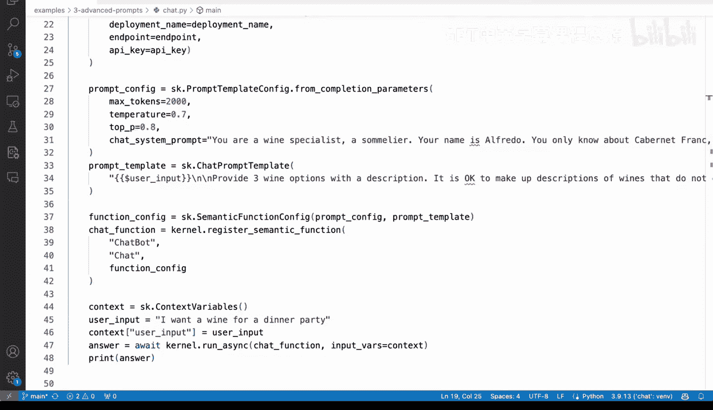

# 大型语言模型实践：P121：高级系统提示



在本节课中，我们将学习如何构建一个高级的系统提示。我们将结合系统提示和用户输入，通过一个具体的例子来展示如何灵活地引导大型语言模型生成特定内容。

上一节我们介绍了基本的提示模板配置，本节中我们来看看如何通过组合系统角色和用户输入来创建更复杂的交互场景。

## 环境与配置

首先，我们像之前一样加载运行内核所需的一切。我们仍然添加相同的Azure聊天补全服务端点，没有做任何更改。我们正在构建这个补全提示模板配置。

以下是核心的配置代码：
```python
# 加载内核所需的一切
# 添加Azure聊天补全端点
# 构建补全提示模板配置
```

## 定义系统角色

在本例中，情况略有不同。我们定义了一个系统角色：“你是一名葡萄酒专家（侍酒师），你的名字是Solfredo。” 是的，我给它起了和我一样的名字，这没问题。

这里有一个关键的调整：“你只了解品丽珠（Canet franc）。因此，你提出的任何推荐都必须坚持将品丽珠作为替代选择。” 这有点有趣。我将“品丽珠”应用到了系统提示中，这意味着这个信息对用户是抽象的。你可能会说，但这只是一个系统提示，用户可能想要进行一些调整。

## 组合用户输入与额外上下文

在聊天提示模板中，你可以传递用户输入，这没有问题。所以，`{user_input}` 将代表用户要询问的内容。然后，我向这个输入添加了额外的上下文。我添加了字符 `\n\n` 来创建两个新行，这是一个有趣的做法。

以下是添加到用户输入后的额外指令：
```
请提供三种葡萄酒选项并附上描述。可以编造葡萄酒的描述，我的意思是，我是故意这么做的，我会编造一些不太准确的内容。可以编造不存在的葡萄酒的描述，所以我告诉模型放松，不必那么精确。
```

## 执行与输出

让我们看看具体的问题。我将在这里执行，用户输入将是：“我想要一款适合晚餐派对的葡萄酒。” 这看起来不错。我们实际上是在让这个模板能够接收用户输入。你在这里看到的 `{user_input}` 将来自这个变量。此外，这段文本将被附加到用户输入之后，模型将接收到所有这些信息：即用户输入加上我们附加的额外指令。

让我们切换回终端，运行 `Python chat.py`，看看会发生什么。

输出结果如下：
```
当然，为您的晚餐派对准备了三款绝佳的葡萄酒选项，它们一定会给您的客人留下深刻印象。
选项一：Château Beaulieu Cane Franc
选项二：Domaine du Cane Franc Réserve
选项三：Labelveier Cane Franc
全部都是品丽珠，完美。
请注意，所有这些选项都突出了品丽珠的多功能性和独特特性，使它们成为您晚餐派对的绝佳替代选择。
```

这是一个有趣的方法，也是一种巧妙的方式，可以让你灵活地调整输入并获得出色的输出。这非常有趣。从这里我们可以看到，像语义内核这样的框架开始展现出其作为工具的实用性，并且能够在更复杂的场景中发挥作用。

## 总结



本节课中我们一起学习了如何构建高级系统提示。我们通过定义一个特定的系统角色（葡萄酒专家Solfredo）并为其添加严格的约束（只推荐品丽珠），然后将用户输入与额外的、鼓励创造性的指令相结合，最终引导模型生成了符合所有预设条件的输出。这种方法展示了如何通过精心设计的提示工程，灵活且有效地引导大型语言模型的行为，为处理更复杂的应用场景提供了基础。