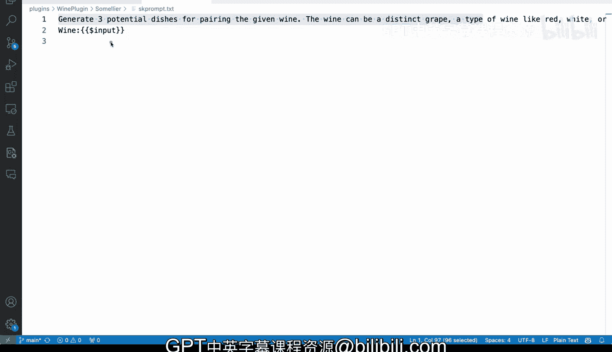

# 大型语言模型实践：P125：48_03_03_定义功能

在本节课中，我们将学习如何在语义内核（Semantic Kernel）中定义功能。我们将了解语义内核中“功能”的概念，它与传统编程中的函数有何不同，并通过一个具体的“葡萄酒插件”示例来演示其结构和配置方法。


---

## 语义内核中的“功能”概念

上一节我们介绍了语义内核的基本概念，本节中我们来看看如何定义功能。首先需要明确，语义内核中的“功能”可能容易引起混淆。它并非特指像Python函数那样的编程函数，而是语义内核的组件。这些组件可以是一个实际的函数，也可以是其他形式，它更像是一组配置的集合，类似于“插件”的概念。我们稍后将看到这些插件如何工作。

对于当前我们要进行的实现，我们不会讨论实际的Python函数（在语义内核中也称为内联函数或原生函数）。这些概念可能在其他框架（如LangChain）中也有类似体现，具体取决于你使用的框架，你需要弄清楚你正在使用哪种能力。

## 代码结构与初始化

以下是定义功能的基本代码结构。我们将逐步解析每一部分。

```python
# 定义文件路径并加载密钥
import os
from dotenv import load_dotenv

load_dotenv()

# 初始化内核
from semantic_kernel import Kernel
kernel = Kernel()

# 加载配置文件并提取OpenAI部署信息
deployment_name = os.getenv("OPENAI_DEPLOYMENT_NAME")
endpoint = os.getenv("OPENAI_ENDPOINT")
api_key = os.getenv("OPENAI_API_KEY")

# 初始化内核聊天服务
from semantic_kernel.connectors.ai.open_ai import OpenAIChatCompletion
kernel.add_chat_service("chat_completion", OpenAIChatCompletion(deployment_name, endpoint, api_key))
```

## 导入与使用插件

接下来，我们将导入一个名为“wine_plugin”的插件。请注意，在语义内核的文档和示例中，“技能”（skill）和“插件”（plugin）这两个术语有时会混用。为了与文档保持一致，此处我们沿用相同的布局。

```python
# 导入插件（技能）
plugins_directory = "./plugins"
wine_plugin = kernel.import_semantic_skill_from_directory(plugins_directory, "wine_plugin")

# 使用插件中的功能
result = wine_plugin["sommelier"]("Merlot")
print(result)
```

代码中，`plugins_directory` 是一个相对路径，指向包含插件的目录。我们调用了插件中名为 `sommelier` 的功能，并传入参数 `"Merlot"`。

## 插件目录结构

现在，让我们查看插件的物理结构，以理解其组织方式。

以下是插件目录的结构示例：
```
plugins/
└── wine_plugin/
    └── sommelier/
        ├── config.json
        └── skprompt.txt
```

可以看到，这与我们代码中的引用路径 `plugins/wine_plugin/sommelier` 完全对应。每个功能（如 `sommelier`）都是一个独立的子目录，其中包含必要的配置文件。

## 配置文件解析

每个功能目录下通常包含两个关键文件：`config.json` 和 `skprompt.txt`。

首先，我们看看 `config.json` 文件的内容：

```json
{
  "schema": 1,
  "type": "completion",
  "description": "Given a type of wine, suggest possible dishes.",
  "completion": {
    "max_tokens": 500,
    "temperature": 0.5,
    "top_p": 1.0,
    "presence_penalty": 0.0,
    "frequency_penalty": 0.0
  },
  "input": {
    "parameters": [
      {
        "name": "input",
        "description": "The type of wine to suggest possible dishes for.",
        "defaultValue": ""
      }
    ]
  }
}
```

这个配置文件定义了功能的类型、描述、与大语言模型交互的参数（如token数量、温度等），以及输入参数的名称和描述。这里的输入参数名为 `input`。

## 提示词模板

接下来，我们查看 `skprompt.txt` 文件，它包含了发送给大语言模型的具体提示词模板。

```
Generate three potential dishes for pairing with the given wine.
The wine can be a distinct grape, a type of wine like red, white, or bubbly.
Sometimes the given wine description might not be super accurate, so make sure you always suggest dishes regardless.

Wine: {{$input}}
```

提示词模板中，`{{$input}}` 是一个变量，它会被替换为调用功能时传入的实际参数值（例如 `"Merlot"`）。这个 `input` 变量名与 `config.json` 中定义的输入参数名 `input` 必须一致。如果你在配置中将参数名改为其他名称，那么提示词模板中的变量名也需要相应更改。

---

## 总结



本节课中我们一起学习了在语义内核中定义功能的方法。我们明确了语义内核的“功能”是类似于插件的配置组件，并逐步解析了其代码结构、插件导入方式、目录组织以及核心的配置文件和提示词模板。通过 `config.json` 和 `skprompt.txt` 两个文件的配合，我们可以灵活地定义和配置一个非原生的语义功能，为后续构建更复杂的应用打下基础。