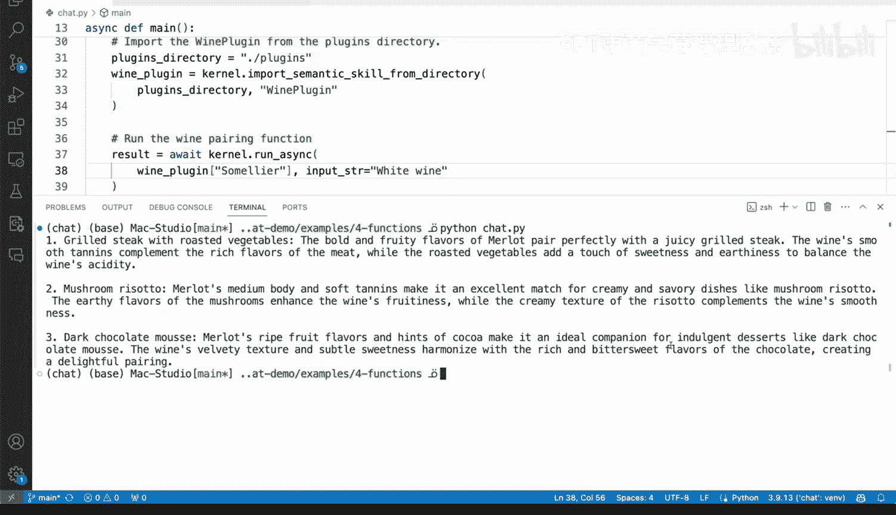

# 大型语言模型实践：P126：在大型语言模型中使用功能


## 概述
在本节课程中，我们将学习如何在Azure平台上部署的实际大型语言模型中使用功能。我们将通过一个具体的例子——为特定葡萄酒推荐搭配菜肴——来演示如何正确配置和调用模型，并指出配置过程中常见的陷阱。

## 配置与准备工作
上一节我们介绍了功能的基本概念，本节中我们来看看如何将其应用于实际的Azure大型语言模型。首先，我们需要确保正确配置了访问模型所需的密钥和参数。

我们定义了三个关键参数来连接Azure OpenAI服务：
*   **部署名称** (`deployment_name`)
*   **终端节点** (`endpoint`)
*   **API密钥** (`api_key`)

正确配置这些参数至关重要。一个常见的错误是混淆它们的顺序或格式，这会导致调用失败。务必使用关键字参数的形式来传递它们，以确保清晰和准确。

以下是使用`openai`库初始化客户端的代码示例：
```python
client = AzureOpenAI(
    api_key=api_key,
    api_version="2023-05-15",
    azure_endpoint=endpoint
)
```

## 执行模型调用
配置好客户端后，我们就可以向模型发送请求了。我们的目标是让模型根据输入的葡萄酒类型，推荐三道可能的搭配菜肴。

我们构建的提示词（`prompt`）结构如下：
*   **指令**：为给定的葡萄酒生成三道潜在的搭配菜肴。
*   **输入**：葡萄酒的类型（例如：Merlot）。

以下是调用模型完成请求的代码：
```python
completion = client.chat.completions.create(
    model=deployment_name,
    messages=[
        {"role": "system", "content": "You are a helpful assistant."},
        {"role": "user", "content": prompt}
    ]
)
```

## 运行示例与调试
现在，让我们在终端中运行脚本。输入葡萄酒类型为“Merlot”。

执行命令：
```
python chat.py
```

如果所有配置正确，模型将返回推荐菜肴，例如：烤肋眼牛排、蘑菇烩饭、黑巧克力慕斯。

然而，配置错误是常见问题。如果参数传递顺序错误或格式不对（例如，误将API密钥当作URL），你会收到类似“URL parsing”的错误提示。这时，需要返回并仔细检查`deployment_name`、`endpoint`和`api_key`这三个参数的赋值是否正确。

## 尝试不同输入
调试成功后，我们可以轻松更改输入来获取不同的推荐。例如，将输入从“Merlot”改为“white wine”。

再次运行脚本，模型将返回适合白葡萄酒的菜肴推荐，例如：烤柠檬香草鸡、扇贝意大利面、卡普里沙拉。

这个过程展示了模型的灵活性，但也再次强调了初始配置准确性的重要。



## 总结
本节课中我们一起学习了在Azure大型语言模型中调用功能的具体步骤。核心在于正确配置连接参数并使用关键字参数来避免混淆。我们通过一个葡萄酒配餐的实例，演示了从构建提示词、调用模型到处理结果和调试错误的完整流程。记住，仔细检查`deployment_name`、`endpoint`和`api_key`是成功调用的关键。