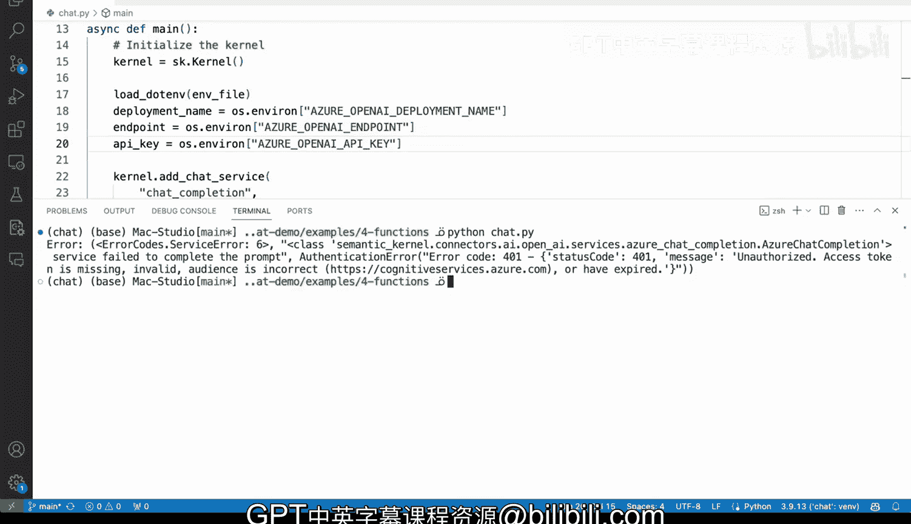

# 大型语言模型实践：P127：处理错误 🔧

在本节中，我们将学习如何识别和处理在使用Azure与语义内核（Semantic Kernel）时可能遇到的一些常见错误。理解这些错误信息对于调试和确保应用程序正常运行至关重要。

## 概述

我们已经初步了解了在使用Azure和语义内核工作时可能遇到的一些问题。本节将专门介绍几种你可能遇到的错误类型。这些错误常常出人意料，是开发过程中的痛点。我们将快速浏览几种常见情况，帮助你更好地应对。

## 部署名称错误

首先，我们从部署名称开始。我将故意使用一个不正确的部署名称。这是最容易犯的错误之一，请务必亲自尝试，因为你的环境情况也可能发生变化。

以下是部署名称错误时的处理步骤：

1.  运行包含错误部署名称的Python文件。
2.  系统通常会返回一个`404`错误，这表示“未找到”。
3.  错误信息会明确指出“部署未找到”，并提示“此资源的API部署不存在”。

需要记住的是，在Azure中，如果你刚完成部署且时间少于五分钟，有时也可能收到相同的错误。虽然这令人沮丧，但至少错误信息指明了原因。因此，如果刚刚创建了部署，请至少等待五分钟再尝试。

现在，让我们修正这个错误，使其正常工作。

## 终端点（Endpoint）错误

接下来，我们看看终端点错误。你可能收到提示，指出这不是一个有效的URL。例如，如果输入为空，你会收到验证错误：“输入应为有效的URL，输入为空”。

让我们尝试一个错误的URL，例如 `https://example.do.co`，然后保存并运行代码。

我们可能会在异常中看到一个比较刻意的错误，例如“未找到错误”（`404`）。这个错误信息可能不够清晰，它不会明确告诉你问题出在终端点上。因此，请务必确保终端点指向你环境中实际存在的有效地址。

现在，让我们修正终端点，填入正确的值。

## API密钥错误

最后，我们来处理API密钥错误。首先，尝试将API密钥设置为`None`。

此时，你会收到提示：“请提供API密钥、令牌或令牌提供者”。这个信息虽然没有以非常友好的方式明确指出问题，但你能看到这里传入了`None`。

接着，我们将其改为一个字符串，但使用一个完全无效的API密钥，例如“empty_token”。

运行后，我们会收到“未经授权：访问令牌缺失、无效或受众不正确”的错误。这是一个很好的身份验证错误，明确指出了访问令牌的问题，非常有用。据此，我可以判断这个密钥不正确。

现在，让我们去修正它。

## 总结

在本节课中，我们一起学习了如何处理Azure语义内核中的常见配置错误。你需要确保**部署名称**、**终端点**和**API密钥**这三部分信息都正确无误。通过这样的试错过程，你将能够理解什么是有效的、什么是无效的，并至少对如何尝试修复问题有一个基本的概念。