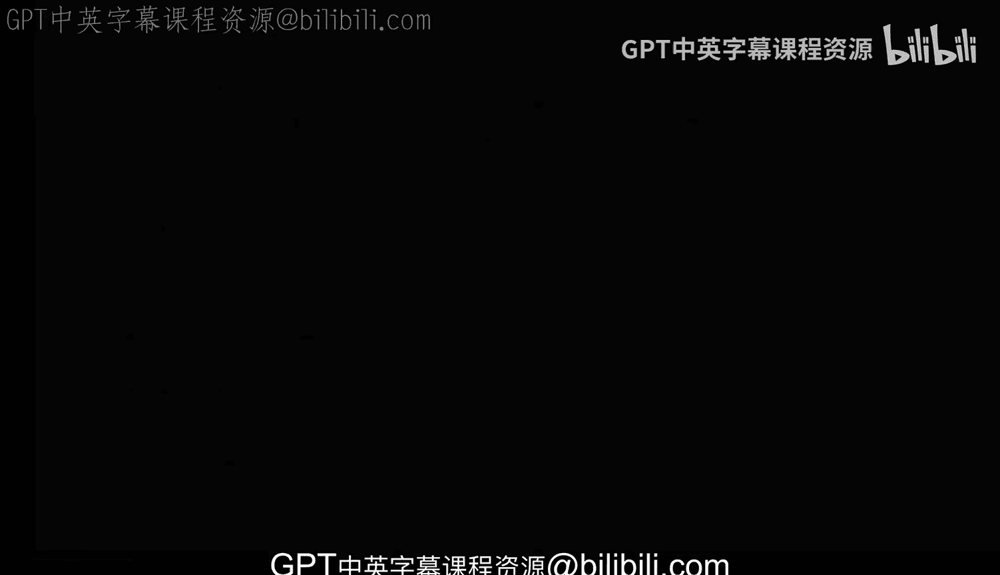
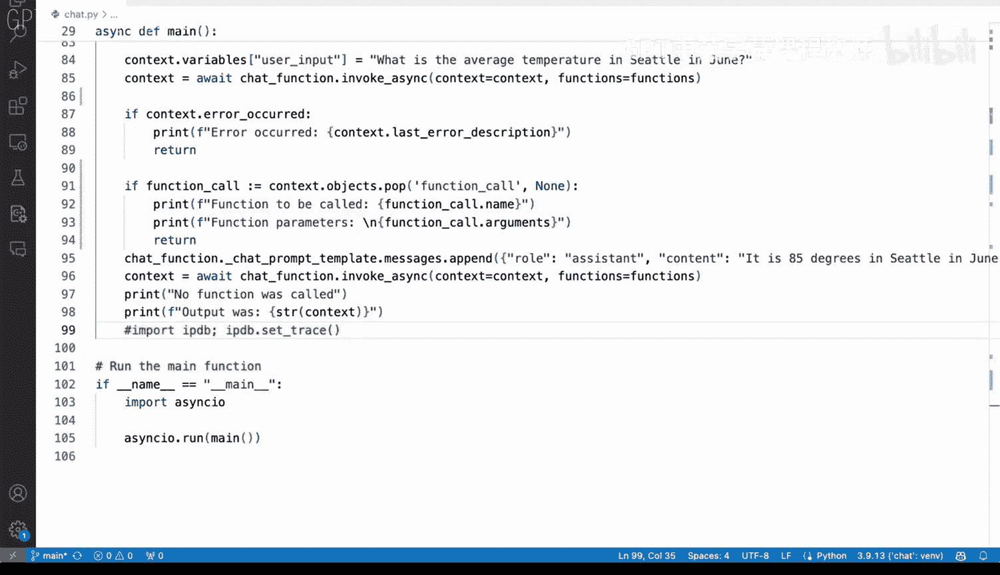

# 大型语言模型实践：03：创建胶合函数



## 概述
在本节课中，我们将学习如何在不依赖复杂配置的情况下，使用Python和Semantic Kernel框架创建一个原生的胶合函数（或插件）。我们将构建一个名为`TravelWeather`的类，它能根据给定的城市和月份返回该月的平均气温。通过这个过程，你将理解如何定义函数、设置参数，并让大型语言模型（LLM）自动调用这个功能。

---

## 构建原生函数类

上一节我们介绍了Semantic Kernel的基本概念，本节中我们来看看如何从零开始构建一个功能类。

我们将创建一个名为`TravelWeather`的类。这个类将使用Semantic Kernel提供的装饰器来定义其功能。以下是构建此类所需的关键导入和结构：

```python
from semantic_kernel.skill_definition import sk_function, sk_function_context_parameter
from semantic_kernel.orchestration.sk_context import SKContext
```

### 类定义与装饰器

我们首先定义一个类，并使用`@sk_function`装饰器来标记核心功能方法。这个装饰器会告诉Semantic Kernel这是一个可供LLM调用的函数。

```python
class TravelWeather:
    @sk_function(
        description="获取指定城市在指定月份的平均气温。",
        name="travel_weather"
    )
    async def get_weather(self, context: SKContext) -> str:
        # 函数逻辑将在这里实现
        pass
```

*   **`description`**： 为LLM提供函数功能的描述。
*   **`name`**： 指定函数的调用名称，最好与类名相关联以便识别。

### 添加上下文参数

为了让LLM知道需要向函数传递哪些信息，我们使用`@sk_function_context_parameter`装饰器来定义参数。

以下是定义“城市”和“月份”两个必需参数的代码：

```python
    @sk_function_context_parameter(
        name="city",
        description="需要获取平均气温的城市。",
        default_value=""
    )
    @sk_function_context_parameter(
        name="month",
        description="需要获取平均气温的月份。",
        default_value=""
    )
    async def get_weather(self, context: SKContext) -> str:
        # 现在可以从context中获取city和month参数
        city = context["city"]
        month = context["month"]
        return f"The average temperature in {city} in {month} is 75 degrees."
```

*   每个装饰器定义一个参数，包括其`name`、`description`和`default_value`。
*   在函数内部，可以通过`context`字典访问这些参数的值。

---

## 配置与调用函数

定义好函数类之后，我们需要在Semantic Kernel中注册并配置它，以便LLM能够发现和调用。

### 导入与技能注册

首先，我们导入必要的模块并创建Semantic Kernel实例。

```python
import semantic_kernel as sk
from semantic_kernel.connectors.ai.open_ai import AzureChatCompletion

kernel = sk.Kernel()
# 配置Azure OpenAI服务
kernel.add_chat_service(
    "chat_completion",
    AzureChatCompletion(
        deployment_name="your_deployment_name",
        endpoint="your_endpoint",
        api_key="your_api_key",
        api_version="2023-07-01-preview"  # 此示例需要此特定版本
    )
)
```

接下来，我们导入之前定义的`TravelWeather`类，并将其作为一个“技能”注册到内核中。

```python
from your_module import TravelWeather

travel_weather_skill = kernel.import_skill(
    TravelWeather(),
    skill_name="TravelWeather"  # 技能名称
)
```

### 配置聊天提示模板

为了让LLM知道在对话中如何使用这个技能，我们需要设置一个系统提示词。

```python
prompt_template_config = sk.PromptTemplateConfig(
    description="一个旅行天气查询助手。",
    default_services=["chat_completion"],
    schema=1,
    type="completion",
    completion=sk.PromptTemplateConfig.CompletionConfig(
        temperature=0.7,
        top_p=0.8,
        max_tokens=2000
    )
)

# 创建包含系统指令的提示模板
system_message = """
你是一个旅行天气聊天机器人，名字叫Frederick。
你的目标是帮助人们查询某个城市在某个月份的平均气温。
"""
prompt_template = sk.PromptTemplate(
    template=system_message + "{{$user_input}}",
    prompt_template_config=prompt_template_config,
    kernel=kernel
)
```

### 调用与执行

以下是调用流程的步骤：

1.  我们创建一个包含用户问题的上下文。
2.  让Semantic Kernel处理这个上下文，决定是否需要调用我们注册的函数。
3.  检查结果，查看是否有函数被调用及其参数。

```python
# 定义用户输入
user_input = "西雅图六月的平均气温是多少？"

# 创建上下文
context = kernel.create_new_context()
context["user_input"] = user_input

# 调用语义函数（这里指我们的提示模板流程）
result = await kernel.run_async(prompt_template, input_vars=context)

# 检查结果中是否包含函数调用
if hasattr(result, 'function_call') and result.function_call:
    print(f"将要调用的函数: {result.function_call.name}")
    print(f"函数参数: {result.function_call.arguments}")
else:
    # 如果没有函数调用，直接输出LLM的回复
    print(result.result)
```

在这个示例中，LLM会分析用户输入“西雅图六月的平均气温是多少？”，识别出意图，并决定调用`travel_weather`函数，同时自动提取出`city="Seattle"`和`month="June"`作为参数。

---

## 调试与注意事项

创建胶合函数涉及多个组件协同工作，调试可能具有挑战性。在开发过程中，你可以使用Python的调试工具（如`pdb.set_trace()`）来深入检查`context`对象的内容、函数调用流程以及参数传递是否正确。

核心在于确保：
1.  函数装饰器的`name`和`description`清晰准确。
2.  上下文参数的定义与函数内部获取参数的键名一致。
3.  技能被正确导入到Semantic Kernel中。

---

## 总结

本节课中我们一起学习了如何使用Python和Semantic Kernel创建原生的胶合函数。我们完成了一个`TravelWeather`类的构建，它能够接收城市和月份参数并返回模拟的平均气温。关键步骤包括：
1.  使用`@sk_function`和`@sk_function_context_parameter`装饰器定义函数及其参数。
2.  配置Semantic Kernel并导入自定义技能。
3.  设置系统提示模板来引导LLM的行为。
4.  编写调用逻辑，处理可能发生的函数调用。



通过这种方式，我们可以将自定义的、确定性的代码逻辑（如查询数据库、调用API）无缝地集成到LLM的推理流程中，极大地扩展了AI应用的能力。虽然初始设置涉及多个环节，但一旦理解其模式，就能高效地构建出强大的AI辅助功能。