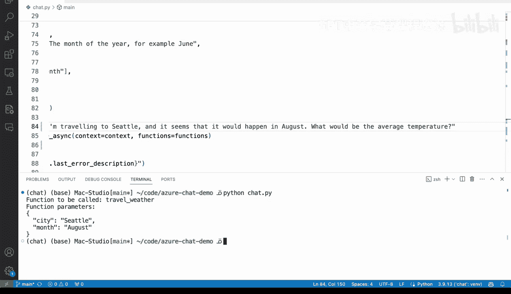

# 大型语言模型实践：P131：使用函数参数

## 概述
在本节课中，我们将学习如何在大型语言模型（LLM）的上下文中使用函数参数。我们将看到LLM如何自动解析用户输入，提取关键信息（如城市和月份），并将其作为参数传递给我们的函数，从而省去了手动解析文本的复杂工作。

## 函数参数的作用
上一节我们介绍了函数调用的基本概念。本节中，我们来看看函数参数如何成为整个流程的“魔法”所在。为了构建一个可工作的函数，我们需要明确它需要哪些信息。

让我们回顾一下顶部的实际类方法，它本身也是一个函数。这个方法需要一个上下文，并且在该上下文中，我们必须提供`city`（城市）和`month`（月份）信息。

考虑一段需要特定信息才能运行的代码。大型语言模型的强大之处在于，它允许我们无需手动解析句子就能获取这些信息。例如，在一句“我想知道西雅图六月的天气”中，我们需要精确地知道城市和月份才能提供有用的回答。手动解析句子来识别这些实体是复杂的，而大型语言模型借助我们提供的描述和配置，可以自动完成这项工作。

因此，当流程进行到这一步时，上下文将包含我们精确理解所需的信息，使我们能够以有意义的方式使用这些参数。

## 探索函数调用
现在，让我们滚动到底部，开始实际操作。我们将重点关注函数调用本身，即函数名和其参数。因为我们设置了自动解析，这些信息已经为我们整理好了。

以下是探索步骤：
1.  打开终端，进入Python环境并导入我们的聊天模块。
2.  调用相关函数，观察返回结果。

运行后，我们可以看到返回的信息：被调用的函数名是`travel_weather`，函数参数是`city: Seattle`和`month: June`。这非常有趣，因为现在我们可以在函数内部使用这些参数了。

我们可以尝试改变输入来验证其鲁棒性。例如，输入“我要去西雅图旅行，平均气温会是多少？”。清除之前的输出并再次运行。

你会发现，即使输入句式改变，我们仍然能精确地获取到城市（Seattle）和月份（June）。这就是解析的“魔法”——它使我们能够稳定地提取关键参数。

## 参数传递与使用
通过这种方式获取到函数参数后，我就能将它们传递给我的函数（实际上是一个类中的方法）。在函数内部，我们将能够访问这些参数，因为它们将成为执行上下文的一部分。

## 总结
本节课中，我们一起学习了大型语言模型如何自动解析用户输入并提取函数参数。我们看到，通过合理的配置，模型可以将自然语言中的关键信息（如城市和月份）准确映射到我们定义的函数参数上。这省去了复杂的手动文本解析工作，使得我们的函数能够稳定、精确地接收所需数据，从而提供有用的响应。