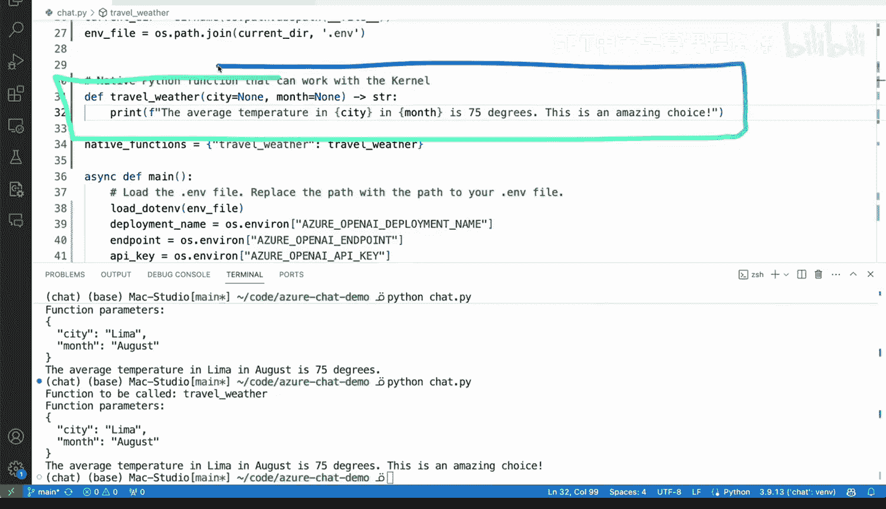

# 大型语言模型实践：P132：使用原生函数 🛠️


在本节课中，我们将学习如何通过定义和使用原生Python函数，来更灵活、更可控地与语言模型内核进行交互。我们将看到如何将模型生成的参数传递给这些函数，并执行自定义逻辑。

---

## 概述

之前我们已经接触过一些控制模型输出的方法。接下来要展示的，是我个人认为能提供更强控制力的最佳方式。如果你希望获得更多控制权，本节内容将非常关键。我们将定义一个原生的Python函数，并通过内核来调用它。

## 定义原生函数

首先，我们定义一个名为 `travel_weather` 的函数。这个函数接收两个参数：`city`（城市）和 `month`（月份）。我们将这两个参数设置为关键字参数，并默认值为 `None`。

以下是函数的定义：

```python
def travel_weather(city=None, month=None):
    # 目前，我们简单地返回一个固定的平均温度
    return "The average temperature is 75 degrees."
```

这个函数目前只是返回一个固定的温度信息。我们还会创建一个辅助字典 `native_functions`，用于将函数名称（字符串）映射到实际的函数对象上。

```python
native_functions = {
    "travel_weather": travel_weather
}
```

我们将不再使用之前演示的其他方法，而是专注于这种原生函数的方式。

## 调用原生函数

现在，我们来看看如何调用这个函数。假设我们从语言模型那里收到了一个JSON格式的字符串，其中包含了要调用的函数名和参数。

例如，我们可能收到这样的数据：
```json
{
  "function": "travel_weather",
  "arguments": "{\"city\": \"Seattle\", \"month\": \"August\"}"
}
```

我们的处理步骤如下：

1.  **解析参数**：首先，我们需要加载这个JSON字符串来获取参数。我们使用 `json.loads()` 方法将字符串解析为Python字典。
    ```python
    import json
    arguments_dict = json.loads(arguments_string)
    ```

2.  **查找并调用函数**：接着，我们从 `native_functions` 字典中根据函数名找到对应的函数对象。然后，使用 `**` 操作符将参数字典作为关键字参数传递给该函数。
    ```python
    function_to_call = native_functions[function_name]
    result = function_to_call(**arguments_dict)
    ```

3.  **执行与输出**：运行上述代码后，函数会被调用。对于输入“Seattle”和“August”，函数将返回“The average temperature is 75 degrees.”。

## 测试与灵活性

我们可以轻松地修改提示词来测试不同的输入。例如，将提示词改为询问秘鲁利马（Lima）八月的天气。

运行后，我们可能得到相同或不同的结果，这完全取决于 `travel_weather` 函数内部的逻辑。目前我们的函数逻辑很简单，总是返回75度。但关键在于，我们现在拥有了完整的控制权。

为了展示这种控制力，我们可以修改函数，使其对特定城市返回定制化的信息：

```python
def travel_weather(city=None, month=None):
    if city == "Lima":
        return "Lima in August is an amazing choice!"
    else:
        return f"The average temperature in {city} during {month} is 75 degrees."
```

保存并再次运行脚本，当查询利马时，我们就会得到“Lima in August is an amazing choice!”这个更具针对性的回复。

## 为何这是更好的选择

我认为这种方法是一个更好的替代方案，原因如下：

*   **完全控制**：它为你提供了对参数处理的完全控制权。
*   **高度灵活**：你可以用更简单、更符合Python风格的方式定义函数，并在其中实现任何你想要的逻辑。
*   **易于扩展**：这种方法为后续集成更复杂的业务逻辑或外部API调用奠定了基础。

在接下来的课程中，我们将探索利用这种方法还能实现哪些更强大的功能。

---

## 总结



本节课中，我们一起学习了如何通过定义和注册原生Python函数来与语言模型内核交互。我们掌握了将模型输出的JSON参数解析并传递给函数的方法，并理解了这种模式在提供控制力和灵活性方面的优势。这为我们构建更复杂、更可靠的AI应用打下了坚实的基础。