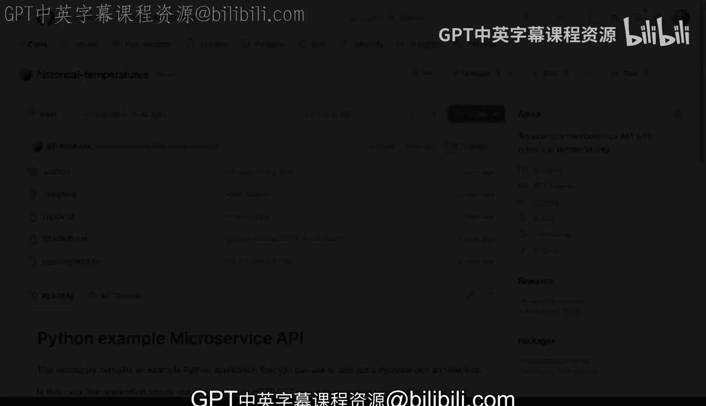
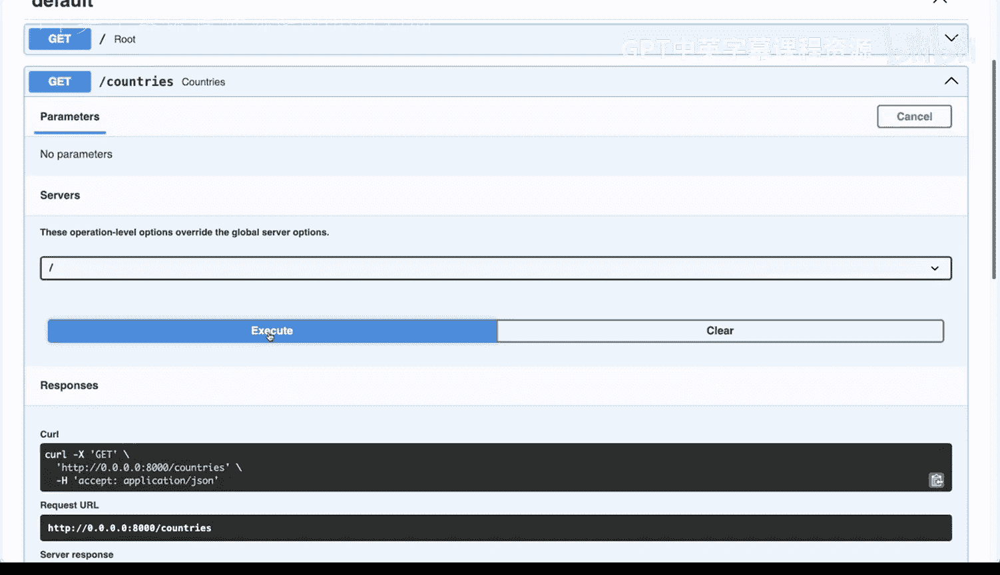
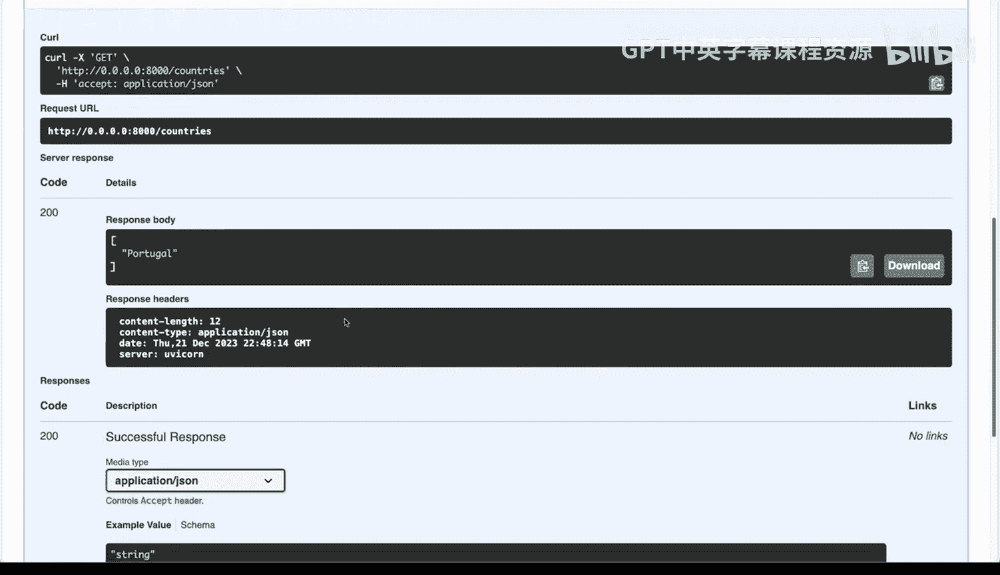
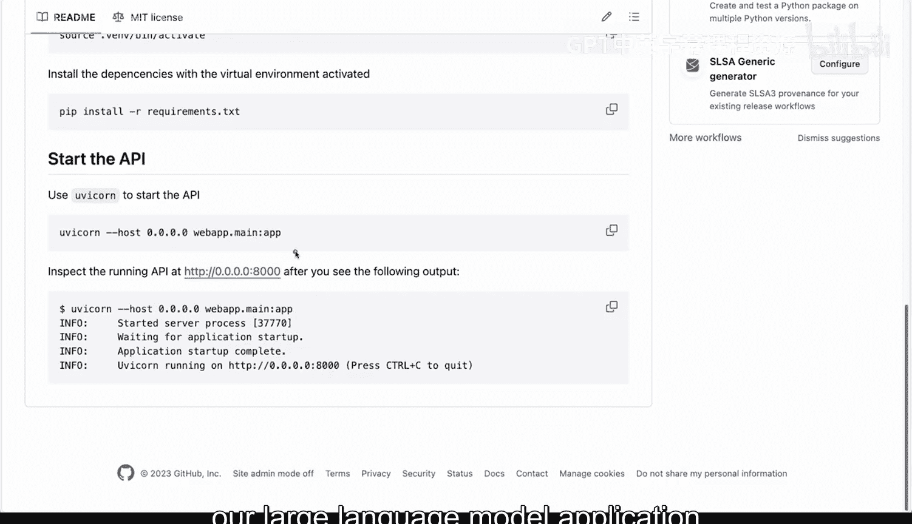

# 大型语言模型实践：P133：函数微服务概述 🧩

在本节课中，我们将学习如何将一个外部微服务集成到大型语言模型（LLM）的整体架构中。我们将通过一个提供历史温度数据的API示例，来理解如何通过连接外部服务来增强LLM的响应能力。

## 微服务架构概述

上一节我们讨论了LLM应用的基本结构，本节中我们来看看如何将外部功能以微服务的形式接入。我们将使用一个具体的API示例，该API旨在提供历史温度数据。在此之前，我们的应用可能只返回简单的字符串，而现在我们将尝试连接一个外部微服务。

这个微服务使用Python编写，但理论上可以使用任何语言，因为其核心是通过HTTP协议进行通信。这意味着它将作为一个HTTP API运行。

## 运行与演示

以下是该微服务的运行方式。具体启动细节并非重点，重要的是它将在本地主机的端口8000上运行。

我已经提前启动了该服务，现在向大家展示它的运行情况。这个API支持一些端点，并且目前仅支持GET请求。

我们可以通过Swagger界面来与这个正在运行的API进行交互。Swagger是一种用于测试和可视化API的工具。

现在，让我们尝试执行一个请求，看看能得到什么结果。

可以看到请求的URL，并且目前它只返回葡萄牙的数据。这很有趣。

让我们取消当前操作，尝试获取某个城市的月平均温度。我们将输入国家“Portugal”和城市“Porto”，然后执行请求。

我们得到了一个成功的200响应，返回的数据包含了高温和低温信息，这非常有用。

回顾这个微服务的代码库和Web应用，我们会发现它结构相当简单，只包含少数几个路由，并不复杂。目前它仅返回葡萄牙的数据。

## 微服务与LLM的关联

这个设计理念的核心在于，通过引入外部API，我们可以增强LLM提示词（prompt）的响应能力，并提供LLM本身可能不具备的数据。在本例中，我们提供的就是仅限于葡萄牙的历史温度数据。

虽然目前这个服务运行在本地主机上，但你完全可以将其部署到生产环境中，以这种方式来增强你的应用程序。

在接下来的课程中，我们将看到如何将这个微服务实际“插入”到我们的大型语言模型应用中，并开始向其发送请求，从而真正实现功能的增强。

## 总结

本节课中，我们一起学习了外部微服务在LLM架构中的角色。我们通过一个历史温度API的实例，了解了如何构建、运行一个简单的HTTP微服务，并探讨了将其集成到LLM应用中以提供额外数据和增强响应能力的可能性。这为扩展LLM的功能边界提供了一种实用方法。