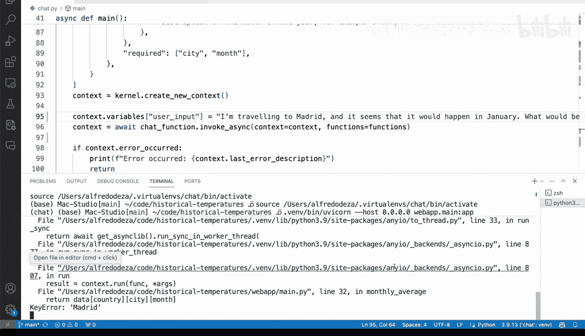
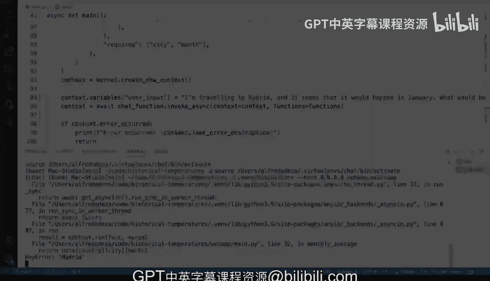

# 大型语言模型实践：第57课：使用外部微服务API 🚀


在本节课中，我们将学习如何通过调用外部微服务API来增强大型语言模型的功能。我们将构建一个旅行天气查询应用，演示如何让LLM与一个独立的天气服务进行交互，以获取动态数据。

---

## 概述

我们将创建一个简单的聊天应用，当用户询问特定城市和月份的天气时，应用会调用一个我们预先搭建好的外部微服务API来获取真实的平均高温数据，而不是返回硬编码的答案。这展示了如何扩展LLM的能力，使其能够处理实时或动态信息。

上一节我们介绍了函数调用的基本概念，本节中我们来看看如何将函数调用与一个真实运行的外部服务结合起来。

## 启动应用与微服务

首先，我回到了我的文本数据环境，并决定启动应用程序。

该应用正在VSCode的终端中本地运行，端口为8000。我这样做是为了让你能直观地看到交互过程。现在，我将向上滚动代码，以便你能看到我是如何增强 `travel_weather` 函数的，使其能够发起微服务请求。

我定义了微服务的URL。在本例中，地址是 `localhost`。如果在生产环境中，你可能不会使用这样的地址，而会采用更健壮的方案，但出于演示目的，这已经足够好。

以下是增强后的函数核心代码：

```python
import requests

def travel_weather(city, month):
    microservice_url = "http://localhost:8000/weather"
    params = {'city': city, 'month': month, 'country': 'Portugal'}
    response = requests.get(microservice_url, params=params)
    result = response.json()
    return f"The average high temperature in {city} in {month} is {result['high']} degrees."
```

## 理解请求过程

现在，我们来剖析一下结果。`requests` 库将执行一个GET请求。请记住，我们的微服务目前只接受GET请求，并且仅支持查询葡萄牙的城市。

我们将传入 `city`（城市）和 `month`（月份）参数。发送请求后，我们将响应加载为JSON格式。最后，我们使用响应中的数据来组织回复语句：“[城市] 在 [月份] 的平均高温是 [结果] 度”。这里的 `result[‘high’]` 是JSON响应的一部分。当我们发起请求时，终端中也会显示这些变量。

这就是整个应用程序和外部微服务的架构。接下来，我们将回到之前的终端进行测试。

在测试之前，我想最后展示一下即将发生的实际请求内容。假设我计划去葡萄牙的波尔图旅行，时间在八月。我想知道那里的平均温度。

## 进行测试查询

我将运行 `python chat.py`。我们将看到 `travel_weather` 函数被调用，并获取到函数参数“Porto”和“August”。

我们得到的回复是：“波尔图在八月的平均高温是77度”。请注意，这个数据不再是硬编码的了。如果我快速向上滚动查看代码，你会发现这个数据来自于微服务的返回结果。

为了确认我的外部微服务确实被调用了，我可以切换到运行微服务的终端标签页，看到那里记录了一次状态码为200的OK请求，查询参数是葡萄牙、波尔图和八月，这证明调用是正确的。

## 尝试更多查询

我可以将其更改为另一个城市，比如里斯本，并尝试不同的月份。

将查询改为：“Lisbon in January”。再次保存并运行提示：`python chat.py`。

查询结果是：“里斯本在一月的平均高温是57度”。如果我切换终端标签页，会看到来自里斯本查询的另一个200状态码响应。

## 错误处理与注意事项

目前这个实现还达不到生产级别，它只是一个示例。在实际应用中，你需要防范各种异常情况。

例如，如果我查询“Madrid”（马德里），程序就会崩溃。因为外部API只接受葡萄牙的城市，而马德里在西班牙。你会在这里看到JSON解码错误。如果查看运行微服务的终端，会发现到处都是错误提示。

这是运行微服务时需要注意的一个问题。但本质上，这个示例很好地展示了如何通过使用微服务来增强和构建大型语言模型应用。

---

## 总结





本节课中我们一起学习了如何为大型语言模型集成外部微服务API。我们构建了一个天气查询功能，演示了如何从硬编码响应过渡到动态数据获取。关键步骤包括定义API端点、使用 `requests` 库发送HTTP GET请求、解析JSON响应以及处理潜在的异常。虽然示例简单，但它清晰地揭示了扩展LLM能力、使其与外部世界连接的核心模式。记住，在生产环境中，需要增加更完善的错误处理、身份验证和日志记录。