# 大型语言模型实践：04：检索增强生成（RAG）架构概述 🧠

在本节课中，我们将学习**检索增强生成**（Retrieval-Augmented Generation， RAG）的基本工作原理和架构流程。这是一种让大型语言模型能够访问并利用外部知识库来生成更准确、更相关回答的技术。

---

## 架构流程概述

上一节我们介绍了RAG的基本概念，本节中我们来看看它的具体工作流程是如何进行的。

整个流程始于用户的查询。通常，查询会直接发送给应用框架，然后由框架调用机器学习模型（如大型语言模型）来生成回答。但在RAG架构中，流程有所不同。


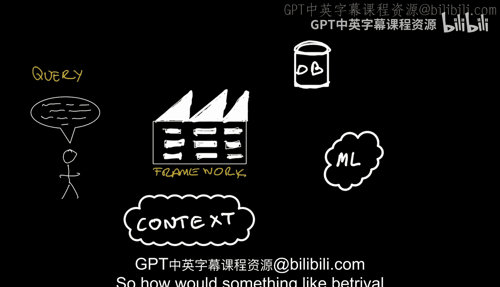

### 第一步：接收查询
用户提出一个问题，例如：“昨天的天气怎么样？” 这个问题首先被发送到应用框架。

### 第二步：查询转向向量数据库
应用框架接收到查询后，并不会直接将其发送给大型语言模型。相反，它会先将查询发送给**向量数据库**进行搜索。

以下是这个过程的伪代码表示：
```python
# 用户查询
user_query = "昨天的天气怎么样？"
# 框架将查询发送至向量数据库进行搜索
search_results = vector_database.search(user_query)
```

### 第三步：数据库检索与返回上下文
向量数据库执行相似性搜索，从存储的文档或数据中找出与查询最相关的信息。例如，它可能检索到“昨天本地气温为25度，晴朗”这条记录。

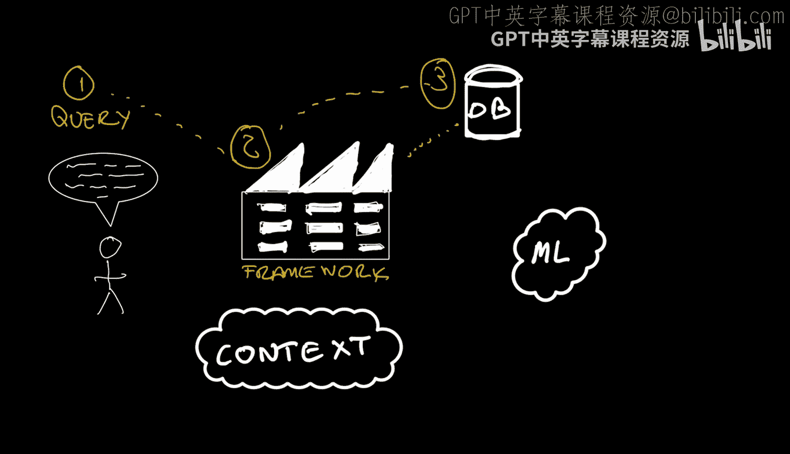

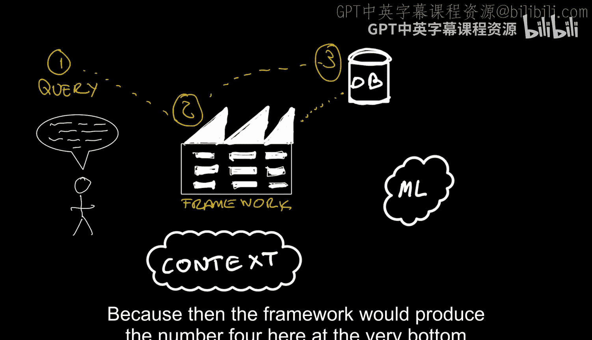

检索到的信息（我们称之为“上下文”）会返回给应用框架，而不是直接给用户。

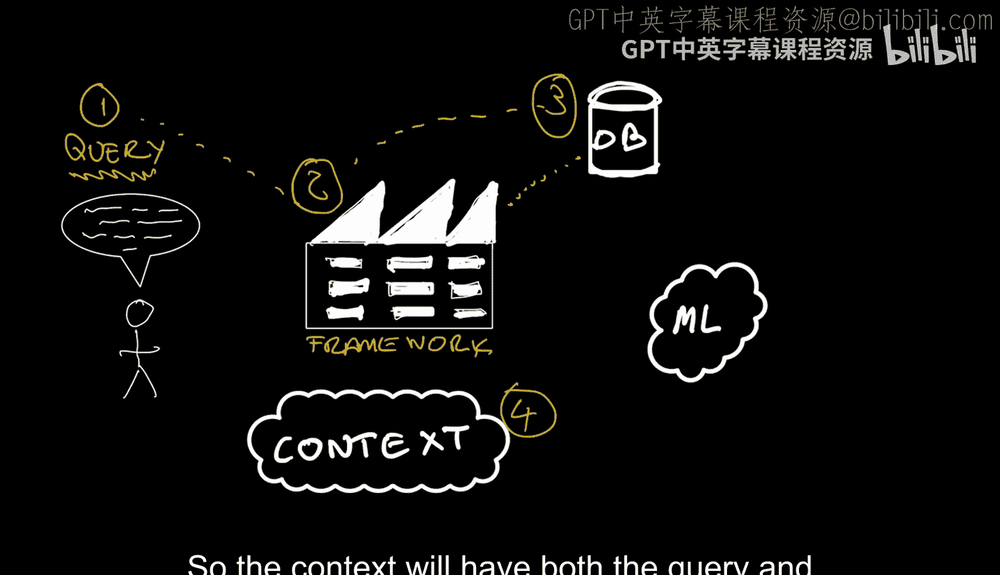

### 第四步：构建增强提示
应用框架现在同时拥有了原始的用户查询和从数据库检索到的相关上下文。它会将这两者组合起来，构建成一个**增强的提示**，准备发送给大型语言模型。

这个过程可以概括为：
**最终提示 = 用户查询 + 检索到的上下文**

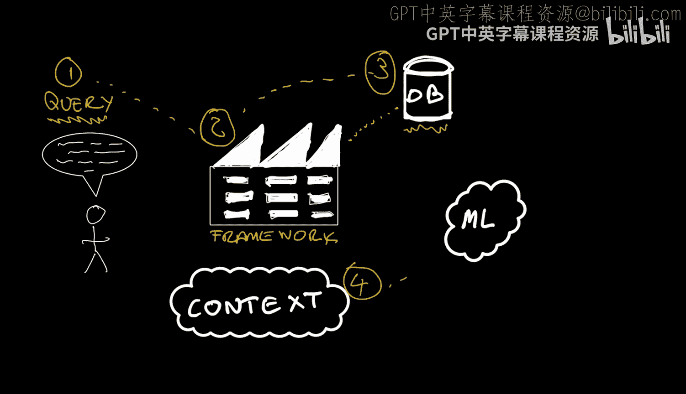

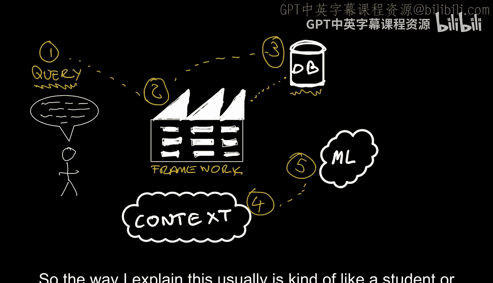

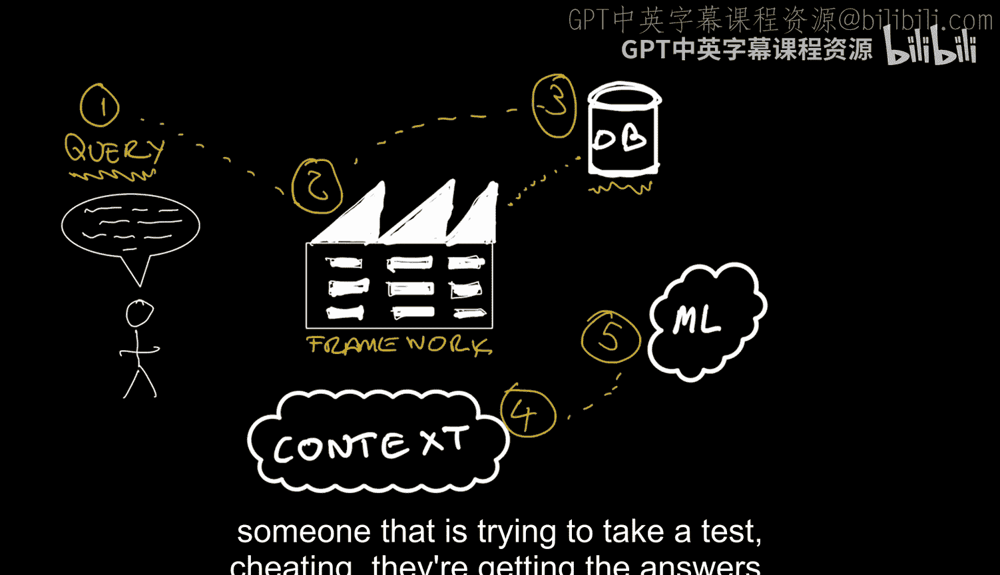

### 第五步：模型生成最终回答
这个包含了“答案线索”的增强提示被发送给大型语言模型。此时，模型的任务不再是凭空生成答案，而是像一个“开卷考试”的学生——它已经拿到了“参考答案”（即检索到的上下文），只需要将这些信息组织成流畅、自然的语言。

模型生成回答后，将其返回给应用框架，框架最终将回答呈现给用户。

---


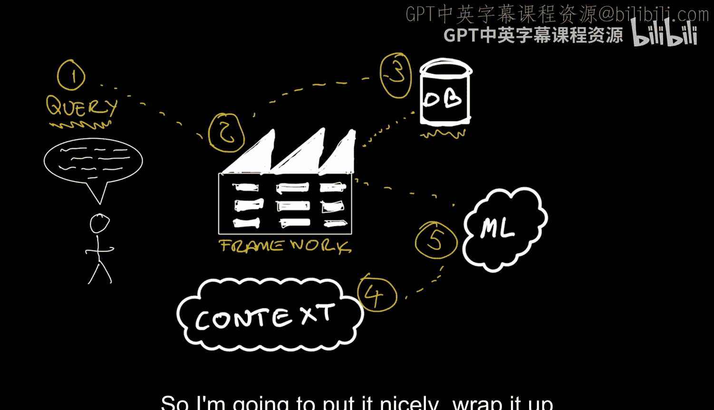

## 流程优势与特点

以下是RAG架构的几个关键优势：

1.  **成本效益**：为大型语言模型重新训练以纳入新知识的成本非常高。而RAG通过向向量数据库添加文档来更新知识，成本低廉且操作简单。
2.  **知识实时性**：模型可以访问训练数据截止日期之后的信息，解决了模型知识陈旧的问题。
3.  **答案准确性**：通过提供确切的参考依据，减少了模型“幻觉”（即编造信息）的可能性。
4.  **可追溯性**：回答基于具体的检索文档，使得答案的来源可追溯，增强了可信度。

---

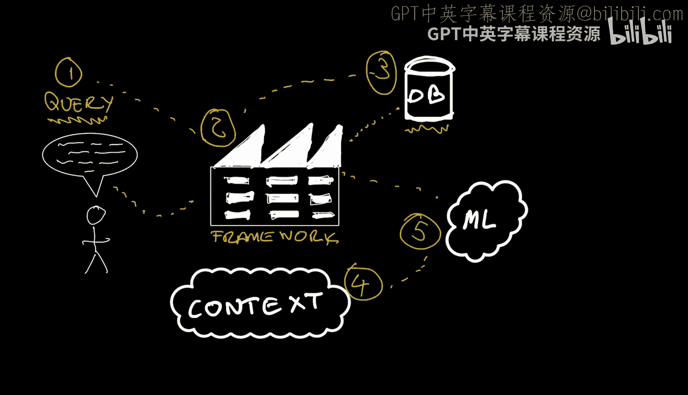

## 总结

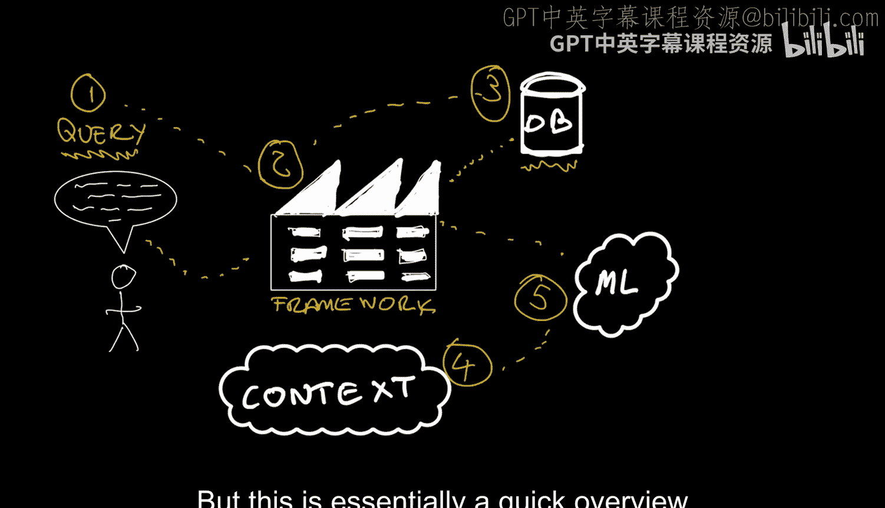

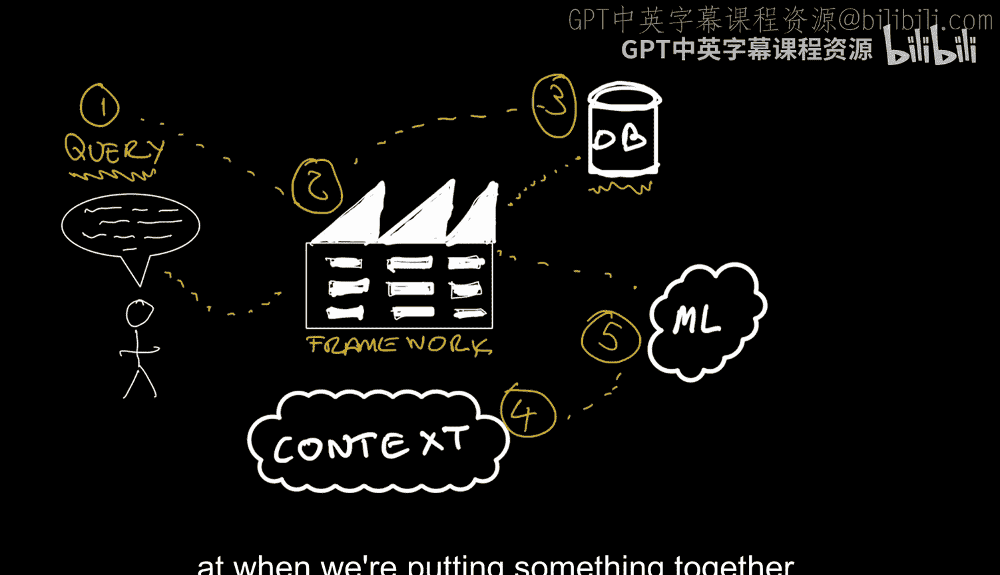

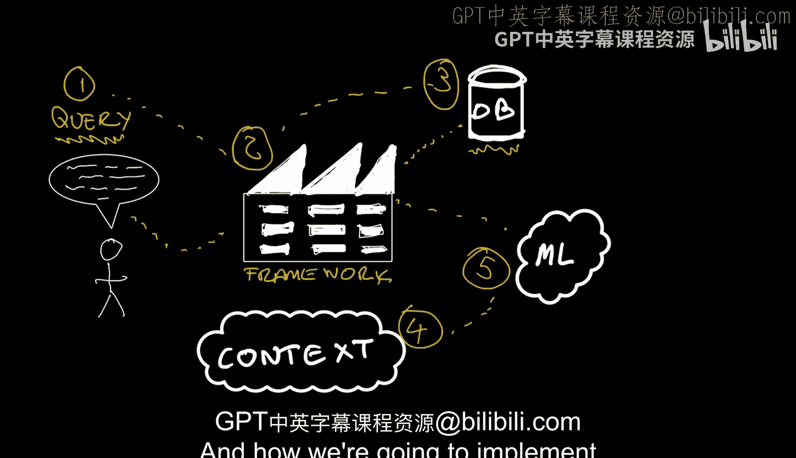

本节课中我们一起学习了检索增强生成（RAG）的核心架构。我们了解到，RAG通过在用户查询和大型语言模型之间引入一个**向量数据库检索**的步骤，将外部知识动态地注入生成过程。其核心路径是：**用户查询 → 应用框架 → 向量数据库检索 → 构建增强提示 → 大型语言模型生成 → 返回用户**。这种架构以较低的成本显著提升了模型回答的准确性和相关性，是构建高效AI应用的关键模式之一。在后续课程中，我们将深入探讨如何具体实现和部署这一架构。