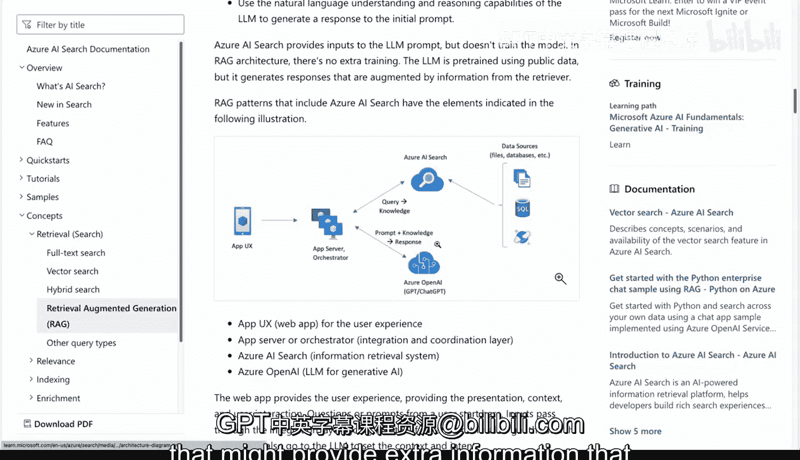

# 大型语言模型实践：04：什么是RAG 🧠

在本节课中，我们将学习检索增强生成（RAG）技术。这是一种通过整合外部知识源来增强、优化大型语言模型输出的方法。我们将了解其核心概念、工作原理以及它在实际应用中的架构。

## 概述

检索增强生成是一种通过使用搜索数据库或搜索引擎（有时也称为向量数据库）来扩展、锚定和改进结果的技术。它旨在弥补大型语言模型在特定、最新或专有知识上的不足。

## RAG的基本概念

上一节我们概述了RAG，本节中我们来看看它的基本工作原理。其核心思想是，在用户提问和模型生成答案之间，引入一个检索步骤。

**RAG的核心流程**可以概括为以下步骤：
1.  用户提出问题。
2.  系统从外部文档库中检索相关信息。
3.  将问题和检索到的信息一同提交给大型语言模型。
4.  模型基于所有输入生成更准确、更可靠的回答。

例如，当询问“美国当前的政治事件”时，语言模型自身可能因训练数据时效性限制而无法准确回答。此时，数据库、搜索引擎或向量数据库就发挥了作用。它们可以提供最新的信息，使回答变得超级准确。在处理用户请求时，系统可以先从文档中获取相关信息，然后将这些信息连同问题一起发送给大型语言模型。

因此，大型语言模型实际接收到的是**问题本身以及从文档中检索到的任何相关搜索结果**。

## RAG在Azure AI中的架构

理解了基本概念后，我们进一步看看RAG在云平台（如Azure）中是如何具体实现的。下图来自Microsoft Learn，展示了Azure AI搜索中的检索增强生成架构。

请注意，Azure AI搜索最近已从“Azure认知服务搜索”更名。如果您熟悉旧名称，现在它叫Azure AI搜索。

以下是该架构中各组件的简要说明，我们将在后续课程中详细覆盖：

1.  **应用程序/协调器**：接收用户请求的入口点，通常由API、Python代码或容器实现。
2.  **Azure AI搜索**：请求首先被提交到这里。它利用预先加载的大量信息进行检索，生成用于增强提示的必要响应。
3.  **Azure OpenAI**：接收增强后的请求（即原始问题+检索结果），调用大型语言模型生成最终答案。
4.  **响应流程**：答案经由协调器返回给用户。

本质上，这就是RAG的运作方式。当人们谈论搜索、向量数据库或检索增强生成时，他们指的是类似的实现方案：通过预先加载的、能提供模型当前所不具备的额外信息的文档，来增强模型的行为。

## 总结

本节课中，我们一起学习了检索增强生成（RAG）。我们了解到，RAG是一种通过整合外部知识源（如搜索数据库或向量数据库）来提升大型语言模型回答准确性、时效性和可靠性的关键技术。其核心流程是在模型推理前加入检索步骤，用相关信息“增强”用户的问题。我们还初步了解了RAG在Azure AI平台上的典型应用架构。