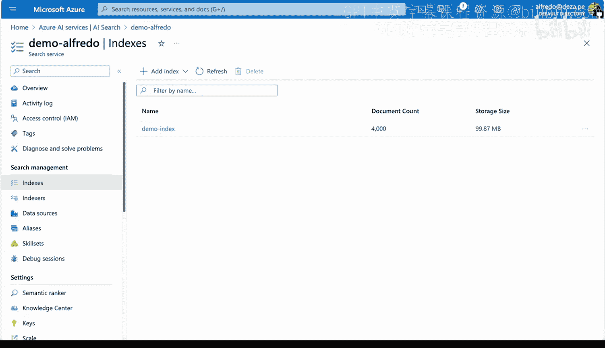

# 大型语言模型实践：P139：Azure AI搜索概述 🧠

在本节课中，我们将学习Azure AI搜索服务。该服务是Azure平台上的核心组件，能帮助我们在应用程序中嵌入文档时增强其能力。我们将快速浏览其界面，并演示如何创建一个新的搜索资源。

## 概述

Azure AI搜索，之前被称为Azure认知搜索，是Azure平台提供的一项强大服务。它主要用于增强应用程序处理文档的能力，特别是在我们尝试将文档嵌入应用时。接下来，我们将快速概览其功能，并演示创建新资源的步骤。

## 创建Azure AI搜索资源

上一节我们介绍了Azure AI搜索的基本概念，本节中我们来看看如何创建一个新的搜索服务实例。

首先，我们需要创建一个新的资源。我将使用一个演示资源组，并遵循“demo”前缀的命名惯例，以便于后续管理和清理资源。

以下是创建步骤：
1.  服务名称需要全局唯一，例如可以命名为 `demoFredoSearch`。
2.  选择区域，例如 `US2`。
3.  选择定价层。这里有一个非常有用的选项：**免费层**。它提供50MB的存储空间，支持基本操作，且无需任何费用。对于我们的学习目的，选择免费层非常合适。
4.  配置副本和分区数量。在免费层中，最大副本数为1，分区数也为1，只有一个搜索单元，这完全满足我们当前的需求。
5.  最后，点击“审阅并创建”。系统会进行验证，然后开始创建资源。

创建成功后，我们可以点击“转到资源”来进入新创建的服务。

## 探索服务功能

现在我们已经创建了资源，让我们进入服务界面，看看有哪些核心功能。

在服务主界面，你会看到“导入数据”的选项，这非常实用。更具体地说，是“导入和矢量化数据”。当我们计划结合大型语言模型处理数据时，**矢量化**是一个关键步骤。

你可以通过用户界面（UI）完成此操作。点击后，系统会提示你创建Blob存储账户（如果你还没有的话），然后选择存放数据的容器和文件夹。由于我们目前没有现成的数据存储，这里暂不深入演示此流程，但后续会介绍其他实现方式。

## 索引与搜索示例

为了更全面地了解，我想展示一个我之前创建的其他搜索服务实例。在这个实例中，我已经上传了数据并完成了索引构建，数据也进行了矢量化处理。

在这个实例中，你可以执行搜索表达式，可以按字段筛选，也可以浏览结果。例如，我之前处理了一些关于葡萄酒的数据，执行搜索后可以看到返回了许多结果。虽然这些结果目前看来不相关，但这没关系，我们将在后续课程中学习如何具体实现和应用。

本质上，这就是快速开始使用Azure AI服务，特别是AI搜索的方法。你可以创建自己的实例和资源，以便在准备好与大型语言模型及**RAG模式**（检索增强生成）交互时，将你的应用程序连接起来。

## 总结

本节课中，我们一起学习了Azure AI搜索服务。我们从概述开始，了解了其核心价值。接着，我们逐步演示了如何创建一个免费的搜索服务资源。然后，我们探索了服务界面，重点介绍了数据导入和矢量化功能。最后，通过一个已有索引的实例，我们预览了搜索的基本操作。掌握这些步骤，你就能为自己的应用程序创建AI搜索能力，为后续集成大型语言模型和实现RAG模式打下基础。