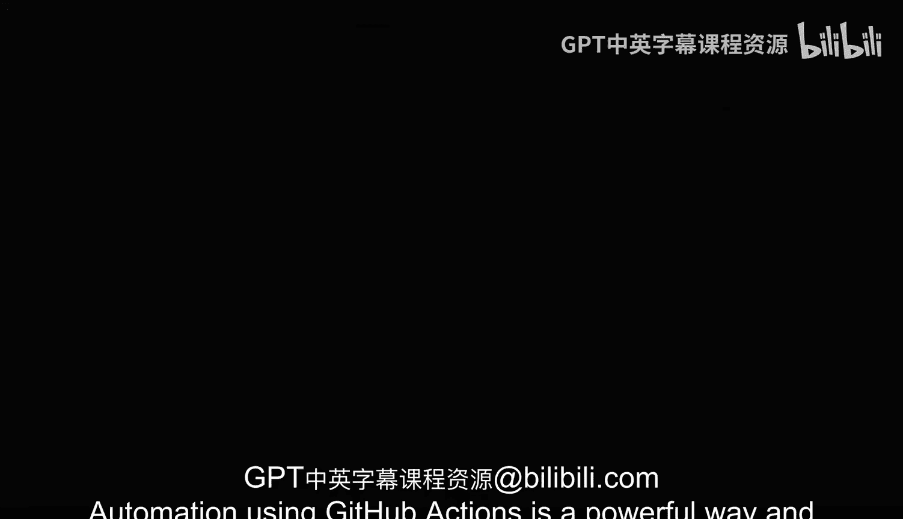
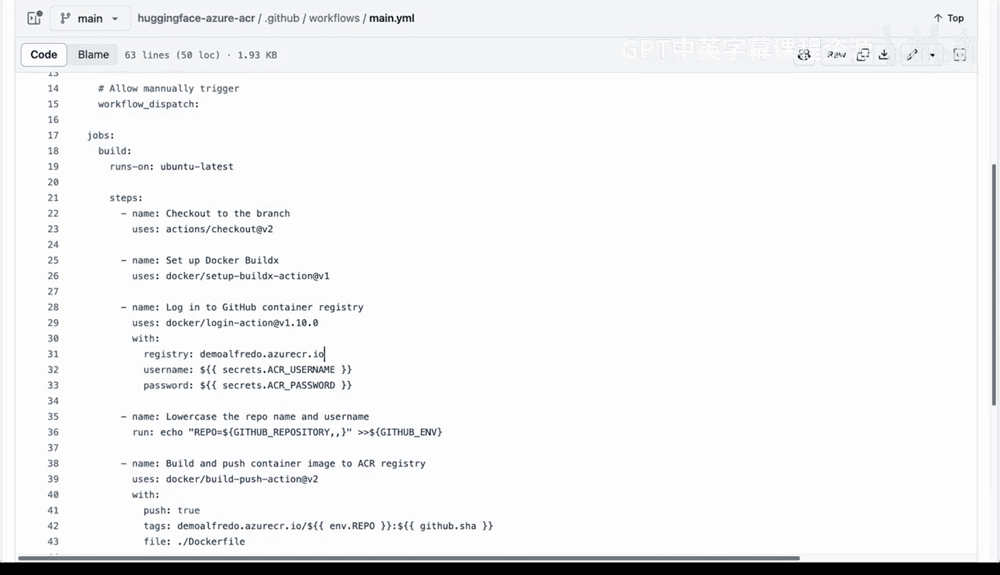

# 大型语言模型实践：P140：使用GitHub实现自动化与部署 🚀



在本节课中，我们将学习如何利用GitHub Actions实现端到端应用的自动化部署。这是一种强大且直接的方法，能够简化从代码到云服务的发布流程。

## 概述

GitHub Actions提供了一种自动化工作流的方式，通过定义YAML配置文件，可以实现代码构建、容器镜像推送以及云服务部署等一系列操作。本节将快速概览其核心概念与基本结构。

## GitHub Actions工作流基础

上一节我们介绍了自动化部署的概念，本节中我们来看看如何具体配置一个GitHub Actions工作流。

其核心在于在代码仓库中创建一个特定目录和配置文件。你需要创建一个名为 `.github` 的目录，并在其下创建 `workflows` 子目录。在此子目录中，你可以放置YAML格式的工作流定义文件。

## 工作流文件结构解析

以下是工作流YAML文件的一个通用结构示例。GitHub提供了模板帮助你快速上手。

```yaml
name: Deploy to Azure Container App

on:
  workflow_dispatch: # 允许手动触发

jobs:
  build-and-deploy:
    runs-on: ubuntu-latest
    steps:
      - name: Checkout code
        uses: actions/checkout@v3

      - name: Build Docker image
        run: docker build -t ${{ secrets.REGISTRY_LOGIN_SERVER }}/myapp:${{ github.sha }} .

      - name: Log in to Azure Container Registry
        uses: azure/docker-login@v1
        with:
          login-server: ${{ secrets.REGISTRY_LOGIN_SERVER }}
          username: ${{ secrets.REGISTRY_USERNAME }}
          password: ${{ secrets.REGISTRY_PASSWORD }}

      - name: Push Docker image
        run: docker push ${{ secrets.REGISTRY_LOGIN_SERVER }}/myapp:${{ github.sha }}

      - name: Deploy to Azure Container Apps
        uses: azure/container-apps-deploy-action@v1
        with:
          appSourcePath: ${{ github.workspace }}
          acrName: ${{ secrets.REGISTRY_NAME }}
          containerAppName: my-huggingface-app
          resourceGroup: my-resource-group
```
在这个示例中，`name`字段定义了工作流的名称。`on`字段定义了触发条件，例如示例中的`workflow_dispatch`表示允许手动触发工作流。被注释掉的环境变量会显示为灰色。

## 核心步骤详解

工作流由一系列步骤组成，以下是其主要步骤的分解：

1.  **检出代码**：第一步是使用`actions/checkout`操作将仓库代码拉取到运行环境中。
2.  **构建Docker镜像**：此步骤根据项目中的`Dockerfile`文件构建容器镜像。
3.  **登录容器注册表**：此步骤对之前创建的Azure容器注册表进行身份验证。如何创建注册表不是当前重点，重点是获得构建和推送镜像到实际注册表的能力。
4.  **推送镜像**：将构建好的Docker镜像推送到指定的容器注册表中。

使用GitHub Actions的一个重要优势在于它能安全地管理密钥。所有以`${{ secrets.XXX }}`格式引用的都是存储在GitHub仓库设置中的加密密钥，这保证了敏感信息的安全性。

## 部署到Azure容器应用

构建并推送镜像后，下一步是将其部署到云平台。以下是部署阶段的关键操作：

1.  **身份验证**：首先需要向Azure进行身份验证，以获得部署权限。
2.  **执行部署**：最后，我们将应用部署到Azure容器应用服务。Azure容器应用是一个托管服务，专门用于运行容器化应用。

在部署配置中，我们通过一系列选项指定：从哪个注册表获取容器镜像、需要为容器分配多少内存和CPU资源，以及要拉取的具体镜像标签（例如`huggingface-azure`）。

## 关于GitHub Secrets

最后需要提及的是GitHub Secrets。Secrets是GitHub Actions的一个特定功能，它允许你将敏感信息（如密码、API密钥）安全地存储在GitHub仓库设置中。你可以在工作流文件中安全地引用它们，从而实现配置的复用。设置过程非常直接，添加后即可实现高复用性。

## 总结



本节课中我们一起学习了使用GitHub Actions进行自动化部署的快速概览。我们了解了工作流的基本结构、核心构建与部署步骤，以及如何利用Secrets安全地管理凭证。这是一种直接且不复杂的方式，能够高效地将应用（例如连接Azure OpenAI服务的应用）从代码部署到云环境。我们将在后续课程中看到其更详细的工作过程。