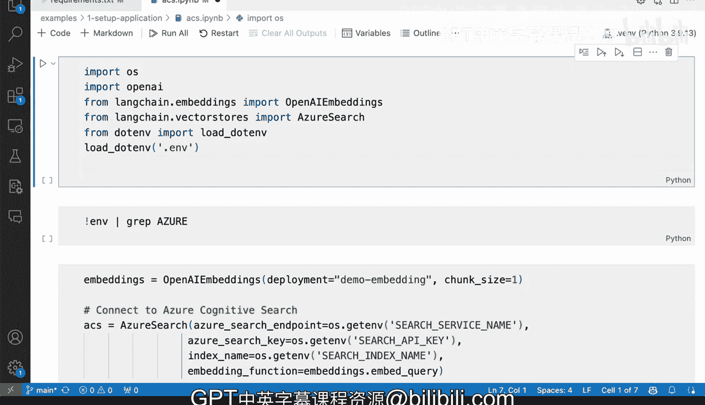

# 大型语言模型实践：04：创建Azure资源与准备开发环境

在本节课中，我们将学习如何为构建基于向量数据库的应用程序创建必要的Azure资源，并配置相应的Python开发环境。我们将创建Azure OpenAI服务，部署嵌入模型，并安装项目所需的Python库。

---

## 创建Azure OpenAI资源

上一节我们介绍了Azure AI Search服务。本节中，我们来看看如何创建Azure OpenAI资源。

首先，我们需要创建一个新的Azure OpenAI资源。我们将它命名为 `demoredo`，并确保它位于之前创建应用程序时使用的同一个资源组中。资源组位置选择 `US2` 或 `US`。资源名称需要确保全局唯一。

创建过程中，在配置网络访问时，选择允许从所有网络访问。我们暂时不添加任何标签。确认所有信息无误后，点击“创建”按钮。资源部署需要一些时间来完成。

## 部署嵌入模型

资源创建完成后，我们需要部署一个用于生成嵌入向量的模型。

我们需要进入新创建的Azure OpenAI服务的“工作室”界面。在工作室中，导航到“模型”部分，然后查看可用的“嵌入”模型。我们将选择 `text-embedding-ada` 模型进行部署。

部署时，需要指定一个部署名称，例如 `demo-search`。这个名称非常重要，后续在代码中会用到它来调用嵌入服务，从而将我们的数据向量化。高级选项可以保持默认，无需修改。点击“创建”后，部署过程通常很快。部署成功后，可以在列表中看到名为 `demo-search` 的部署。

## 安装Python依赖库

现在，我们来看看编写代码需要安装哪些Python库。

以下是项目所需的依赖库及其特定版本，这是确保所有功能正常工作的关键。

*   **`azure-search-documents`**：用于与Azure AI Search服务进行交互。
*   **`langchain`**：这是一个类似于我们之前见过的Semantic Kernel的框架，专门用于简化与大语言模型的交互。
*   **`openai`**：这个库让我们能够无缝地与Azure OpenAI服务进行交互，尤其是在配合Langchain使用时。
*   **`fastapi`**：后续我们将构建应用程序，因此需要这个Web框架。
*   **`antitick-token`**：这是一个用于配合 `azure-search-documents` 进行嵌入操作的必要组件。

## 工具与库的作用

接下来，我们简要说明这些工具和库在项目中的角色。

在后续的Notebook中，我们将看到为什么需要同时使用 `openai` 和 `langchain`。`langchain` 为我们提供了连接Azure Search的能力。同时，通过 `langchain`，我们也能方便地使用Azure OpenAI的嵌入服务。嵌入服务是帮助我们生成向量数据的关键，这些向量数据将用于填充我们之前提到的索引。

---

本节课中我们一起学习了创建Azure OpenAI资源、部署嵌入模型以及配置Python开发环境的完整流程。完成这些步骤后，你就为开始处理数据并构建应用程序做好了准备。