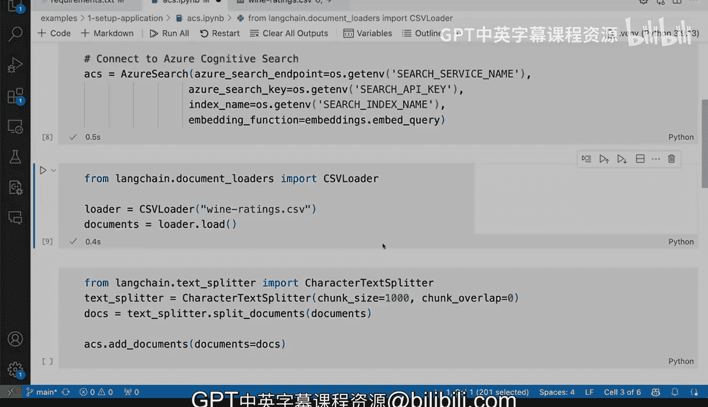

# 大型语言模型实践：4.4：创建嵌入向量 🧠

在本节课中，我们将学习如何为文本数据创建嵌入向量，并将其上传至 Azure AI 搜索服务。我们将使用一个葡萄酒评分数据集作为示例，演示从加载数据、分割文本到生成嵌入向量的完整流程。

上一节我们介绍了 Azure AI 搜索的基础设置，本节中我们来看看如何实际处理数据并创建嵌入向量。

---

现在，我们准备创建嵌入向量。我们已经准备好分割文本，并开始将数据上传到 Azure AI 搜索（之前称为 Azure 认知服务搜索）。

我们将使用 Jupyter Notebook 来完成这项工作。与其直接点击每个单元格的播放按钮来展示执行过程，不如先说明我们将要做什么。

我们将处理一些葡萄酒评分数据。这些评分数据来自我之前下载的一个资源库。我想展示一下它的样子。

这是一个名为 `wine_ratings.csv` 的 CSV 文件。它包含索引列、名称、国家/地区、产区、葡萄品种、评分和品酒笔记。

这是一种与我们想要扩展的服务进行交互的有趣方式。我们希望让服务更容易地为我们提供信息。

然而，检索增强生成的一个问题是，当我们将文档分割成小块时，对于像 CSV 这样的数据集（本质上是逗号分隔值数据），有时并不完全清楚该如何处理。

LangChain 框架将允许我们获取所有这些内容，将它们分割成块，并能够将它们嵌入到数据库中。

这是 `wine_ratings.csv` 文件。我将滚动到顶部，开始逐一讲解。

请注意，我有一个 `.env` 文件。你必须准备好你的 Azure 应用程序的密钥和机密信息。

如果我快速展示一下 `README` 文件，你会看到这里解释得非常清楚。这里以渲染良好的方式展示了密钥应该如何配置。

我正在使用搜索服务名称、搜索 API 密钥和搜索索引名称。我使用的是 Azure 认知搜索或 Azure AI 搜索。我这样称呼它们是因为稍后部署时，如果这些密钥长度超过 20 个字符，可能会出现问题。

因此，你必须确保所有数据都已准备好在你的 `.env` 文件中，否则数据将无法加载。

我将关闭 `README`，回到 Jupyter Notebook，并开始执行代码。

数据已加载，我的 Azure 密钥一切就绪。

我将使用 OpenAI 嵌入模型。这个类来自 LangChain，它将负责创建嵌入向量，并允许我分割文本。

然后，我将创建嵌入实例。这里需要指定块大小以及 OpenAI 的部署名称（例如 `demo-embedding`，无论你如何命名你的部署）。这一步至关重要。

现在，连接到 Azure 认知搜索。我们将在这里完成这一步。代码将使用端点、正确的端点、API 密钥以及我们在创建 Azure AI 搜索时指定的搜索索引名称。这个索引名称在那里至关重要。

嵌入函数将来自我们之前定义的 `embed_query`。所有这些都为我们处理好了。

我们如何处理、如何分割、如何获取那个 CSV 文件？我们将使用 LangChain 的另一个辅助工具——文档加载器。有一个非常方便的 CSV 加载器可供使用。

我们需要做的就是传入文件路径，然后执行加载器进行加载。我们将运行这段代码，这大约只花了半秒钟。

至此，我们已经能够使用 CSV 文件、收集信息并完成加载。接下来，我们将实际把这些数据块“塞”进去，稍后会看到结果。

---

本节课中我们一起学习了如何为结构化数据（CSV）创建嵌入向量的完整流程。我们了解了使用 LangChain 框架加载 CSV 文件、配置 OpenAI 嵌入模型以及连接到 Azure AI 搜索服务的关键步骤。核心在于将文本数据分割成块，并通过嵌入模型将其转换为向量，以便后续的语义搜索和检索增强生成任务。