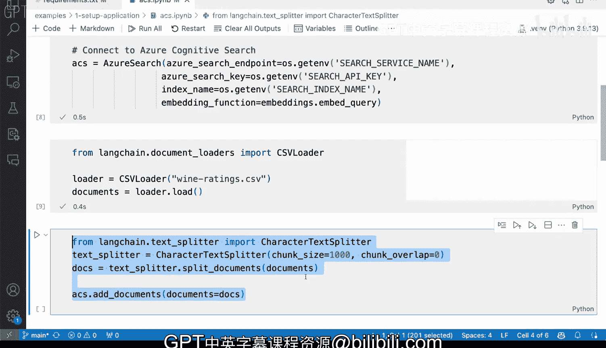

# 大型语言模型实践：第4章：创建并上传索引 📚

在本节课中，我们将学习如何将数据文档分割成块，并将其上传到Azure认知搜索服务中，以构建可供大型语言模型查询的索引。

上一节我们介绍了如何连接到Azure认知搜索并加载数据文件。本节中我们来看看如何对数据进行分块处理并上传。

## 数据分块处理

首先，我们需要使用LangChain库中的文本分割器功能。这里我们将使用字符分割器，它能将文本分割成更小的块。这是必要的步骤，因为我们需要将大文档分解成适合处理的片段。

以下是使用字符分割器的代码示例：
```python
from langchain.text_splitter import CharacterTextSplitter
text_splitter = CharacterTextSplitter(chunk_size=1000, chunk_overlap=0)
```

## 上传文档至索引


完成分块后，下一步是将这些文档块添加到我们之前创建的Azure认知搜索索引中。我们通过变量`ACS`来引用该服务。

以下是上传文档的核心步骤：
1.  使用分割器处理文档。
2.  调用索引服务的添加文档方法。

## 关于服务层级的注意事项

需要牢记一点：我之前创建服务时使用的是免费层级。当前操作产生的数据量可能会远超免费层级的允许上限。如果执行上传，可能会在达到限制后无法继续运行。

因此，我不会再次运行此代码，因为它已经为我生成了一个良好的索引。如果你尝试重复添加文档，并且所在层级的配额已达上限，也可能会遇到限制。

## 处理时间说明

此外，这个过程可能需要相当长的时间。因为你需要将所有文本分块处理，并连接这些服务。文档越大，处理所需的时间就越长。

---



本节课中我们一起学习了如何使用文本分割器创建数据块，以及如何将它们上传到Azure认知搜索以构建索引。同时，我们也了解了服务层级限制和处理时间等实际注意事项。